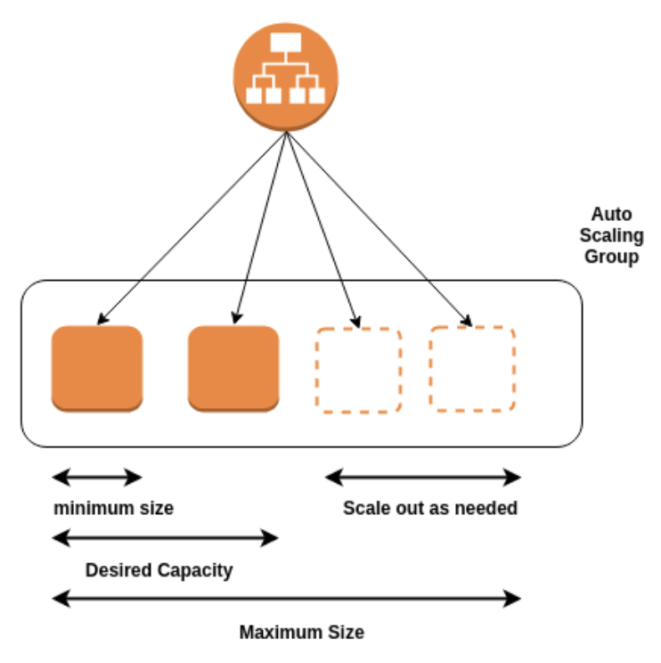
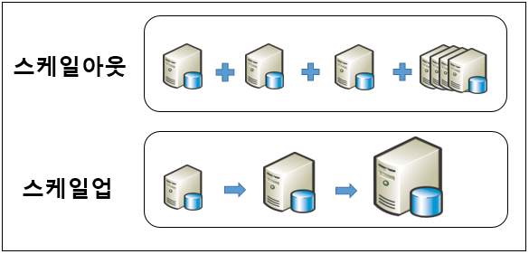
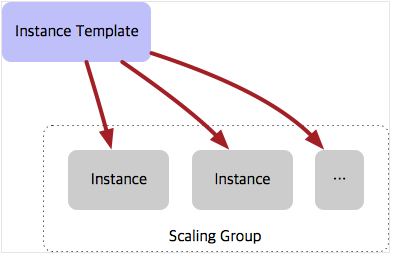

*Autoscale*

## Autoscale

Autoscaling이란, 인스턴스의 부하를 모니터링해서 어느 정도 수준이 되면 자동으로 인스턴스를 추가하거나 삭제하는 기능을 말한다.

예를 들어, 갑자기 서비스 사용량이 폭주해 서버의 CPU 사용률이 80-90%를 넘어갈 수 있다. 이런 경우 미리 설정해 놓은 Autoscale 옵션(CPU 사용량이 80%를 넘어갈 경우)에 의해 새로운 인스턴스가 자동 생성되고, 새로운 연결 요청은 새로운 인스턴스와 분산한다. 또한 CPU 사용량이 줄어들 경우에도, 특정 기준에 의해 존재하던 인스턴스를 삭제해줄 수도 있다.

이 방법은 스케일아웃이 적용된 방법이다.

서버를 확장시키는 방법에는 두 가지가 있는데, Scale-Up(스케일업), 그리고 Sclae-Out(스케일아웃)이 있다.

*Scale-Out vs Scale-Up*

### Scale-Out

서버의 대수를 늘려 처리 능력을 향상시키는 것. 수평 스케일이라고도 불린다.

저렴한 서버를 사용해 대수를 늘려나가므로 비용적 측면에서 부담에 적다. 하지만 대수가 늘어날수록 관리 편의성은 떨어진다. 여러 대의 서버에 분산되어 처리되어 장애 시 장애 영향도가 비교적 작다.

### Scale-Up

서버 그 자체의 용량, 메모리 등을 증강해서 처리 능력을 향상시키는 것. 수직 스케일이라고도 불린다.

성능 확장에 한계가 있고, 성능 증가에 따른 비용 증가폭이 크다. 장애가 발생할 경우 장애 영향도가 크고, CPU, Memory, SSD 등 고성능 장비가 필요하게 된다.

*Instance Template*

Autoscale은 서버 확장 방법 중, Scale-Out을 사용하여 자동 확장 및 축소하는 방법으로 볼 수 있다.

자동으로 인스턴스를 생성 및 삭제하기 위해서는 위 그림과 같이 인스턴스에 대한 템플릿을 만들어, 특정 기준에 도달했을 때 템플릿을 바탕으로 생성해주도록 설정이 필요하다.

\[출처\]

[https://hanjustudy.tistory.com/9](https://hanjustudy.tistory.com/9)

[https://meetup.toast.com/posts/176](https://meetup.toast.com/posts/176)

[https://coconutstd.github.io/posts/AWS정리-2/](https://coconutstd.github.io/posts/AWS정리-2/)
