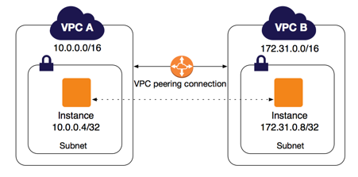
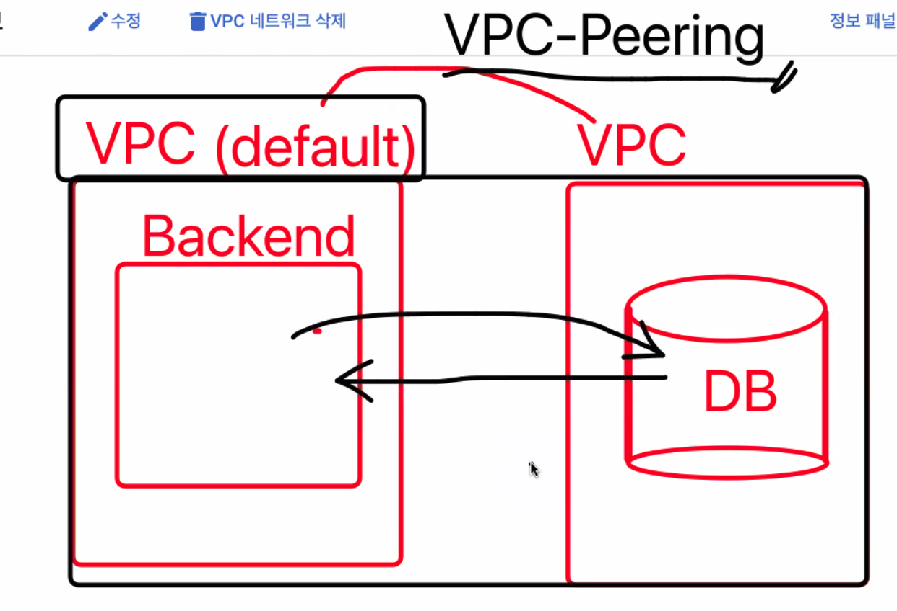
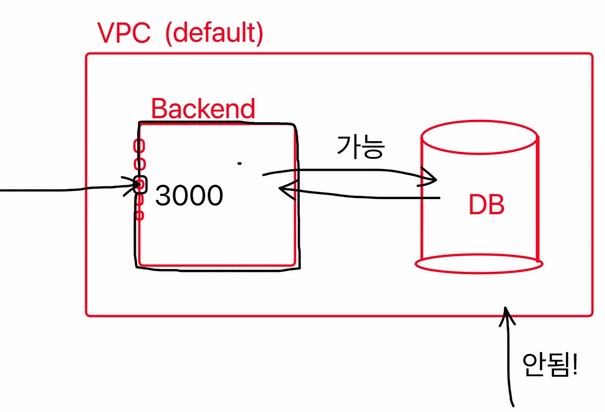

*VPC Peering*

## VPC

Virtual Private Cloud의 약자이다.

사용자가 정의한 가상의 네트워크로 리소스를 관리할 수 있는 개념이다.

간단하게 설명하자면, 개인적인 클라우드를 가상으로 만들어서, 그 네트워크망 안에서 각종 서버, DB 등을 띄워 사용하겠다는 것이다.

VPC를 적용하면, 위의 그림과 같이 각 VPC 안에서 인스턴스들을 관리할 수 있고, A VPC에서 B VPC로는 기본적으로 접근이 불가하다.

그래서 만약에 백엔드와 DB를 GCP에서 별도의 VPC에 생성을 한 경우, 백엔드에서 DB로 접속이 안된다.

이런 경우 두 VPC 간 트래픽을 라우팅할 수 있도록 네트워크 연결을 해주는 VPC Peering 기술을 이용해야 한다.

## VPC Peering

위에서 말한 것처럼, VPC가 다르면 접속이 안된다.

동일한 VPC에 있는 경우 통신이 가능한 것처럼, VPC Peering은 다른 VPC에서도 연결을 할 수 있게 연결해주는 과정이다. GCP에서 제공하는 기능이다.

공부를 하면서 DB를 공개 IP로 생성했었는데, 비공개 IP로 변환한 후에 VPC Peering을 설정해주면 백엔드 서버에서만 DB로 접속이 가능하게 된다.

\[출처\]

[https://docs.aws.amazon.com/ko\_kr/vpc/latest/peering/what-is-vpc-peering.html](https://docs.aws.amazon.com/ko_kr/vpc/latest/peering/what-is-vpc-peering.html)
