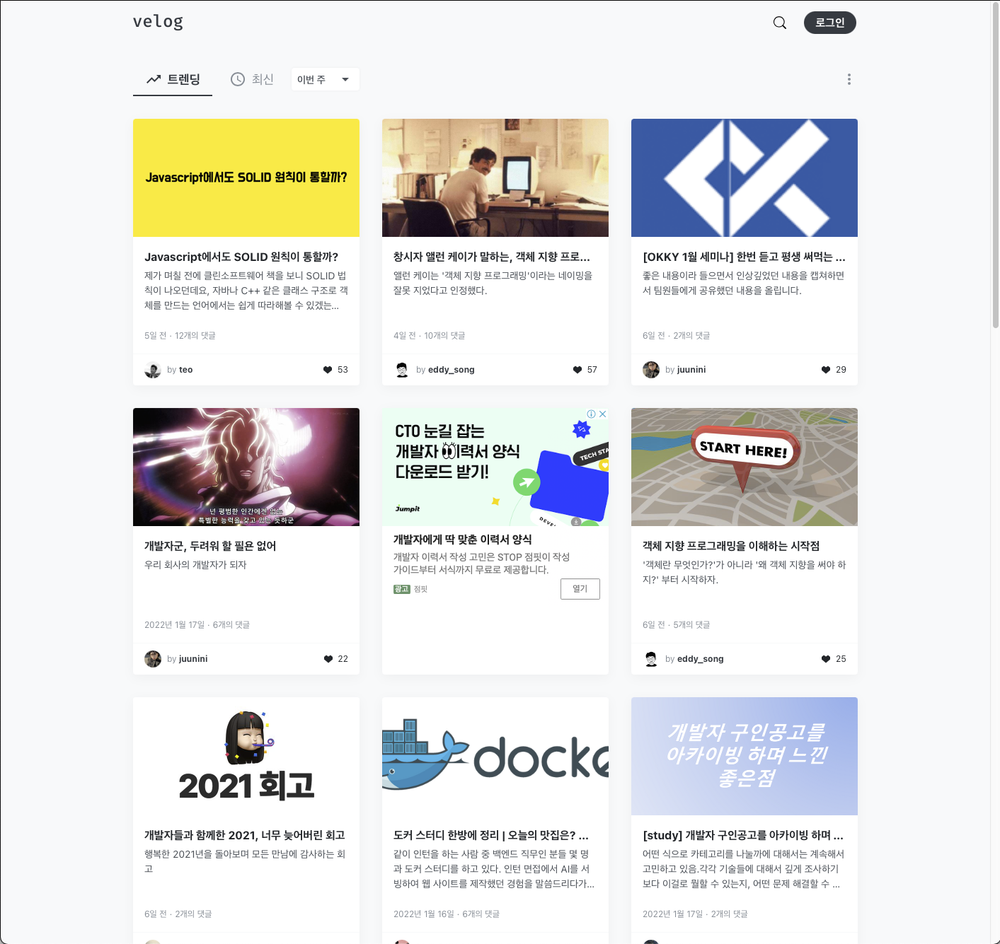
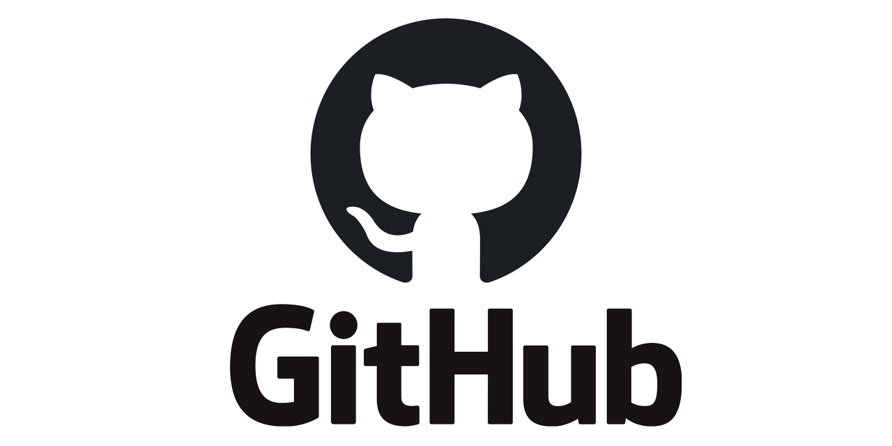
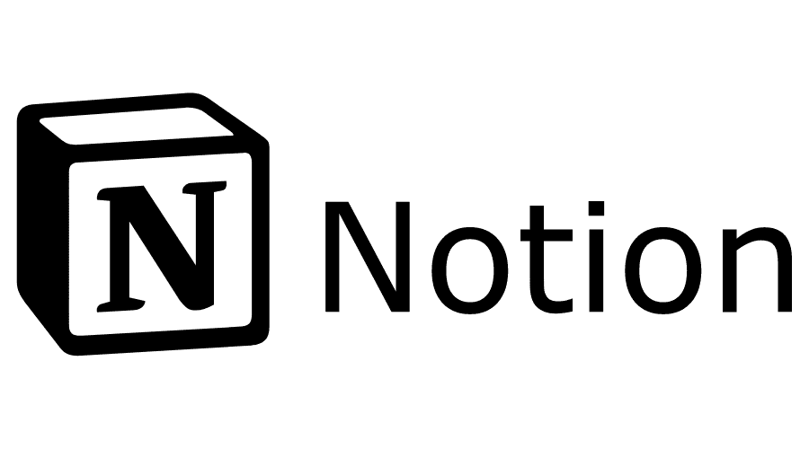
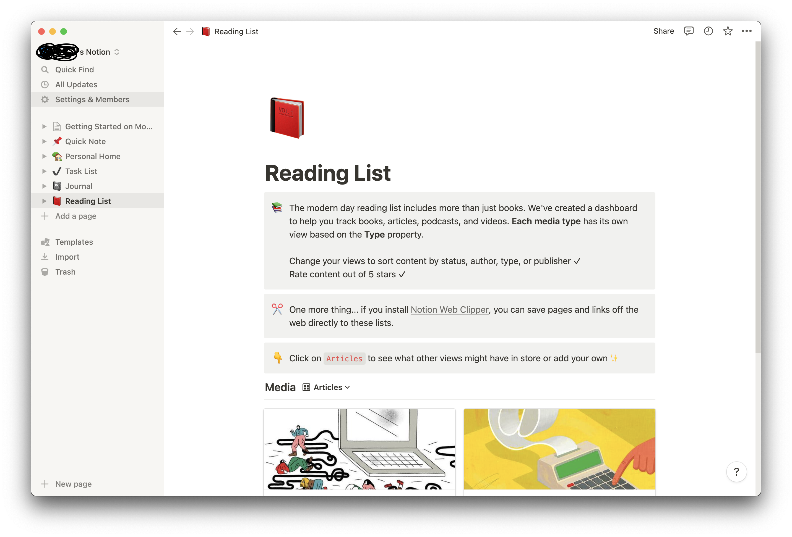
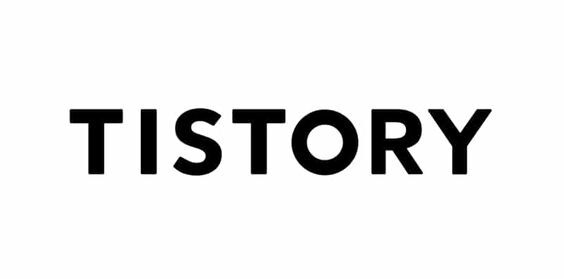

나는 컴퓨터공학도, 개발자로 수 년을 살아왔지만 아이러니하게도 내 개인 사이트를 가지고 있지 않다.

직접 웹페이지를 개발하는 정도는 아니더라도, 블로그 플랫폼을 이용하여 개발 블로그를 운영하는 사람들이 많은 것은 확실하다.

잘 만든, 잘 꾸며진 사이트가 그 개발자의 이력서 혹은 포트폴리오가 되는 이 세상,

나도 부끄럽지 않게 개발 블로그를 운영하기로 마음 먹었다!

(일상 포스팅도 해야지)

그런데 막상 블로그를 만드려고 하니, 플랫폼이 꽤 여러가지여서 어떤 것을 골라야 할지 고민이 되었다.

(지금 이 글은 티스토리로 쓰고 있지만 언제 갈아탈지는 모름)

그렇다고 3~4개씩 동시에 운영할만큼 부지런하지는 않은 것 같으니...

구글링을 해보니 이미 많은 분들이 블로그 플랫폼에 대해 장단점을 잘 정리해서 올린 포스팅들이 많지만,

내 관점에서 몇 가지 포스팅 플랫폼의 특징을 정리하여 최선의 선택을 하고자 이 글을 작성한다.

## 1. Velog

[https://velog.io](https://velog.io "Velog 공식 홈페이지")

---

*velog(벨로그)*

> 개발자를 위한 블로그 서비스. 개발자 velopert가 1인 개발한 플랫폼이다.  
> 원래 워드프레스로 블로그 운영을 하다가 개발자로서 불편했던 점들을 개선해서 아예 새로 블로그 플랫폼을 개발해야겠다고 생각하여 만들었다고 한다.  
> 국내 꽤 많은 개발자들이 사용하여 개발자 생태계가 구축되어 있어 올라오는 정보들의 질이 좋은 편이다.  
>
> 일반적인 블로그 서비스들이 위지윅 에디터를 사용하는 것과 달리, 개발자들에게 익숙한 마크다운을 사용해 바로 글을 작성할 수 있다. 마크다운으로 작성한 문단 제목을 통해 목차가 자동으로 생성되며 생성된 목차는 글 오른쪽에 링크로 보인다.  
>
> \[출처 : 나무위키\]

구글링을 하면 공식 사이트 밑에 바로 나무위키의 설명이 나온다. 물론 절대적으로 공신력 있는 자료가 정리된 사이트라고 보기는 어렵지만, 간단한 설명이나 심심풀이로 나무위키를 참고하는 편이다.

~~(나무위키 재밌다. 옛날 사람들이 백과사전을 재밌게 읽었다는게 이런 느낌이었을까)~~

*velog(벨로그) 메인에도 개발 관련 포스팅이 많은 것을 확인할 수 있다.*

이걸 1인이 개발했다고?

블로그 플랫폼 자체를 혼자서 개발할 생각을 하다니 대단하다.

기획하고 만든 사람이 개발자이다 보니 마크다운, 개발언어 등 개발 포스팅을 올리기에 좋은 플랫폼이라고 생각된다.

내가 블로그를 운영해야겠다고 생각하게 된 계기와 해당 플랫폼의 장점이 잘 부합하기는 하다.

또한 꾸미기 나름이겠지만 대체적으로 깔끔한 느낌이 든다.

### 특징

-   개발 관련 포스팅을 하기에 좋다. (개발자니깐!)
-   개발 관련 트렌드나 내용들을 확인하기 좋다. (개발자니깐2!)
-   구독 기능이 없다. (관심있는 유저의 글을 보려면 따로 찾아봐야 한다)
-   통계 기능이 부실하다. (게시글의 조회수는 조회할 수 있다는데, 방문수나 방문 경로 등 자세한 통계는 얻기 힘든가 보다. 인스타 팔로우, 좋아요가 없는 느낌?)
-   광고로 수익 창출을 할 수 없다. (~~동기부여=돈~~)
-   등등

### 느낌

> 이쁜 개발자 포스팅 플랫폼. 하지만 커뮤니티성(팔로우, 구독, 통계)이 부족. ~~그것보다 광고가 안된다고?~~

## 2. GitHub

[https://github.com](https://github.com "GitHub 공식 홈페이지")

---

*GitHub(깃허브)*

> 대표적인 무료 Git 저장소.  
> 깃허브(GitHub)는 소프트웨어 분산 버전 관리(DVC) 툴인 깃(Git)을 사용하는 프로젝트를 지원하기 위한 웹호스팅 서비스이다. 깃(Git)이 텍스트 명령어 입력 방식인데 반해, 깃허브는 화려한 그래픽 사용자 인터페이스(GUI)를 제공한다. 깃허브는 전 세계 최대 규모의 오픈소스 공유 사이트 겸 개발자 커뮤니티로 성장했다. 루비(Ruby) 언어를 사용하여 개발했다. 깃허브의 마스코트는 고양이 머리에 문어 다리가 달린 옥토캣(Octocat)이다.  
>
> \[출처 : 해시넷\]

개발자라면 한번쯤은 사용해...보지 않았더라도 한번쯤은 들어봤을 GitHub이다.

깃허브 자체는 Git을 통한 오픈포스 공유 사이트 및 커뮤니티지만, 몇가지 작업을 거쳐 블로그로 만들어 운영할 수 있다고 한다.

개발자니깐 당연히 깃을 써야지!

개발자니깐 당연히 깃허브 써야지!

개발자니깐 당연히 깃허브 블로그 써야지!(이건 아닌가?)

깃허브 자체가 개발자를 위한 사이트, 커뮤니티지만 그렇기 때문에 써야한다? 그건 아닌 것 같고 다른 특징도 좀 더 살펴보기로 했다.

이건 개발자 자기 입맛대로 모든 기능을 커스텀하여 사용할 수 있다.

그런데 그게 큰 진입 장벽으로 다가온다. 개발지식이나 깃허브 환경에 익숙하지 않은 사람이라면.

모든 개발이 그러하듯, 초기 세팅이 정말 어렵다면 개발의지가 뚝 떨어진다... 그런 느낌이 여기서도 든다면?

### 특징

-   깃허브다(~~개발자니깐 개발자니깐 개발자니깐~~)
-   커스텀이 자유롭다. (~~애초에 웹페이지를 만드는 건 개발자, 그 개발자들의 커뮤니티? 블로그 내맘대로 만드는 건 당연하지~~)
-   초기 세팅이 어렵다. (사람에 따라 다르겠지만, 생각보다 잘 차려진 밥상에서 한 술 뜨는게 편하단 걸 느낀다)
-   검색 엔진에 노출되도록 세팅이 필요하다. (이건 초기 세팅의 연장선인데, 검색 엔진에서 상위에 노출시키려면 별도의 작업이 필요한 것으로 보인다)
-   등등

### 느낌

> 깃허브 좋다. 깃허브니깐. 근데 난 여기서도 홈페이지 보수하면서 일하고 싶지는 않아...

## 3. Notion

[https://www.notion.so/ko-kr/product](https://www.notion.so/ko-kr/product "Notion 공식 홈페이지")

---

*Notion(노션)*

> 메모, 문서, 지식 정리, 작업, 프로젝트, 데이터베이스를 하나의 서비스로 통합한 종합 메모 서비스이다.  
>
> \[출처 : 나무위키\]

내가 블로그 플랫폼을 찾을 때 유심히 봤던 노션이다.

유심히 봤던 이유는... 그냥 예쁘다.

(~~사실 나는 그냥 이쁜 블로그를 원했던 것은 아닐까?~~)

*Notion(노션) 계정 생성 후 화면*

노션은 사실 메모 앱이다. 그런데 깔끔하게 정리를 할 수 있을 뿐만 아니라, 데이터베이스를 추가하여 다양한 뷰로 데이터를 확인할 수 있다는 점이 정말 매력적으로 보였다.

그리고 메모를 동시에 여러 명이 작업하면서 코멘트를 달고 수정사항을 기록하고 하는 모든 작업이 노션 하나에서 이루어진다.

위에서 말한 것처럼 사실상 노션은 페이지에 메모를 하는 앱이지만, 우피라는 서비스를 이용하면 노션을 블로그처럼 사용이 가능하다.

([https://www.oopy.io/blogs/your-blog-with-oopy)](https://www.oopy.io/blogs/your-blog-with-oopy)

물론 노션 자체에도 페이지에 주소가 있지만, 길고 복잡하기에 자신만의 도메인명으로 홈페이지를 운영할 수 있게 해주는 것이다.

유튜브에서 노션 사용법을 검색하면 가장 상위에 노출된 영상으로, 사용법에 참고

([https://youtu.be/ETMFdlVxRsE](https://youtu.be/ETMFdlVxRsE))

### 특징

-   메모 앱이지만, 데이터베이스를 추가해서 다양한 뷰로 데이터를 볼 수 있다. (개인적으로 정말 좋다고 생각)
-   공식적으로, 혹은 사용자들이 만들어놓은 템플릿을 활용하여 꾸밀 수 있다. (초보자나 센스 있는 페이지 구성을 하고 싶을 때)
-   협업을 하거나 소통을 하고 싶을 때 코멘트를 남기기 쉽다. (소통, 협업)
-   모바일 어플도 있지만 매우 느리다고 한다. (어플이 아니더라도 페이지 내용이 많으면 무거워서 느림)
-   개인용 요금제는 무료지만 프로 혹은 팀 요금제를 사용하면 매달 요금이 나간다. (많이 비싸진 않아도 무료인 다른 플랫폼에 비해)
-   앞서 말한 우피라는 서비스를 통해 개인 도메인을 가져야 광고를 사용할 수 있다. 그리고 우피도 유료다.
-   등등

### 느낌

> Notion을 블로그로 사용하지 않더라도, 이 앱을 빨리 알았다면 대학교나 회사에서 일잘러가 될 수 있었을 것 같은 느낌

## 4. Tistory

*Tistory(티스토리)*

> Tistory(Tattertools + history의 합성어) 2006년 5월 개설된 카카오의 서비스형 블로그. 원래 태터툴즈 개발사인 태터앤컴퍼니(TNC)와의 공동 운영 형태였으나 2007년 7월을 기점으로 운영권 일체가 Daum에 이전되었다.  
> ...  
> 2017년 8월 31일 오후에 티스토리 관리자 메뉴가 완전히 개편됐다. 페이지 기능이 추가되었으며, 곧 다음 메일과의 연동 기능이 종료될 예정이라고 한다. 앞으로 플래시 제거를 거처 앱 개편, 홈 디자인 재개편이 있을 예정이라고 한다.  
> 2018년 10월 22일 초대장이 없어도 티스토리 가입이 가능하게 되었다. 단, 무분별한 광고글을 막기 위해 1일 글 등록 수가 제한된다. 따라서 뉴스미디어 같이 글 등록수가 많은 사이트의 경우에는 카카오에 문의하여야 한다.  
>
> \[출처 : 나무위키\]

이 글을 작성하고 있는 티스토리(~~샨새교~~)다.

사실 예전에는 초대장을 받아야만 티스토리 계정을 사용할 수 있었다.

그 당시에 티스토리를 사용하는 것이 뭔가 멋있어 보였고, 티스토리 블로거들의 게시물도 고급지다(?)라는 느낌을 받아서 네이버가 아닌 티스토리를 위해 초대장을 구걸하고 다녔던 것 같다.

정작 계정을 만들고 나서는 블로그의 퀄리티는 사람의 능력에 따른 것임을 깨닫고 깊이 처박아 두었다.

그리고 최근, 내 홈페이지를 꾸리기 위해 다시 꺼내 들었다.

구글을 검색엔진으로 사용하는 개발자로써, 구글링을 하면 티스토리 블로그가 상위에 뜬다는 점이 좋았다.

(~~물론 네이버에 개발지식을 검색하는 분들도 많이 있었다~~)

네이버에서 검색을 하면, 네이버 블로그가 뜨고 티스토리 블로그는 웹사이트로 뜨게 된다고 한다.

이 말은 국내 최대 검색엔진인 네이버에서 검색하는 사람들의 대부분이 내 티스토리 블로그를 보지 못할 확률이 높다는 것

블로그가 다른 사람들과 소통하고, 지식을 나누고, 교류가 중요한 점에서는 치명적인 단점으로 보이지만,

그 외의 장점으로 인해 많은 사람들이 사용하고 있는 것 같다.

### 특징

-   블로그 플랫폼답게, 블로그 방문자 수, 유입 경로, 조회수, 키워드 등 분석에 강점이 있다.
-   광고로 수익창출을 할 수 있다. (~~구글 애드센스로 돈 벌고 싶다~~)
-   기본적으로 제공하는 기능이나 글 작성이 쉽고, 스킨도 깔끔하다.
-   국내 최대 검색엔진 네이버에 노출이 어렵다. (~~어른들은 구글보단 네이버지 암~~)
-   기본적인 기능은 좋지만, 화려하게 혹은 다양하게 글을 작성하기에는 부족한 느낌이 있다. (노션과 비교하면...)

### 느낌

> 너무 평범하지도, 너무 튀지도 않는 나에게 은근 잘 어울리는 옷이 있다? 이 옷이 질릴지는 앞으로 지켜보겠어

## 총평

작성하고 보니 노션이나 티스토리에 좀 후한 평을 하지 않았나 생각이 든다.

그래도 나는 종합적으로 티스토리가 가장 나에게 적합한 포스팅 플랫폼이라고 생각했다.

(~~썸네일을 티스토리로 해놓기는 했지만~~)

잘 구축된 블로그 플랫폼, 마크다운이나 HTML이나 코드 등의 기본적으로 필요한 입력이 잘 되어있고,

거기에 추가로 쉽고 빠름에도 예쁘게 꾸며지는 블로그에 끌렸다.

그래서 우선 티스토리에서 개발(이자 일상) 블로그를 운영하기로 했다.

그리고 이 글이 제대로 된 첫 포스팅이 될 것이고...

앞으로 잘 쓰겠지?

아 그래도 노션이 생각보다 정말 이쁜 메모 앱인 것 같아서, 별도로 사용할 예정이다.

(처음부터 깔끔하고 예쁜 블로그를 원하긴 했다)

기회가 된다면 노션도 병행해서 운영하거나, 갈아탈지도?

