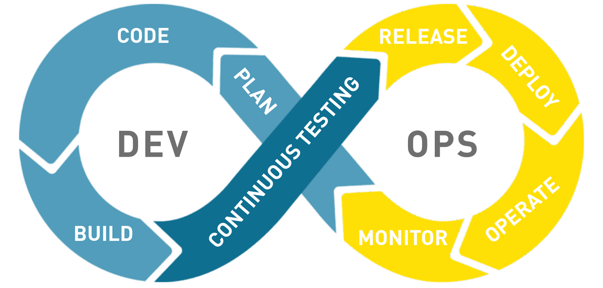

*CI/CD DevOps*

## CI/CD

**CI - Continuous Integration**

새로운 코드 변경사항을 정기적으로 빌드 및 테스트해 공유 레파지토리에 통합하는 것을 말한다.

여러 개발자들이 함께 프로그램을 개발하는 경우, 기능 추가시 commit을 하고 push하고 공유 레파지토리에 pull request를 하게 된다. 규모가 커지면 개발자와 merge할 소스의 수가 많아지는데, 수동으로 진행하려면 상당히 번거롭다. 따라서, 자동화된 빌드 및 테스트는 이러한 복잡한 merge 과정에서 오류나 충돌을 방지하는 역할을 한다.

CI의 목표는 신속하게 개발, 버그 수정을 거쳐 업데이트의 시간을 단축시키는 것이다.

**CD - Continuous Deployment**

Production 레벨까지 자동으로 소스를 deploy하는 것을 말한다.

개발자가 개발한 소스가 빌드, 테스트, 병합까지 되는 CI를 넘어 실제 Production 환경까지 릴리즈되는 것을 말한다.

즉, CI/CD는 지속적으로 통합해서, 지속적으로 배포한다는 의미이다.

이렇게 소스를 지속적으로 그리고 자동으로 빌드, 테스트, 병합, 배포까지 해주는 CI/CD 툴에는 여러가지가 있다.(Jenkins, Bamboo, ... 등등)

## CI/CD 예제(Cloud Build)

이번에는 GCP(Google Cloud Platform)에서 제공하는 Cloud Build의 트리거를 이용해, Github에 소스가 push될 경우 자동으로 배포까지 되는 환경을 테스트해보고자 한다.

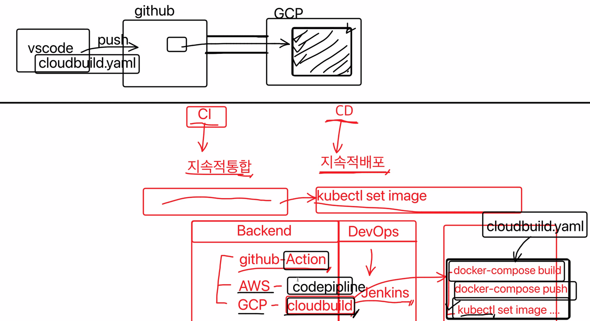

우리가 소스를 수정하고, git commit, git push, docker-compose build, docker-compose push 한 다음에 쿠버네티스에서 set image를 하면 해당 image로 새로운 pod가 생성되면서 배포가 되었었다.

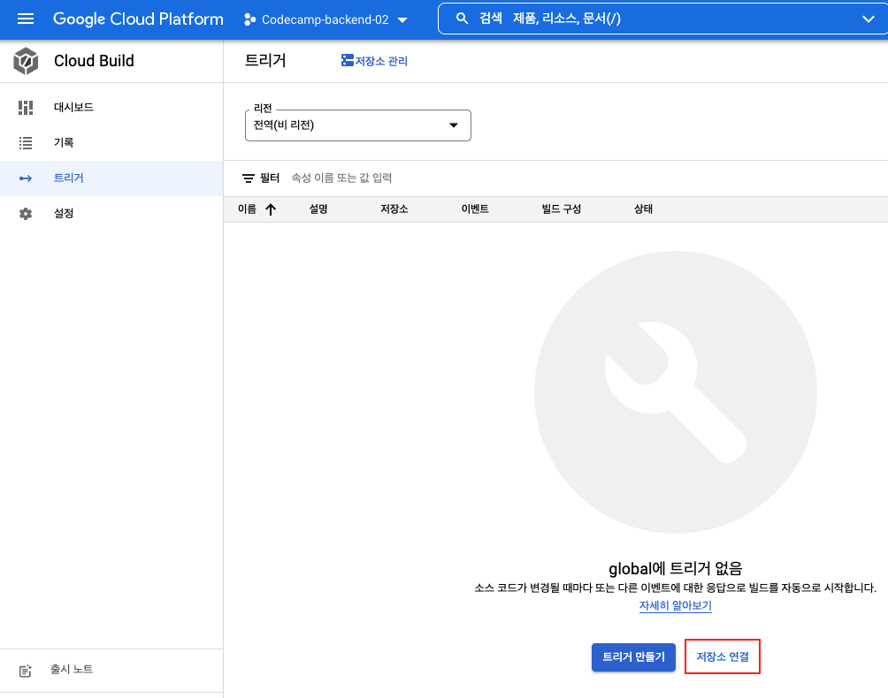

GCP에서 Cloud Build 메뉴의 트리거를 들어가 트리거를 생성해야 한다.

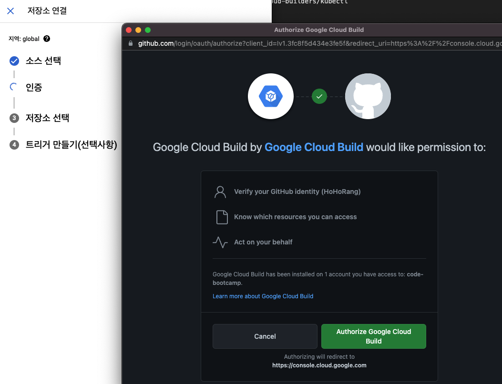

소스로 Github를 선택 후 인증을 한다.

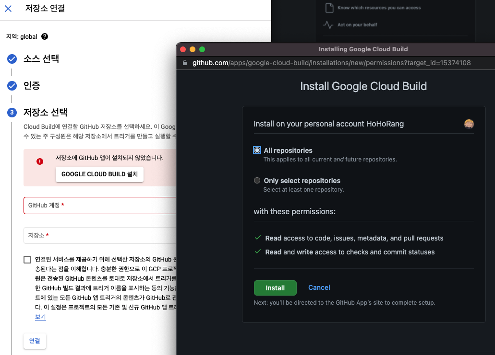

기능을 사용하려면 Github에 Google Cloud Build를 설치해야 한다.

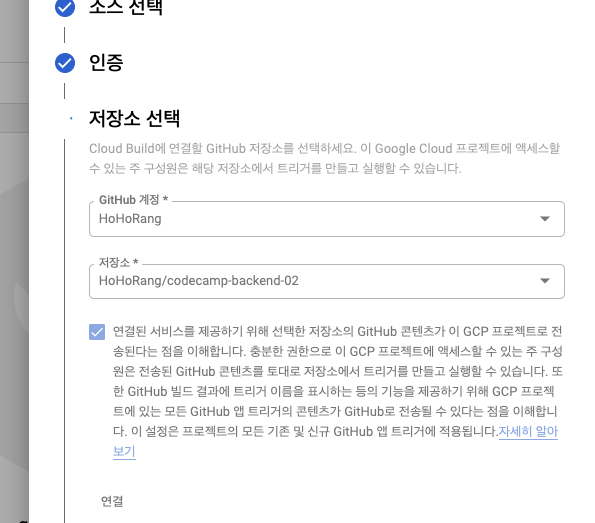

연결할 저장소를 선택하고,

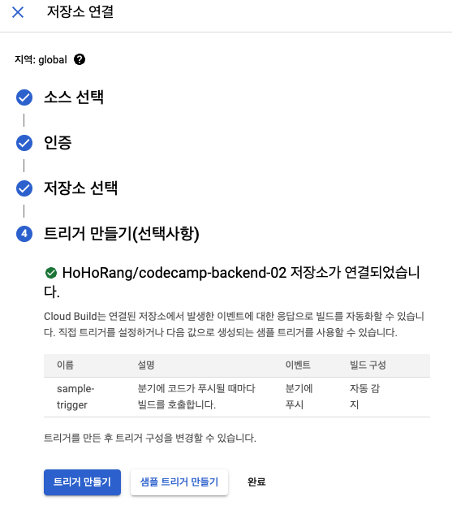

만들기를 눌러 아래와 같이 생성한다.

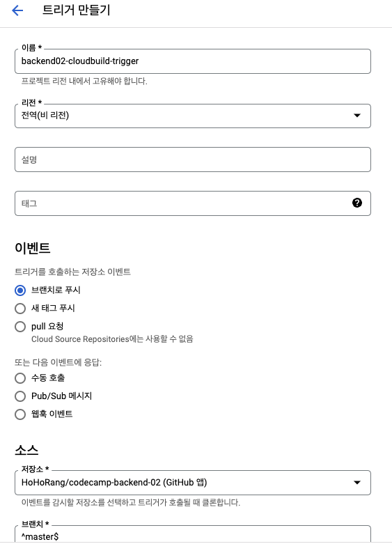

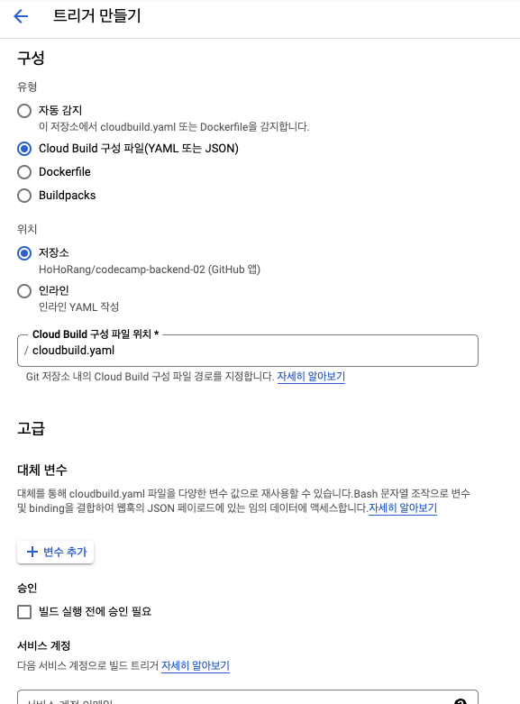

master 브랜치에 push가 될 경우 cloudbuild.yaml 파일을 참조해서 자동으로 빌드되도록 설정했다.

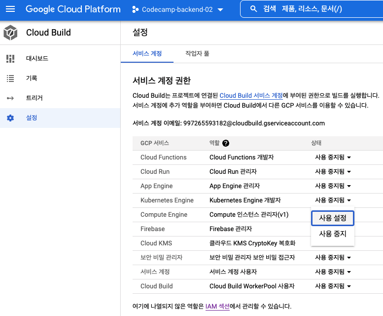

추가로, 설정에서 Kubernetes Engine 사용설정으로 선택한다.

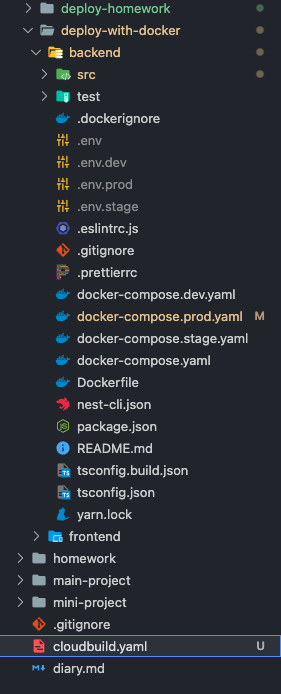

root에 cloudbuild.yaml 파일을 생성한다.

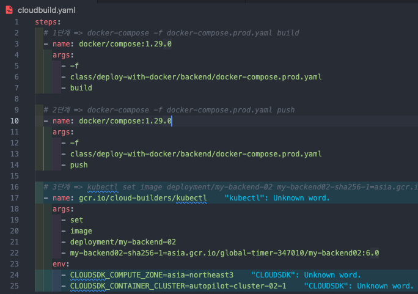

트리거가 실행되면 어디에서 어떤 파일에 대해 명령어를 실행할지 위와 같이 설정해준다.

원래 VSCode와 Kubernetes에서 직접 실행했던 명령어를 전부 적어주었다.

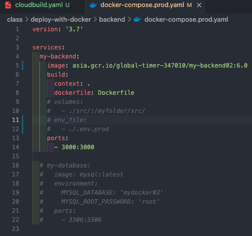

docker-compose.prod.yaml 파일에서 env\_file은 주석처리 하고, cloudbuild.yaml 파일과 이미지 버전을 맞춘다.

모든 설정이 완료되었으니, 확인해보도록 하자.

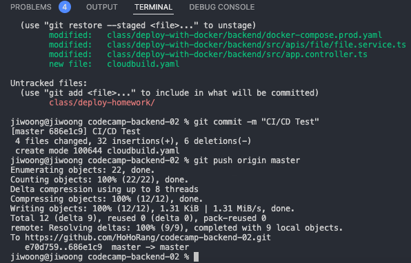

소스를 수정하고 git commit, push 한다.

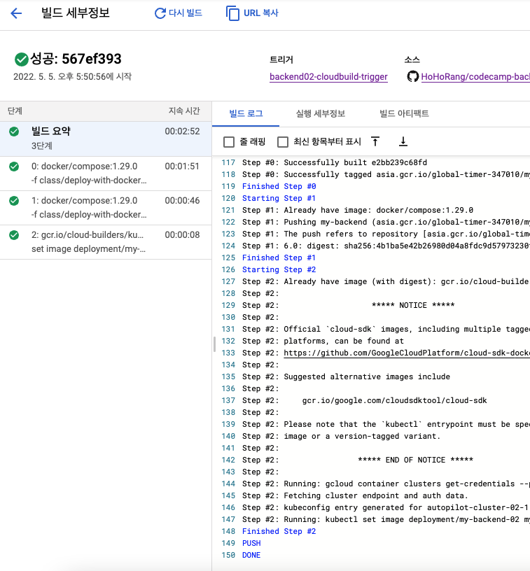

위와 같이 순서대로 build, push, set image까지 실행되어 완료된 것을 확인할 수 있다.

완료된 후, 쿠버네티스 클러스터에서 확인하도록 하자.

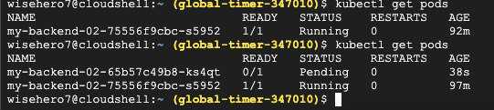

배포가 완료되어 새로운 pod가 생성된 것을 확인할 수 있다.

이렇게 간단하게 Google Cloud Build를 통해 소스 commit, push할 때 자동으로 배포까지 진행되는 예제를 진행해보았다.
