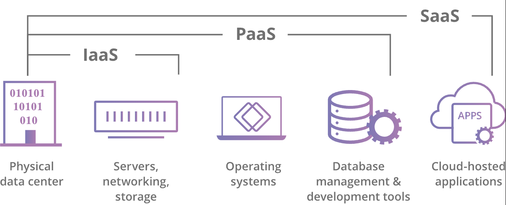

*Cloud*

## Cloud

클라우드란 인터넷 기반 컴퓨팅을 의미한다. 인터넷 상에 가상화된 서버에 프로그램을 두고 필요할 때마다 컴퓨터, 스마트폰 등에 불러와 사용하는 것을 말한다.

Cloud라는 이름은 인터넷 어딘가에 떠있는 컴퓨팅 자원(CPU, 메모리, 디스크)을 가져다가 사용할 수 있음을 나타낸다. 인터넷이 연결되어 있다면 어디서든지 접속하여 사용할 수 있다.

클라우드를 사용하면 다음과 같은 특징이 있다.

-   서버의 위치, 전력 등을 신경쓰며 구축하지 않아도 된다.
-   서버 세팅에 신경쓰지 않고 서비스 운영을 할 수 있다.
-   서비스 부하에 따라 실시간으로 확장이 가능하고, 사용한 만큼 비용을 지불한다.

## Cloud 서비스 모델

*Cloud Service Model*

-   SaaS(Software-as-a-Service): 애플리케이션이 클라우드 서버에 호스팅되고 사용자가 인터넷을 통해 애플리케이션에 액세스하는 모델. 집을 빌리는 것과 같은 모델이다.
-   PaaS(Platform-as-a-Service): 애플리케이션을 구축하는 데 필요한 개발 도구, 인프라, 운영 체제 등 모든 것을 제공하는 모델. 집을 짓는 모든 도구를 빌리는 것과 같은 모델이다.
-   IaaS(Infrastructure-as-a-Service): 필요한 서버와 저장소를 임대하는 모델. 건물을 지을 수 있는 토지를 임대하는 것과 같은 모델이다.

\[출처\]

[https://library.gabia.com/contents/infrahosting/9114/](https://library.gabia.com/contents/infrahosting/9114/)

[https://www.cloudflare.com/ko-kr/learning/cloud/what-is-the-cloud/](https://www.cloudflare.com/ko-kr/learning/cloud/what-is-the-cloud/)
