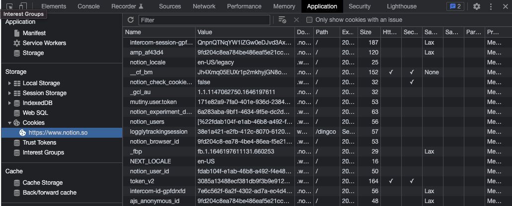
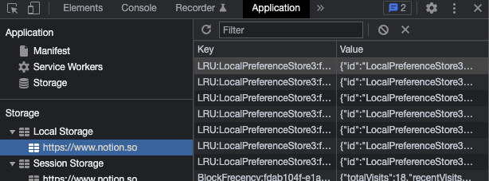
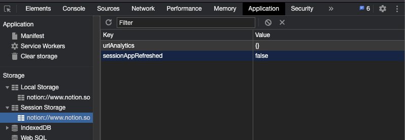

*Cookie*

## Cookie

쿠키는 클라이언트(브라우저) 로컬에 저장되는 키, 값이 들어있는 데이터 파일이다.

유효시간이 있는 동안에는 브라우저가 종료되더라도 인증이 유지된다. Response Header에 Set-Cookie 속성을 이용해 클라이언트에 쿠키를 생성할 수 있다.

쿠키는 브라우저가 Request를 요청할 때 Header에 넣어서 자동으로 서버에 전송된다.

## Local Storage

*Local Storage*

브라우저를 닫았다가 다시 열어도 계속 유지되는 데이터 저장소이다. 데이터를 지우지 않는 이상 영구적으로 보관할 수 있다. 위의 사진과 같이 도메인 별로 생성된다.

## Session Storage

*Session Storage*

브라우저가 열려있는 동안 유지되는 데이터 저장소이다. 열려있는 동안은 Reload 하더라도 유지된다.

도메인 별로 생성되는데, 브라우저가 다르면 도메인이 같아도 다른 영역으로 인식된다.

위의 Local Storage와 Session Storage는 Web Storage로, Cookie와는 다른, 클라이언트 웹브라우저에 데이터를 저장할 수 있도록 제공되는 기능이다.

Web Storage는 Cookie와 달리, 클라이언트에서 쓰이는 데이터로 서버로의 전송은 되지 않는다.

또한, 문자열 뿐만 아니라 객체 정보를 저장할 수 있어 개발 편의성을 제공한다.

용량의 제한이나 만료 기한이 없어, 필요한 데이터를 영구적으로 보관할 수도 있다.
