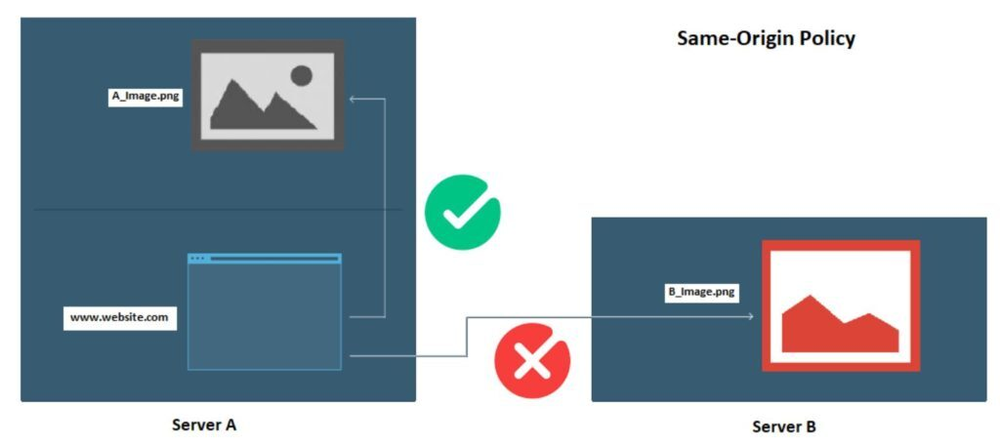

*CORS*

## CORS(교차 출처 리소스 공유)

Cross Origin Resource Sharing

추가 HTTP 헤더를 이용하여, 한 출처에서 실행 중인 웹 애플리케이션이 다른 출처의 선택한 자원에 접근할 수 있는 권한을 부여하도록 브라우저에서 알려주는 체제이다. 도메인, 프로토콜, 포트가 다를 때 실행된다.

(ex. [aaa.com](http://aaa.com) 프론트엔드에서 [bbb.com](http://bbb.com) 백엔드로 데이터 요청하는 경우)

Origin과 다른 사이트에서의 요청에 대한 응답을 설정해주는 옵션이다.

기본적으로 요청하는 Origin과 Target이 다르면 브라우저에서 백엔드의 응답을 차단한다.

서버는 Origin과 Target이 달라도 기본적으로 응답은 해주지만, 브라우저에서 CORS 정책으로 인해 응답을 차단하는 것이다.

(ex. [aaa.com](http://aaa.com) → [bbb.com](http://bbb.com) 불가능)

SOP(Same-Origin Policy): 같은 출처에서만 리소스를 공유할 수 있는 정책

CORS는 출처가 다르더라도 몇가지 예외 사항을 두고 리소스 공유를 허용하는 정책

즉 다른 출처로 리소스를 요청하는 일이 있다면, SOP 정책을 위반하는 것이지만, CORS 정책까지 위반하면 오류를 뱉으면서 다른 출처의 리소스에 접근이 불가하게 된다.

CORS 옵션은 백엔드 쪽에서 설정이 가능하다.

(ex. cors: “[bbb.com](http://bbb.com)” 혹은 cors: true)

CORS 오류를 해결할 수 있는 방법은 백엔드에서 Access-Control-Allow-Origin을 세팅해주는 것이다. 모든 출처에 대해 응답을 해주어 차단하지 않게 설정해줄 수 있지만, 위험하므로 우리가 사용하려는 프론트엔드 출처를 명시하도록 설정하면 해당 출처에서 오는 요청에만 응답을 브라우저에서 차단하지 않도록 설정할 수 있다.

백엔드(NestJS)에서는 예시로 아래와 같이 CORS 패키지를 설치하여 적용해주는 단계가 필요하다.

```shell
npm install cors

혹은

yarn add cors
```

```javascript
import cors from "cors";

app.use(cors()); //모든 CORS 허용
```
