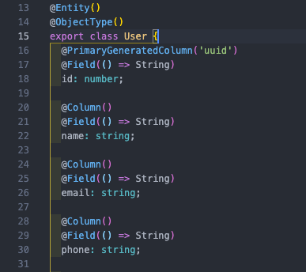

*DAO*

## DAO, DTO, VO?

지금 나는 NestJS 프레임워크로 공부를 하고 있다. TypeORM을 사용하여 class로 entity를 만들고 데이터 조회, 저장, 삭제 등을 해본 적이 있는데, 그 때 DTO라는 개념이 등장했고, 정확히는 이해를 못했지만 API를 실행하기 위해서 어떤 데이터를 담아보내기 위한 그릇? 정도의 개념으로 이해를 했었다.

뭐 대략적인 뜻은 맞는 것 같다. DTO 뿐만 아니라, Spring Framework에 대해 조금 공부할 때에도 들었지만 DAO, VO 등 Java를 사용하다가 등장한 낯선 용어들 때문에 당황했던 적이 있다.

이 글에서는 DAO, DTO, VO의 개념을 살펴보고자 한다.

## DAO

Data Access Object의 약자로, 데이터베이스 Data에 접근하기 위한 객체이다.

소스 코드의 service와 DB를 연결하는 객체라고 보면 된다.

아래는 NestJS에서 생성한 entity로, TypeORM과 GraphQL에서 사용할 수 있도록 구현한 코드이다. 아래 클래스는 실제로 DB에 테이블로 생성이 되고, repository 의존성 주입을 통해 service 단에서 SQL 작업이 가능하다.

```javascript
import { Field, ObjectType } from '@nestjs/graphql';
import { UserGrade } from 'src/apis/userGrade/entities/userGrade.entity';
import {
  Column,
  CreateDateColumn,
  DeleteDateColumn,
  Entity,
  ManyToOne,
  PrimaryGeneratedColumn,
  UpdateDateColumn,
} from 'typeorm';

@Entity()
@ObjectType()
export class User {
  @PrimaryGeneratedColumn('uuid')
  @Field(() => String)
  id: number;

  @Column()
  @Field(() => String)
  name: string;

  @Column()
  @Field(() => String)
  email: string;

  @Column()
  @Field(() => String)
  phone: string;

  @Column()
  //@Field(() => String)
  password: string;

  @Column({ nullable: true })
  @Field(() => String)
  loginId: string;

  @Column({ nullable: true })
  @Field(() => String)
  rrn: string;

  @Column({ nullable: true })
  @Field(() => String)
  nickname: string;

  @Column({ default: 'SITE' })
  @Field(() => String)
  provider: string;

  @ManyToOne(() => UserGrade)
  @Field(() => UserGrade)
  userGrade: UserGrade;

  @CreateDateColumn()
  @Field(() => Date)
  createdAt: Date;

  @UpdateDateColumn()
  @Field(() => Date)
  updatedAt: Date;

  @DeleteDateColumn()
  @Field(() => Date)
  deletedAt: Date;
}
```

## DTO

Data Transfer Object의 약자로, 데이터 교환을 위해 사용하는 객체이다.

DB로부터의 데이터를 service, controller에서 전달할 때 사용하는 객체로, 별도의 로직을 가지고 있지 않은 객체이다.

NestJS 프로젝트를 하면서 DTO를 사용했던 부분은, GraphQL API를 호출할 때, 인자로 string, integer를 받는 것이 아니라, 별도의 DTO를 생성하여 인자를 받도록 구현한 부분이다.

위의 entity와 비슷해 보이지만, GraphQL에서 input type으로 사용되도록 해당 모듈을 import하고 @InputType 데코레이터를 통해 필요한 필드를 입력받도록 설정했다.

```javascript
import { Field, InputType, Int } from '@nestjs/graphql';

@InputType()
export class CreatePostInput {
  @Field(() => String)
  title: string;

  @Field(() => String)
  contents: string;

  @Field(() => Int, { nullable: true })
  likeCount: number;

  @Field(() => Int, { nullable: true })
  dislikeCount: number;

  @Field(() => Int, { nullable: true })
  hitCount: number;

  @Field(() => Date, { nullable: true })
  updateDate: Date;

  @Field(() => String)
  boardId: string;

  @Field(() => String)
  storeId: string;

  @Field(() => String)
  foodTypeId: string;

  @Field(() => String)
  userId: string;

  @Field(() => [String])
  tags: string[];
}
```

## VO

Value Object의 약자로, 값을 가지고 있는 오브젝트로써 쓰인다.

DTO와 다르게 변경이 불가한 Read Only 속성을 가진다.

위의 예제 코드들은 NestJS 프레임워크에서 GraphQL API 구현을 위해 사용한 코드로, Spring에서 사용하는 DAO, DTO 코드들과 다른 부분이 있을 수 있다.(위 DTO는 service, controller 간의 전송을 위해 쓰인게 아니라 GraphQL API를 호출할 때 인자로 사용하기 위해 쓰였다)

\[출처\]

[http://melonicedlatte.com/2021/07/24/231500.html](http://melonicedlatte.com/2021/07/24/231500.html)

[https://gmlwjd9405.github.io/2018/12/25/difference-dao-dto-entity.html](https://gmlwjd9405.github.io/2018/12/25/difference-dao-dto-entity.html)

[https://kyounghwan01.github.io/blog/etc/nest/validation-dto/#dto-](https://kyounghwan01.github.io/blog/etc/nest/validation-dto/#dto-)[란](https://kyounghwan01.github.io/blog/etc/nest/validation-dto/#dto-%E1%84%85%E1%85%A1%E1%86%AB)
