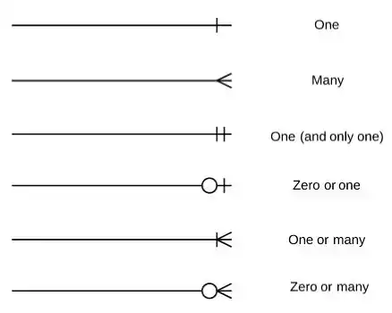

*ERD*

## ERD

Entity Relationship Diagram의 약자로, **개체(Entity)들의 관계(Relation)을 나타낸 그림(Diagram)**을 말한다.

*ERD 표기법*

위와 같은 표기법으로 개체, 즉 DB 테이블 간의 관계를 표현해줄 수 있다.

위 표기법은 개체 한쪽에만 표시하지는 않고, 양쪽 개체에 표시하여 One to Many, Many to Many 등과 같이 쓰인다.

### One

~대일 관계를 나타낸다. 하나의 데이터를 가진다는 의미다.

### Many

~대다 관계를 나타낸다. 여러개의 데이터를 가진다.

### One (and only one)

~대일 관계를 나타내는데, 하나의 row끼리만 연결된 경우이다.

### Zero or one

~대일 관계인데, 필수가 아닐 경우를 말한다. 하나도 데이터가 없을 수 있다.

### One or Many

~대다 관계를 나타내는데, 1개 이상임을 말한다.

### Zero or Many

~대다 관계이지만 데이터가 없을수도, 하나일수도, 여러개일 수도 있다.

추가로, **점선인 경우는 비식별 관계**, **실선인 경우는 식별 관계**이다.

한 테이블의 PK(기본키)가 다른 테이블에 기본키가 된다면 식별 관계, 아니면 비식별 관계이다.

예를 들자면, 서브카테고리는 메인카테고리의 ID를 컬럼으로 가지고 있지만, 메인카테고리 ID가 데이터를 구분하는 식별자로 쓰이지는 않고, 서브카테고리 ID 자체만으로 식별자가 되어 쓰인다.

위의 ERD를 예로 설명하고자 한다.

-   메인카테고리는 서브카테고리와 일대다 관계이다. 메인 카테고리 하나에는 서브카테고리가 0개, 혹은 여러개가 있을 수 있다.
-   서브카테고리와 상품은 일대다 관계로, 서브카테고리 아래에 상품이 0개 이상 있을 수 있다.
-   상품 정보에는 이미지가 0개 이상 있을 수 있다.(일대다)
-   상품과 알러지 정보는 다대다 관계로, 상품에 알러지 정보가 여러개 있을 수 있고, 알러지 정보 하나가 여러 상품에 들어있을 수 있다.(다대다 관계는 별도의 테이블로 표현된다)

\[출처\]

[https://mulmandu17.tistory.com/68](https://mulmandu17.tistory.com/68)

[https://mjn5027.tistory.com/43](https://mjn5027.tistory.com/43)

[https://choiseungyoun.github.io/posts/what-is-erd/](https://choiseungyoun.github.io/posts/what-is-erd/)
