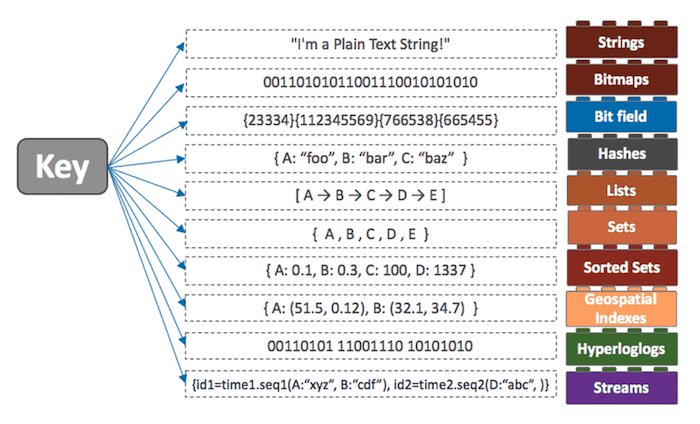
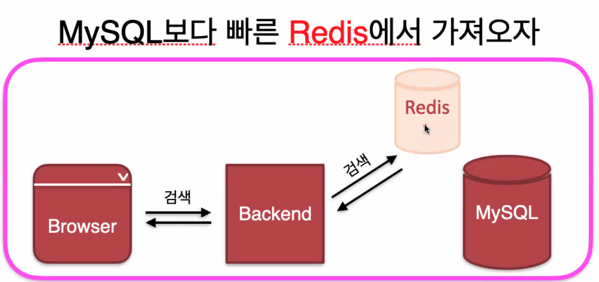
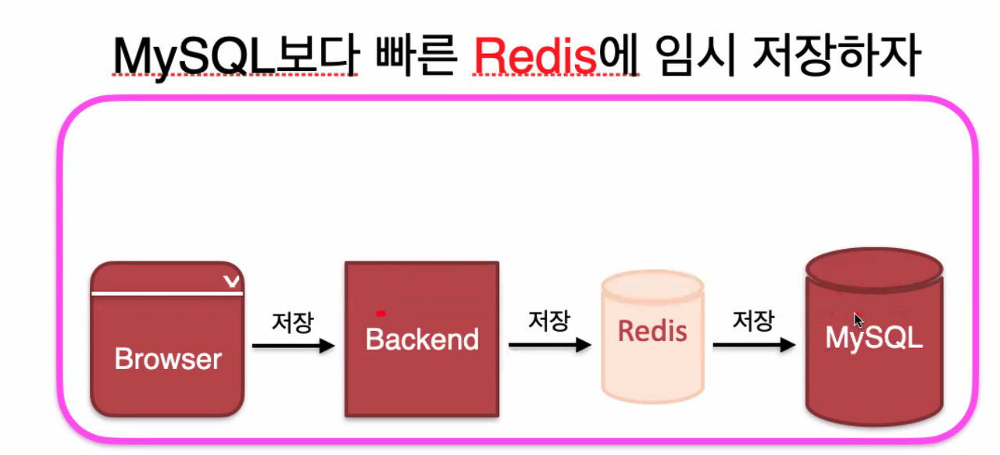
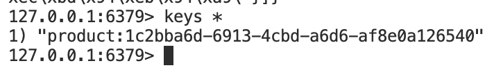
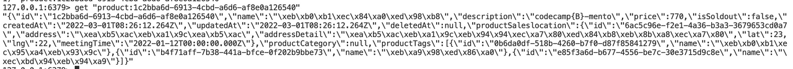
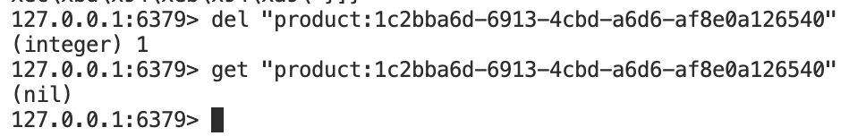

*Redis*

## Redis

웹 서비스를 운영할 때, 서버와 DB를 두면 기본적으로 운영이 가능하다. 하지만, 사용자가 점점 늘어나면서 서버에 수많은 요청을 하고, 수많은 DB 작업이 일어난다면 디스크에 직접 기록을 하는 DB에는 부하가 발생하게 된다. 이는 곧 서비스의 응답속도에도 영향을 미친다.

컴퓨터의 기본 구조를 알고 있으면 Redis가 등장한 이유를 쉽게 이해할 수 있을 것 같다. 디스크에 직접 기록하는 DB는 느리니, 캐시서버를 두고 한 번 읽었던 데이터를 임시로 저장하여 다음에 다시 접근할 일이 있으면 속도가 빠른 캐시서버에서 데이터를 가져오는 방법을 생각하게 된 것이다.

Redis는 캐시 시스템으로, 모든 데이터를 메모리에 저장하고 조회하는 **인메모리 데이터베이스**이다. 캐시 기능을 제공하면서 영속성, 다양한 데이터 구조와 같은 부가적인 기능을 지원하고 있다.

*다양한 형식의 데이터 지원*

보통 생각하는 MySQL DB와 달리, 다양한 데이터 구조를 key에 저장이 가능하다. 컬럼 별로 숫자, 문자, 날짜 등의 타입을 설정할 필요가 없고 저장하려는 데이터를 특정 키와 저장할 수 있어 어렵지 않게 사용할 수 있는 장점이 있다.

정리하자면, Redis는 NoSQL로 **Key-Value 타입**의 저장소이고, **문자열, 리스트, 해시, 셋 등 다양한 형식의 데이터를 지원**하는 인메모리 데이터베이스이다.

Redis를 사용하는 용도는 크게 2가지로 나뉜다.

-   빠른검색용(Cache-Aside 패턴)

MySQL 보다 빠른 Redis에서 가져올 경우

Redis에 찾으려는 데이터가 있는 경우(Cache-Hit) 가져오고, 없으면(Cache-Miss) MySQL에서 검색하고 Redis에 캐싱하여 추후에 검색시 Redis에서 찾게 된다.

-   임시저장용(Write-Back 패턴)

MySQL보다 빠른 Redis에 임시 저장할 경우

디스크를 사용하는 MySQL에 데이터를 저장하기 전에, 읽고 쓰는 속도가 빠른 Redis에 임시로 저장(디스크 I/O 발생을 최소화)

실제로 Redis를 실행하고 접속하여 확인해보면

keys \* 를 입력해 모든 key를 조회한다.

get \[key\] 명령어를 입력해 위에서 조회된 키에 대한 값을 조회해본다.

위의 설명과 같이 key에 대해 다양한 데이터 저장을 지원하는 것을 확인할 수 있다.

del \[key\] 명령어를 이용해 key에 대한 데이터를 삭제하고 조회해보면 정상적으로 삭제된 걸 확인할 수 있다.
