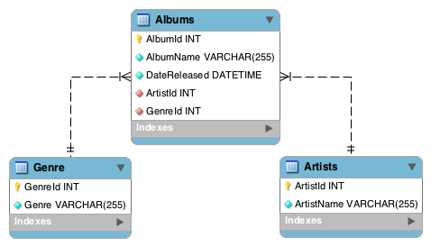
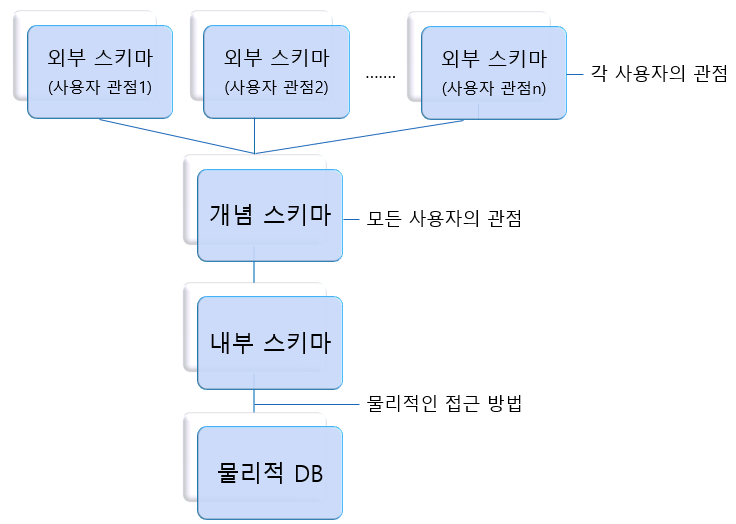

*DB Entity*

## Schema(스키마)

스키마는 DB의 구조와 제약 조건에 관한 전반적인 명세를 기술한 메타데이터의 집합

개체의 특성을 나타내는 속성(Attribute), 속성들의 집합으로 이루어진 개체(Entity), 개체 사이에 존재하는 관계(Relation)에 대한 정의와 제약조건에 대한 정의이다.

### 스키마의 특징

-   스키마는 데이터 사전에 저장된다.
-   스키마는 특정 데이터 모델을 이용해서 만들어진다.
-   스키마는 시간에 따라 불변인 특성을 갖는다.
-   스키마는 데이터의 구조적 특성을 의미하고, 인스턴스에 의해 규정된다.

*DB Schema*

### 외부 스키마

사용자 뷰. 사용자들의 입장에서 데이터베이스 논리 구조를 정의한 것이다.

하나의 데이터베이스에 여러 개의 외부 스키마가 존재할 수 있고, 하나의 외부 스키마를 여러 사용자가 공유해 사용할 수 있다. 사용자가 SQL을 통해 DB에 접근하거나, 프로그래밍 언어를 통해 접근할 수 있다.

### 개념 스키마

전체적인 뷰. 데이터베이스의 전체적인 논리 구조이다. 한 DB에 하나만 존재한다.

개체 간의 관계와 제약 조건을 정의하고, 접근 권한, 무결성 규칙 등을 정의한다.

단순히 스키마라고 하면 개념 스키마를 말하는 것이다.

DBA(DB 관리자)에 의해 구성된다.

### 내부 스키마

물리적인 데이터베이스 구조이다. 저장 스키마라고도 한다.

디스크 기억장치에 물리적으로 구현하기 위한 방법을 기술한 것이다.

시스템 설계자 관점에서 보는 스키마이다.

\[출처\]

[https://coding-factory.tistory.com/216](https://coding-factory.tistory.com/216)

[https://iingang.github.io/posts/DB-schema/](https://iingang.github.io/posts/DB-schema/)
