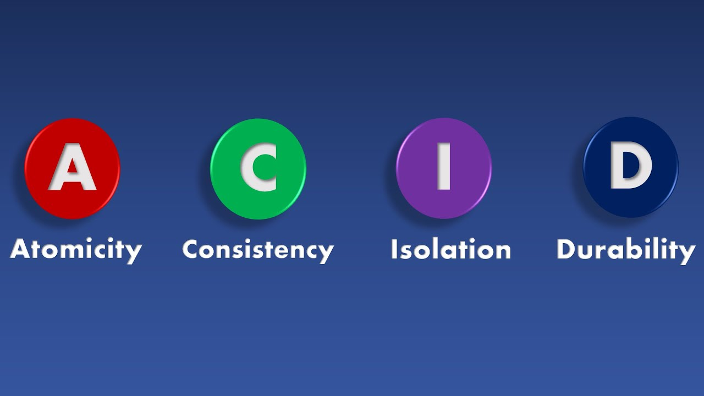

*ACID*

## Database Transaction

데이터베이스에서 하나의 논리적 기능을 수행하기 위해 행하는 **쪼갤 수 없는 작업의 단위**이다.

즉, 한 번 실행되면 모두 수행되거나 모두 수행되지 않는 작업의 논리적 단위이다. 주로 시스템의 기능을 실행하다가 예기치 못한 오류로 인해 작업이 제대로 수행되지 않는 경우 **데이터 부정합을 방지**하기 위해 사용한다.

예를 들어, 송금을 하는 경우에 송금하는 계좌에서 금액을 차감하고, 송금받는 계좌에서는 그만큼의 금액을 증가시켜야 한다. 하지만, 어떤 오류로 인해 차감은 되었지만 증가는 되지 않은 경우에 돈이 없어지는 문제가 발생한다.

이와 같은 이유로 송금과 같은 기능은 모두 수행되거나 수행되지 않아야 하는, 한 Transaction 내에서 작업이 이루어져야 한다.

만약 차감을 했다가 송금받는 계좌에 금액 증가를 실패했다면, 이전의 차감 작업도 모두 되돌려 놓아야 한다. 이처럼 트랜잭션의 초기 상태로 되돌려 놓는 것을 **Rollback(롤백)**이라고 한다.

모든 작업이 오류 없이 완료되었다면 트랜잭션을 완료하는데, 이 작업을 **Commit(커밋)**이라고 한다.

## Transaction의 4가지 특성(ACID)

트랜잭션이 안전하게 수행되는 것을 보장하기 위한 4가지 특성이 있다. 각 특성의 앞 글자만 따서 ACID라고 한다.

### 원자성(Atomicity)

트랜잭션의 작업 전체가 수행이 완료되거나, 혹은 어떠한 연산도 수행되지 않는 특성. 작업 단위를 일부분만 실행하지 않는다는 것을 의미한다.

### 일관성(Consistency)

트랜잭션이 성공적으로 완료되면 일관적인 DB 상태를 유지하는 것을 말한다. 예를 들어 송금 작업을 수행하기 전이나 후에도 동일하게 금액은 정수형 컬럼이다.

### 격리성(Isolation)

트랜잭션 수행 시 다른 트랜잭션이 영향을 미치지 못하도록 보장되는 특성이다. 다른 트랜잭션의 영향을 받으면 결과가 달라질 수 있기 때문에, 다른 트랜잭션과는 격리된 상태에서 작업이 수행되어야 한다.

### 지속성(Durability)

성공적으로 수행된 트랜잭션은 영원히 반영되는 특성이다. 예를 들어 특정 작업을 수행하여 트랜잭션이 완료되고 나서는, 시스템이 내려가거나 DB가 꺼진 경우에도 해당 DB에는 그 결과가 저장되어 있는 것이다.
