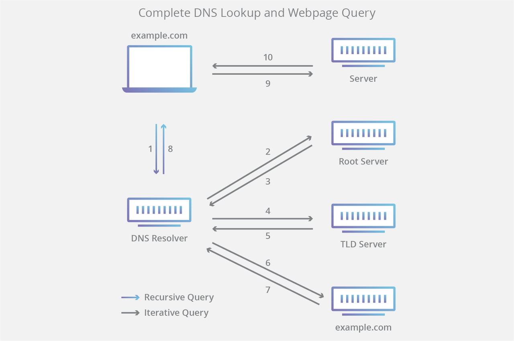

*DNS(Domain Name System)*

## DNS

DNS(Domain Name System)는 숫자로 이루어진 IP주소에 접속하는 것이 아니라, [naver.com](http://naver.com) 과 같은 도메인 이름을 통해 온라인으로 서버에 접속할 수 있는 것을 말한다.

인터넷의 각 기기(서버)는 고유한 IP 주소를 가지고 있는데, DNS를 이용하면 복잡한 234.125.574.132와 같은 복잡한 IP 주소를 기억할 필요 없이, 특정 도메인명으로 접속이 가능하다.

*DNS 조회 단계*

DNS 조회 단계는 아래와 같다.

1.  사용자가 도메인명(ex. [naver.com](http://naver.com))을 입력하면, 인터넷으로 이동하고 DNS 재귀 확인자가 수신한다.
2.  확인자가 DNS 루트 이름 서버를 쿼리한다.
3.  루트 서버가 도메인에 대한 정보를 저장하는 최상위 도메인(TLD) DNS 서버의 주소로 확인자에 응답한다.
4.  확인자가 .com TLD에 요청한다.
5.  TLD 서버가 도메인 이름서버의 IP 주소로 응답한다.
6.  재귀 확인자가 도메인의 이름 서버로 쿼리를 보낸다.
7.  IP 주소가 이름 서버에서 확인자에게 반환된다.
8.  DNS 확인자가 처음 요청한 도메인의 IP 주소로 웹 브라우저에 응답한다.
9.  브라우저가 IP 주소로 HTTP 요청을 보낸다.
10.  해당 서버가 브라우저에게 렌더링할 웹 페이지를 반환한다.

\[출처\]

[https://www.cloudflare.com/ko-kr/learning/dns/what-is-dns/](https://www.cloudflare.com/ko-kr/learning/dns/what-is-dns/)
