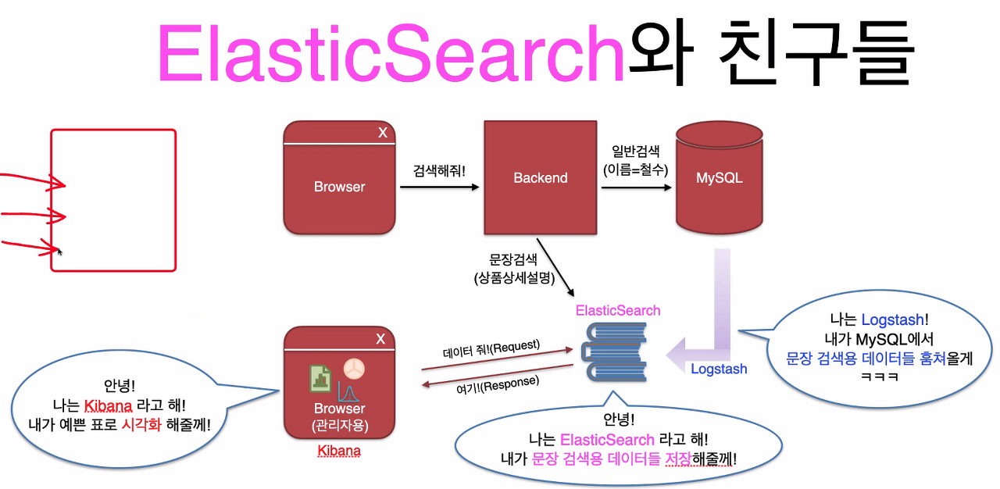
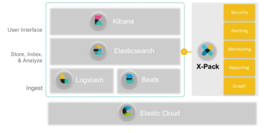

*Elastic Search*

## Elastic Search

Elastic Search는 모든 유형의 데이터를 위한 무료 오픈 소스 검색 및 분산 엔진이다.

간단히 말해, 검색에 최적화된 DB라고 보면 된다. 예를 들어 MySQL에는 특정 상품이나 게시글의 제목, 설명이 컬럼 그대로 저장되어 일부 텍스트를 검색할 때 오래 걸리는 반면, Elastic Search에서는 해당 데이터를 여러 setting으로 저장하여 일부 텍스트 검색 시 빠른 속도로 해당 데이터를 가져올 수 있는 장점이 있다.

### Index vs Inverted-Index

보통 컬럼이 특정 값을 가지는지 검색하는데 인덱스를 사용하여 빠르게 찾을 수 있다.

그런데, 특정 문자열이 포함된 데이터를 검색하려면, 인덱스로 탐색이 되지 않고 모든 데이터를 조회해야 한다.

(ex. title like ‘%점심%’)

그래서, 해당 컬럼을 단어 단위로 쪼개서 새로운 테이블을 만들어 관리하는 방법을 생각해냈다.

위와 같이 단어(토큰) 단위로 쪼개는 것을 토크나이징 이라고 한다.

그리고 그렇게 생성된 새로운 테이블을 역인덱스(Inverted-Index)라고 한다.

이러한 작업을 직접 해줄 수도 있지만, 자동으로 해주는 데이터베이스가 Elastic Search이다.

**Index**

-   빠른 검색(이름이 “철수”인 사람 찾기)
-   MySQL

**Inverted-Index**

-   빠른 전문(Full-Text) 검색 (”점심"이 들어간 문장 찾기)
-   ElasticSearch(NoSQL) (MongoDB와 유사함) (문장 검색용 데이터를 저장)

## ELK Stack

Elastic Search는 함께 자주 쓰이는 도구들이 있다.

우선 시스템을 기준으로 설명하자면, Backend로부터의 데이터를 모두 MySQL에 저장하고, 그 중에 검색에 필요한 데이터들을 뽑아서 ElasticSearch에 저장하게 된다(ElasticSearch가 없어도 서비스는 되는)

MySQL로부터 문장 검색용 데이터를 뽑아오는 작업을 하는 것이 Logstash 이다.

MySQL DB에 쿼리를 날리고, 시각화하여 보게 해주는 Tool 중에는 DBeaver가 있다.

Elastic Search DB도 시각화하여 쉽게 확인할 수 있게 해주는 Tool로 Kibana가 있다.

(보통의 DB Tool과는 달리, Elastic Search로 API 요청을 하고 응답을 받는 형식이다)

Elastic Search

Logstash

Kibana

의 앞글자만 따서 ELK 스택이라고 부른다.
