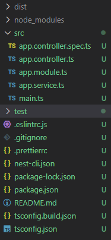

*ESLint & Prettier*

## ESLint

ESLint는 ES와 Lint의 합성어이다.

ES - Ecma Script. ECMA 기구에서 만든 Script. JavaScript를 의미

Lint - 소스 코드를 분석하여 프로그램 오류, 버그, 스타일 오류를 검사

즉, 코드 패턴을 정해서 **코드의 일관성을 높여 버그 발생을 방지하는 목적**으로 사용하는 도구이다.

## Prettier

소스 코드 format을 정해주는 도구이다.

코드를 마음대로 작성해도, 정해진 스타일로 변환해준다. 이름에서 알 수 있듯이 주로 **코드 외형을 보기 좋게 정해진 스타일로 바꿔준다**.

두 개의 도구가 설명이 비슷한 것 같고, 어떤 용도로 쓰이는지 헷갈릴 수 있다.

ESLint는 오류를 잡기 위해 사용하고, Prettier는 스타일을 교정시키기 위해 사용한다.

둘의 용도는 다르기 때문에, 많은 사람들이 두 개의 도구를 함께 사용한다.

두 개를 같이 설치하는 경우, 충돌이 일어나는 경우가 있는데, 주로 eslint-config-prettier 플러그인을 이용하여 적용하는 것이 좋다고 한다.

eslint에서 prettier와 충돌할 수 있는 rule을 꺼서 eslint는 코드 오류를, prettier는 코드 포맷팅을 하도록 사용하는 방식이다.

배우고 있는 NestJS에서는 새로운 Nest 프로젝트를 생성할 경우, 자동으로 prettier와 eslint가 충돌없이 설정된 파일이 생성된다.

```shell
nest new [프로젝트명]
```



위와 같이 프로젝트 폴더 구조를 확인할 수 있고, eslint와 prettier 설정 파일도 자동으로 생성된다.
