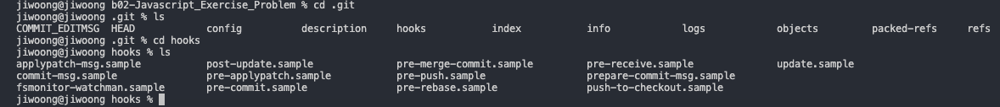

*Git Hooks*

## Husky

git hook을 손쉽게 제어해주는 매니저.

git hook은 git 명령어를 실행하거나 특정 이벤트가 발생(커밋, 푸시)할 때, 특정 스크립트를 실행시키는 기능이다.

husky는 왜 사용할까?

git을 통해 개발자들이 서로 코드를 공유할 때, 각자의 방식으로 작성된 코드가 공유될 수도 있다. 또는 특정 스크립트를 적용한 코드를 올리고 싶을 수 있다. 이 때 git을 통해 github에 올라가기 전, 특정 스크립트를 통해 ESLint와 Prettier의 포맷이 적용된 코드가 올라가게 할 수 있는데, husky를 통해 가능하다.

기본적으로 git hook 설정을 따로 할 수 있다.

프로젝트의 git 디렉토리에 들어가보면, git hook 샘플들을 확인해볼 수 있고, 수정하여 사용할 수도 있다.



*.git/hooks*

husky를 이용하면, 이 폴더의 파일을 수정하지 않고 git hook 스크립트를 설정할 수 있다.

```shell
// package.json
...
"husky": {
    "hooks": {
        "pre-commit": "eslint --fix && prettier --write",
        "pre-push": "npm test"
    }
}
...
```

위와 같이 package.json 파일에 husky 설정을 해주어 어떤 시점에 특정 스크립트를 실행할지 설정해줄 수 있다.
