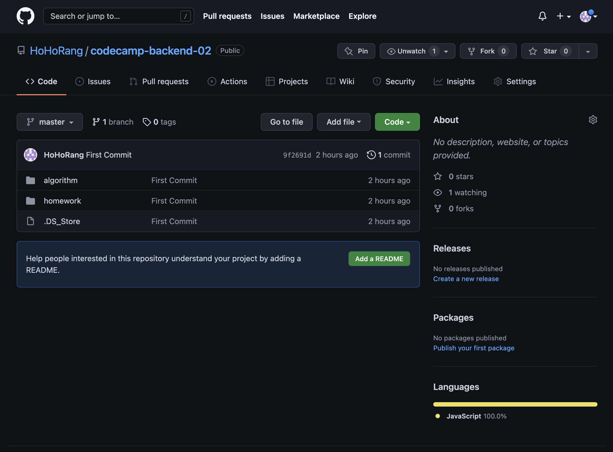

*Github*

## 1. git init

VSCode에서 터미널 실행 후, git저장소로 만들려는 폴더에서 git init을 실행

git init을 실행하면 .git 폴더가 생성되고 git저장소가 됨

```shell
hohorang@MacBookPro codecamp-backend-02 % git init
hint: Using 'master' as the name for the initial branch. This default branch name
hint: is subject to change. To configure the initial branch name to use in all
hint: of your new repositories, which will suppress this warning, call:
hint:
hint:   git config --global init.defaultBranch <name>
hint:
hint: Names commonly chosen instead of 'master' are 'main', 'trunk' and
```

## 2. git remote add origin \<github 주소>

github에서 repository를 생성 후, 위 명령어를 통해 git저장소와 github repository 연결

```shell
hohorang@MacBookPro codecamp-backend-02 % git remote -v
hohorang@MacBookPro codecamp-backend-02 % git remote add origin https://github.com/HoHoRang/codecamp-backend-02.git
hohorang@MacBookPro codecamp-backend-02 % git remote -v
origin  https://github.com/HoHoRang/codecamp-backend-02.git (fetch)
origin  https://github.com/HoHoRang/codecamp-backend-02.git (push)
```

## 3. git status / git add .

git status로 변경된 폴더, 파일 확인 후, git add .(혹은 폴더, 파일명)으로 변경사항 적용

```shell
hohorang@MacBookPro codecamp-backend-02 % git status
On branch master

No commits yet

Untracked files:
  (use "git add <file>..." to include in what will be committed)
        .DS_Store
        algorithm/
        homework/

nothing added to commit but untracked files present (use "git add" to track)
hohorang@MacBookPro codecamp-backend-02 % git add .
hohorang@MacBookPro codecamp-backend-02 % git status
On branch master

No commits yet

Changes to be committed:
  (use "git rm --cached <file>..." to unstage)
        new file:   .DS_Store
        new file:   algorithm/.DS_Store
        new file:   algorithm/example.js
        new file:   homework/.DS_Store
```

## 4. git commit -m "message"

git commit -m "커밋 메시지" 를 통해 github에 커밋

```shell
hohorang@MacBookPro codecamp-backend-02 % git commit -m "First Commit"
[master (root-commit) 9f2691d] First Commit
 4 files changed, 2 insertions(+)
 create mode 100644 .DS_Store
 create mode 100644 algorithm/.DS_Store
 create mode 100644 algorithm/example.js
 create mode 100644 homework/.DS_Store
```

## 5. git push origin master

커밋한 사항을 git push origin master를 통해 origin에 master를 push

```shell
hohorang@MacBookPro codecamp-backend-02 % git remote -v
origin  https://github.com/HoHoRang/codecamp-backend-02.git (fetch)
origin  https://github.com/HoHoRang/codecamp-backend-02.git (push)
hohorang@MacBookPro codecamp-backend-02 % git push origin master
Enumerating objects: 8, done.
Counting objects: 100% (8/8), done.
Delta compression using up to 16 threads
Compressing objects: 100% (7/7), done.
Writing objects: 100% (8/8), 1.68 KiB | 1.68 MiB/s, done.
Total 8 (delta 2), reused 0 (delta 0), pack-reused 0
remote: Resolving deltas: 100% (2/2), done.
To https://github.com/HoHoRang/codecamp-backend-02.git
 * [new branch]      master -> master
```

## 6. 적용완료 및 확인

github repository를 확인하면, commit 및 push한 항목이 적용된 것을 확인할 수 있다.



## \*. 하위 폴더도 git 저장소로 설정된 경우

하위 폴더도 git저장소로 설정되어(.git 폴더가 생성된 상태) 있는 경우,

충돌이 발생해 해당 하위 폴더는 접근할 수 없게 된다.

하위 폴더에 들어가, .git 폴더가 있는지 확인하고, rm -rf .git 명령어를 통해 git저장소를 해제해주면 된다.
