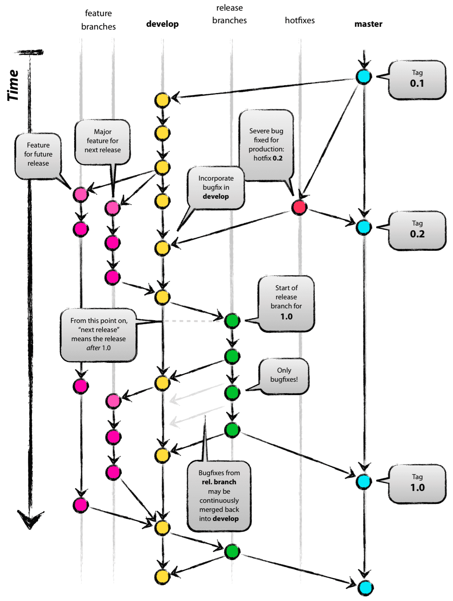
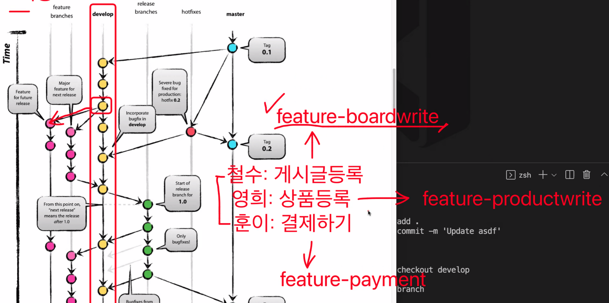
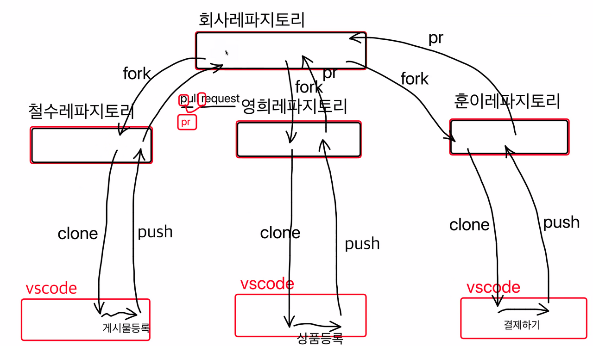
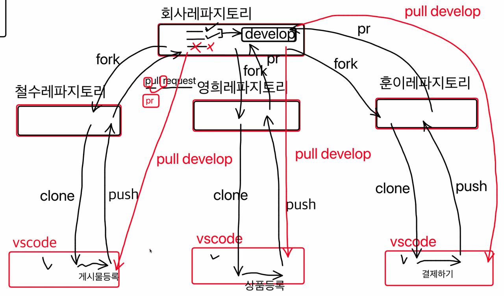
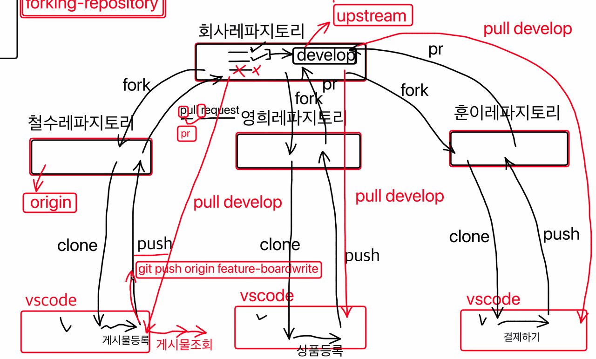

*gitflow*

## Gitflow

위 사진은 Gitflow를 나타내는 그림이다. 공부를 하면서 지금까지 수정한 소스는 모두 master branch에 commit하고 push했었다. 물론 프로젝트의 크기가 작고 혼자 진행한다면 문제가 없지만, 협업을 하면서 프로젝트가 커진다면? 그리고 만약 잘못된 commit으로 인해 소스가 충돌나고 배포가 정상적으로 이뤄지지 않는다면? branch를 하나로 관리하고 모든 수정사항을 거기에 반영한다는 것은 말이 안된다.

위 그림에서 각 branch 별로 진행되는 과정을 설명해보도록 한다.

### master

가장 중요한 branch로, 소스를 최종 반영하기 전의 소스를 관리하는 곳이다. 앞으로 이 branch로의 직접적인 commit, push는 하지 않을 예정이다.

### develop

실제 개발이 이루어지고 반영이 일어나는 branch이다. master branch로부터 따와서 개발을 한다. 여러 개발자들이 협업하여 개발한 기능을 추가하여 반영하는 곳이다.

### feature branches

개발자들이 자신이 개발하는 기능을 올리는 branch이다. 이곳에서 개발이 완료되면 develop branch로 merge한다.

### release branches

develop branch에서 어느 정도 개발이 진행되고, 배포하기 전에 배포 소스를 관리하기 위한 branch이다. 이 branch에서는 암묵적으로 기능 추가는 하지 않고, 간단한 버그 수정 정도만 진행한다. 버그를 수정하면서 고쳐지면 master branch에 병합하고 master를 배포하게 된다.

### hotfixes

프로젝트에 크리티컬한 버그가 발견되면, master branch로부터 hotfix branch를 따서 수정 후 master에 병합한다.

## git forking-repository

개발자들이 github를 통해 협업을 할 때, 아래와 같은 방식으로 소스를 관리하고 개발하게 된다.

회사 레파지토리를 만들고, 각 개발자들은 그 레파지토리를 fork하여 각자의 레파지토리로 가져오게 된다.

그리고 각자의 로컬환경(ex. VSCode)에 clone하여 각자 맡은 기능을 개발하게 된다.

그리고 기능 개발이 끝난 후, 각자의 레파지토리에 commit, push하고, 회사 레파지토리에 pull request를 요청하게 된다.

그런데 만약에, 요청한 3개의 Pull Request 중에 2개만 merge하고, 마지막 PR은 문제가 있어 reject하였다.

1,2번째 PR은 merge되어 회사레파지토리에 저장되었고, 이제 회사레파지토리의 소스가 가장 최신이 되었다.

각 개발자들은 회사레파지토리로부터 소스를 pull 받아야 한다.

pull develop으로 develop branch로부터 소스를 업데이트 받는다.

그러면 개발자들은 자신이 개발한 소스 이외에 다른 개발자들이 개발한 소스가 적용된다.

이러한 방식을 forking-repository 방식이라고 한다.

각 개발자가 push를 할 때는,

git push origin feature-boardwhite 와 같은 명령어로, 자신의 branch(feature-boradwhite)를 origin(자신의 레파지토리)에 적용시킨다.

이와 다르게, pull을 받을 때는,

git pull upstream develop 와 같은 명령어로, upstream(회사 레파지토리)의 develop branch의 소스를 자신의 소스에 적용시킨다.
