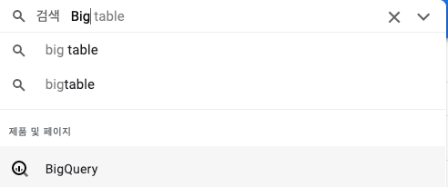
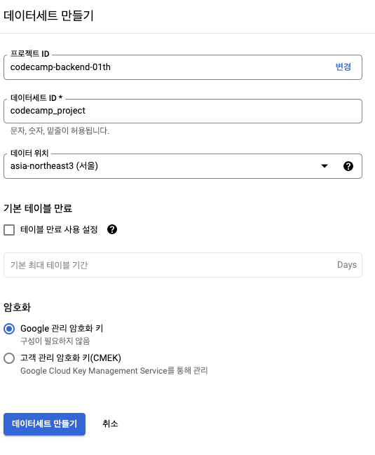
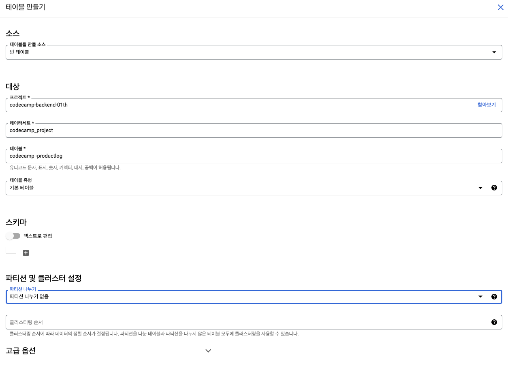
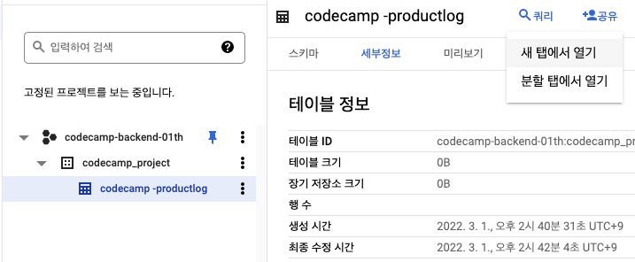
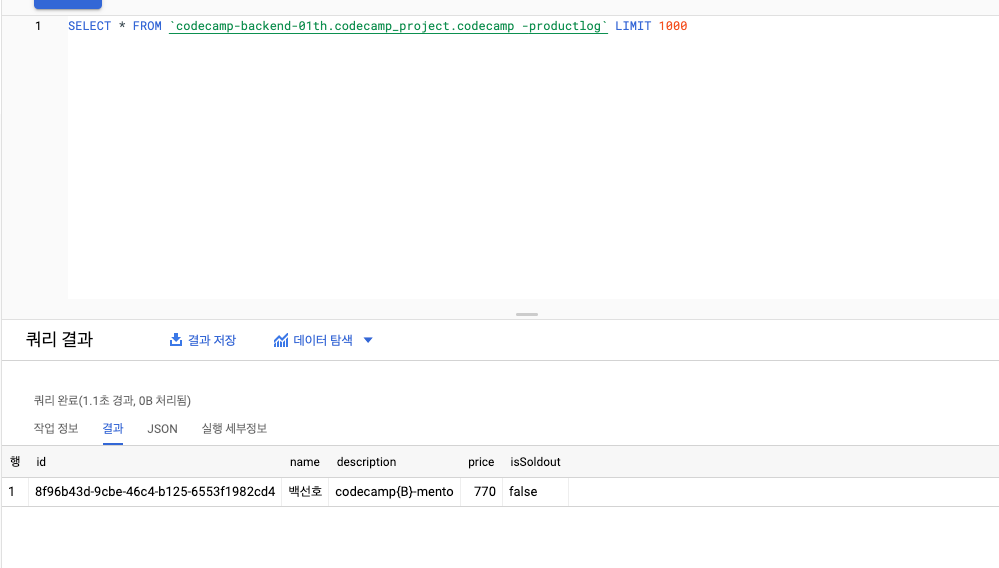

*Google BigQuery*

## BigQuery

Big-Query는 큰(많은) 데이터에 대한 SQL 쿼리를 빠르게 수행해주는 서비스이다. 데이터 분석을 위해 많은 기업들이 데이터 웨어하우스로 도입하여 사용하고 있다.

단순히 많은 데이터를 저장하는 저장소라고만 보기보다, 데이터 저장 및 분석까지 이어지는 서비스라고 볼 수 있다.

GCP(Google Cloud Platform)을 이용하여 클라우드 상에서 제공되는 서비스이다. 별도의 복잡한 설정 필요없이 간단하게 설치 없이 사용 가능하다. 또한 SQL 언어를 사용해 기존 DB에서 데이터를 조회하던 방식으로 조회가 가능하다.

물론, 서비스를 이용하면서 데이터를 저장하는 용량과 조회, 처리하는 양에 따라 비용이 청구되지만, Google의 강력한 CPU 자원을 이용해 빠르게 수많은 데이터를 조회하고 분석처리할 수 있다는 장점이 있다.

(개인적으로 이용하다가 너무 많은 데이터를 저장하고 처리하면서 비용 폭탄을 맞지 않도록 조심해야 한다..)

GCP의 BigQuery 메뉴에 들어가 실제로 이용해볼 수 있다.







소스코드에서 @google-cloud/bigquery 모듈을 다운받아 설치하고, bigQuery용 프로젝트ID와 키를 입력하여 위에서 만든 테이블에 로그성 정보를 적재하도록 구현할 수 있다.

```javascript
...
afterInsert(event: InsertEvent<Product>) {
    const bigQuery = new BigQuery({
      keyFilename: process.env.BIGQUERY_KEY_FILENAME,
      projectId: process.env.BIGQUERY_PROJECT_ID,
    });

    bigQuery
      .dataset('codecamp_project')
      .table('codecamp -productlog')
      .insert([
        {
          id: event.entity.id,
          name: event.entity.name,
          description: event.entity.description,
          price: event.entity.price,
          isSoldout: event.entity.isSoldout,
        },
      ]);
  }
...
```

위 코드는 Product 테이블에 데이터 삽입이 있을 경우 생성했던 bigQuery 테이블에도 데이터를 생성해주도록 설정하는 부분이다.





DB에 데이터를 생성하고나서, GCP의 bigQuery 테이블을 조회해보면 위와 같이 생성된 것을 확인할 수 있다. 간단한 예제로 살펴봤지만, 추후 데이터가 많아질 경우 데이터 적재 뿐만 아니라 분석까지도 가능할 것이다.

\[출처\]

[https://cloud.google.com/bigquery](https://cloud.google.com/bigquery)

[https://bcho.tistory.com/1116](https://bcho.tistory.com/1116)
