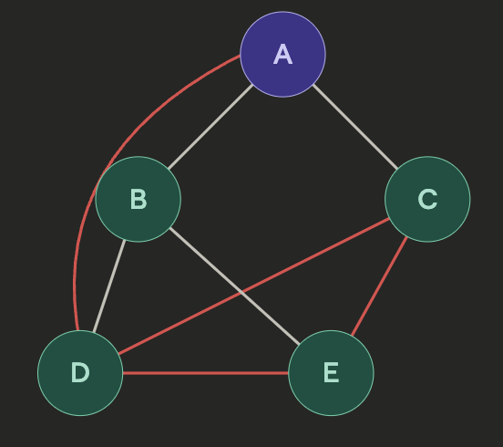
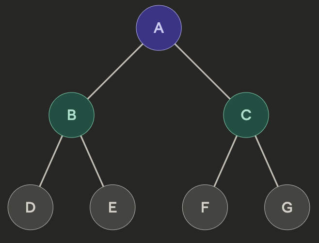

## Graph(그래프)

정점(Vertex)과 간선(Edge)으로 이루어진 자료구조

\- 정점(Vertex / Node): 데이터를 담는 단위

\- 간선(Edge): 정점과 정점 사이의 관계(연결)

*Graph(그래프)*

### Graph의 종류

\- 무방향 그래프(Undirected): 간선에 방향이 없음

\- 방향 그래프(Directed): 간선에 방향이 있음. A→B는 A에서 B로만 이동 가능

\- 가중치 그래프(Weighted): 간선마다 비용(거리, 시간 등)이 다름

\- 비가중치 그래프(Unweighted): 모든 간선이 비용이 동일

\- 연결 그래프: 모든 정점이 경로로 이어져 있음

\- 비연결 그래프: 일부 정점이 단절되어 있음

### Graph의 핵심 특징

\- 사이클이 있을 수 있음 (A→B→D→E→C→A)

\- 정점 간 간선 수에 제한 없음

\- 루트, 부모, 자식 같은 계층 개념이 없음

\- 정점이 자기 자신을 가리키는 셀프 루프도 가능(A→A)

---

## Tree(트리)

트리는 그래프의 특수한 형태로, 아래 조건을 만족하는 자료구조

1\. 사이클이 없다 (비순환)

2\. 모든 정점이 연결되어 있다 (연결 그래프)

3\. 방향이 있다 (부모 → 자식)

위의 3가지 조건을 만족하면 자동으로 N개의 정점은 N-1의 간선을 가짐

(간선이 더 많으면 사이클이 생기고, 더 적으면 연결이 끊김)

*Tree(트리)*

\- Root(루트): 위 그림에서 A로, 최상위 정점, 부모 없음

\- Internal Node(내부 노드): 위 그림에서 B, C

\- Leaf Node(리프 노드): 위 그림에서 D, E, F, G로, 자식이 없는 정점

### Tree(트리)의 구성 요소

\- Root(루트): 트리의 시작점. 부모가 없는 유일한 정점

\- Parent(부모) / Child(자식): 간선으로 연결된 상하 관계

\- Sibling(형제): 같은 부모를 가진 정점들

\- Leaf(리프): 자식이 없는 정점

\- Depth(깊이): 루트에서 해당 정점까지의 간선 수

\- Height(높이): 해당 정점에서 가장 깊은 리프까지의 간선 수

\- Subtree(서브트리): 특정 정점을 루트로 보았을 때 그 아래 부분 트리

### 자주 쓰는 Tree(트리) 종류

\- Binary Tree(이진 트리): 자식이 최대 2개

\- Binary Search Tree(이진 탐색 트리): 왼쪽 자식 \< 부모 \< 오른쪽 자식 규칙을 따르는 이진 트리

\- Heap(힙): 부모가 항상 자식보다 크거나(최대 힙), 작은(최소 힙) 이진 트리

---

## Graph(그래프)와 Tree(트리)의 관계

모든 트리는 그래프에 속하지만, 모든 그래프는 트리는 아님(그래프의 특정 형태가 트리)
