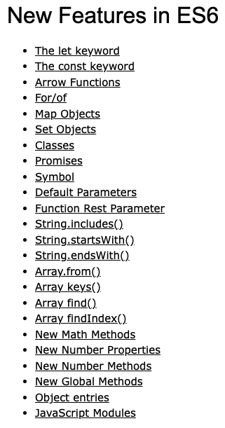

*JavaScript*

## ES6(ECMAScript 2015)

ES = ECMAScript로 ECMA라는 국제기구에서 만든 자바스크립트 표준 문서이다.

2015년에 나온 6번째 버전으로, ECMAScript 2015는 ES6, 또는 ECMAScript 6로도 알려져있다.

JS & NodeJS 등장과 관련하여 포스팅한 게시물에서도 확인할 수 있지만, 자바스크립트가 등장하고 다양한 웹 브라우저에서 사용하면서 공통으로 잘 작동하게 하기위한 표준 규격이 필요해졌고, ECMA 국제기구에서 스크립트 표준을 만들게 된다.

지금까지 여러 버전이 나왔지만, ES6에서 이전의 많은 문제들을 해결하는 기능들이 추가되었다. 추가된 기능들로 가독성 및 유지보수성이 많이 향상되어 많은 사람들이 개발 환경을 ES6에 맞춰 개발을 하게 되었고, 이로 인해 ES6의 기능에 주목하게 된 것이다.

ES6에서 나온 새로운 표준 및 기능은 아래와 같다.

*ES6에서 추가된 기능들*

게시물에 위의 기능들을 다 설명할 수도 있지만, 별도의 게시물로 기능들을 정리하도록 하겠다.

-   [Template Literals & Destructuring](/posts/javascript-template-literals-destructuring/)
-   [Hoisting](/posts/javascript-hoisting/)
-   [Scope](/posts/javascript-scope/)
-   [var, let, const](/posts/javascript-var-let-const/)
