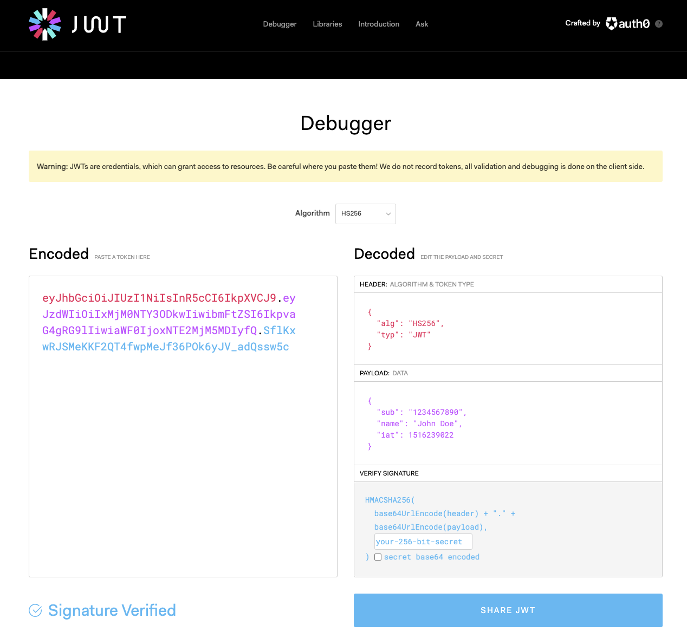

*JWT(JSON Web Token)*

## JWT의 등장

우리가 브라우저를 사용하여 특정 사이트에 로그인할 때, 그 정보를 서버에 전달할 때, 우리는 매번 그 정보를 입력하지 않고 쿠키라는 정보에 저장하고 이를 서버에 전송하는 방식으로 사용했었다.

다시 말해, 우리가 로그인을 했을 때 Set-Cookie의 형태로 저장된 쿠키를 로그인이 필요한 요청을 할 때마다 던져 요청을 하도록 동작했었다.

하지만 요즘은 쿠키 자체만으로는 로그인 인증에서 사용하지 않는다. 쿠키가 노출되었을 때 민감 정보인 로그인 정보가 노출되기 때문에 보안에 좋지 않기 때문이다. 또한 조작을 할 수도 있고, 사이즈가 제한되어 있어 충분한 데이터를 담지 못할 수 있기 때문이다. 서버 측면에서는 매번 들어오는 쿠키를 검증해서 사용해야 하기 때문에 불편한 면도 있었다.

위와 같이 민감정보가 노출되는 것을 막기 위해 나온 개념이 Session이다.

매번 ID, PW를 주고받지 말고 인증 정보 자체를 서버의 특정 세션 저장소에 저장하여, 이 값을 쿠키에 담아 클라이언트에 보내주고, 클라이언트가 요청을 할 때마다 세션 저장소에 있는 동일한 값을 보내주는지 체크하는 것이 핵심 개념이다.

하지만 이 방법도, stateful 하다는 단점이 있다.

즉, 서버의 세션 저장소라는 상태를 저장하는 곳이 있어, 서버의 상태를 저장해야 하기 때문에 해당 서버를 늘리고 싶을 때, 이전 서버에 있던 세션 정보를 또 저장해야 하는 번거로움이 존재한다.

세션저장소를 위해 서버에 별도의 공간을 사용해야 하기때문에 별도의 비용이 든다는 점, 사용자가 늘어날 경우 메모리를 많이 차지한다는 점과, stateful 하다는 단점으로 인해 또 다른 개념이 등장하게 되는데 이게 JWT이다.

## JWT(JSON Web Token)

JWT는 기존의 쿠키와 같이 인증에 필요한 정보들을 담아 사용하는 점에서는 비슷하지만, 인터넷 표준 방식으로 인증 정보들을 담아 암호화시켜 사용한다는 점에서는 차이점이 있다.

인증이 필요한 기능을 서버에 요청할 때, ID나 PW 같은 민감 정보 대신에, JWT 토큰을 전달하는 것이다.

서명되어 안전한 토큰이기 때문에, 서버에서만 변조되지 않은 올바른 정보라는 것을 확인할 수 있고 인증할 수 있다. 또한 세션을 사용하지 않기 때문에 stateless하다는 장점이 있다.

JWT는 .으로 문자열이 3가지로 구분된다.

-   Header

Header에는 토큰 타입과 해싱 알고리즘 2가지 정보가 저장된다.

-   Payload

Payload에는 토큰에 담을 정보가 들어가고, name/value 한 쌍으로 이루어진 Claim이라는 정보들로 이루어진다. 토큰에 대한 정보를 담기 위한 Registered, 그 외에 Public, Private 정보가 있다.

-   Signature

Header의 인코딩 값과 Payload의 인코딩 값이 합쳐진 값에 비밀키로 해싱하여 생성한다. 가장 중요한 부분으로, 서버가 가지고 있는 개인키를 이용해 암호화하기 때문에 해당 서버에서만 복호화가 가능하다.

payload에 담긴 식별자가 변조된 JWT로 요청을 하더라도, 서버가 발급했던 Signature의 payload와 다르기 때문에 인증이 안된다.

[jwt.io](http://jwt.io/) 사이트에서 JWT를 넣어 들어있는 값들을 확인해볼 수 있다. 하지만, signature 부분은 특정 키로 암호화되기 때문에, header와 payload가 변조되었는지는 키를 가진 서버만이 확인할 수 있다는 장점이 있다.
