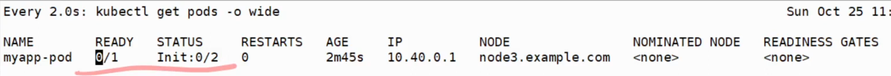
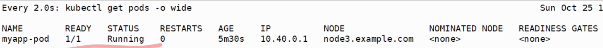

## 3. init container를 적용한 Pod

### init container
- 앱 컨테이너 실행 전에 미리 동작시킬 컨테이너
- 본 Container가 실행되기 전에 사전 작업이 필요한 경우 사용
- 초기화 컨테이너가 모두 실행된 후에 앱 컨테이너를 실행

### init-container-exam.yaml
```yaml
apiVersion: v1
kind: Pod
metadat:
  name: myapp-pod
  labels:
    app: myapp
spec:
  containers:
  - name: myapp-container
    image: busybox:1.28
    command: ['sh', '-c', 'echo The app is running! && sleep 3600']
  initContainers:
  - name: init-myservice
    image: busybox:1.28
    command: ['sh' '-c', "until nslookup myservice.$(cat /var/run/secrets/kubernetes.io/serviceaccount/namespace).svc.cluster.local; do echo waiting for myservice; sleep 2; done"]
  - name: init-mydb
    image: busybox:1.28
    command: ['sh', '-c', "until nslookup mydb.$(cat /var/run/secrets/kubernetes.io/serviceaccount/namespace).svc.cluster.local; do echo waiting for myservice; sleep 2; done"]
```

- 위와 같은 yaml로 Pod를 실행시키면 STATUS가 init-container 0/2로 나오고 진행되지 않는다.


### init-container-exam-svc.yaml (myservice, mydb)
```yaml
apiVersion: v1
kind: Service
metadata:
  name: myservice
spec:
  ports:
  - protocol: TCP
    port: 80
    targetPort: 9376
```

```yaml
apiVersion: v1
kind: Service
metadata:
  name: mydb
spec:
  ports:
  - protocol: TCP
    port: 80
    targetPort: 9377
```

- 위와 같이 init-container가 실행완료될 수 있는 조건인 Service 2개를 생성하면 Pod의 상태가 Running으로 바뀐다.


## 4. infra container(pause) 이해하기

### infra container
- 사용자에게는 보이지 않지만, 실제로는 Pod 내에 pause라는 컨테이너가 같이 생성된다.
- Pod에 대한 host, IP를 관리하는 환경을 만들어주는 컨테이너

### 테스트
- `$ kubectl run webserver --image=nginx:1.14 --port=80`로 Pod 및 컨테이너 실행
- 그 다음, 실제 Pod가 실행중인 노드로 접속하여 `docker ps`(k8s 1.24 이전 버전) 혹은 `crictl ps`(k8s 1.24 이후 버전) 명령어를 통해 현재 동작중이니 컨테이너 확인
- 확인하면, 실행한 컨테이너와 동시에 생성된 pause라는 컨테이너도 생성된 것을 확인할 수 있다.
- 컨테이너 삭제 시 pause 컨테이너도 같이 삭제된다.