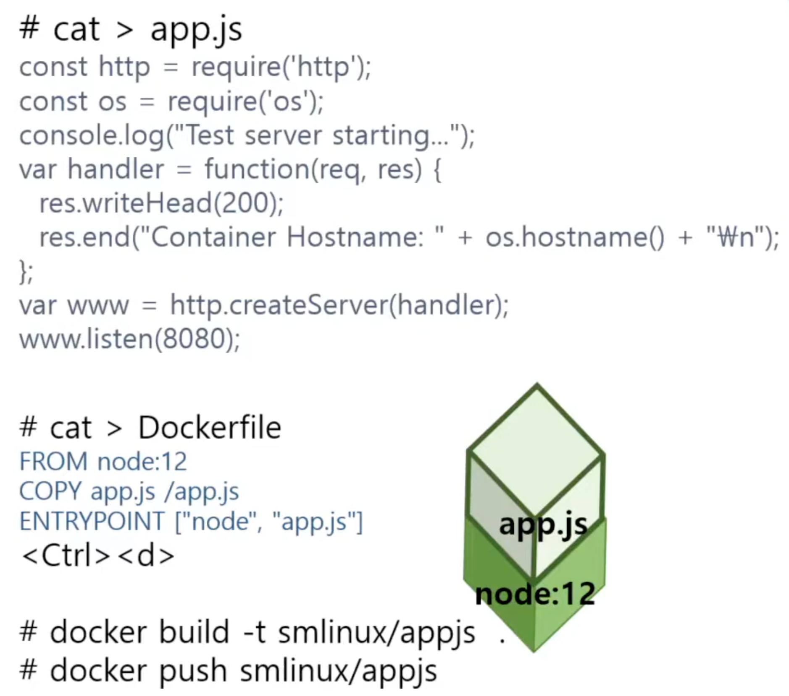
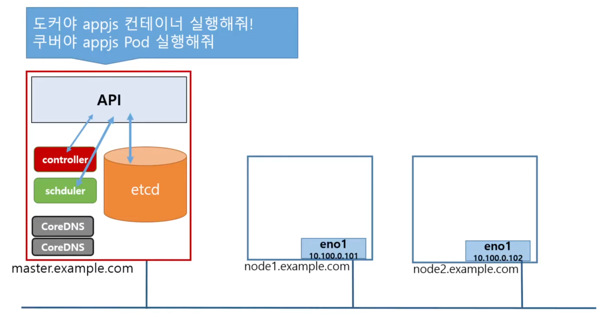
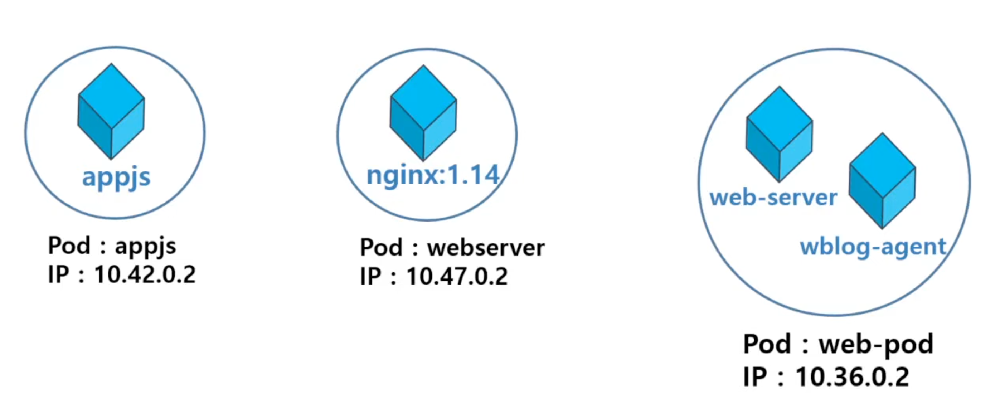

## 개요
- Pod 개념 및 사용하기
- livenessProbe를 사용한 self-healing Pod
- init container
- infra container(pause) 이해하기
- static pod 만들기
- Pod에 resource 할당하기
- 환경변수를 이용해 컨테이너에 데이터 전달하기
- pod 구성 패턴의 종류

## 1. Pod 개념 및 사용하기
### Container 정리
- 코드 작성 및 도커 빌드

  
- 컨테이너 하나 = 애플리케이션 하나

### Pod란?
- 컨테이너를 표현하는 k8s API의 최소 단위
- 쿠버네티스에서는 master node에 Pod를 실행하라고 요청

  
- API를 통해서 컨테이너 동작은 불가함
- 대신, Pod API를 통해 컨테이너를 실행함
- Pod에는 하나 또는 여러 개의 컨테이너가 포함될 수 있음

  

### Pod 생성하기
- kubectl run 명령(CLI)으로 생성
	`$ kubectl run webserver --image=nginx:1.14 --port=80`
- pod yaml을 이용해 생성
	```yaml
	# pod-nginx.yaml
	apiVersion: v1
	kind: Pod
	metadata:
	  name: webserver
	spec:
	  containers:
	  - name: nginx-container
	    image: nginx:1.14
	    imagePullPolicy: Always
	    ports:
	    - containerPort: 80
	      protocol: TCP
	```
	- Pod 실행
		- `$ kubectl create -f pod-nginx.yaml`
	- 현재 동작중인 Pod 확인
		- `$ kubectl get pods -o wide`: 좀 더 많은 정보 출력
		- `$ kubectl get pods -o yaml`: yaml 형태로 출력
		- `$ kubectl get pods -o json`: json 형태로 출력
		- `$ watch kubectl get pods -o wide`: 2초마다 반복해서 출력
	- Pod에 접속해서 결과보기
		- `$ curl <pod's IP address>`

### multi-container Pod 생성하기
- yaml 파일 작성
	```yaml
	# pod-multi.yaml
    apiVersion: v1
    kind: Pod
    metadata:
	  name: multipod
    spec:
	  containers:
	  - name: nginx-container
	    image: nginx:1.14
	    ports:
	    - containerPort: 80
	  - name: centos-container
	    image: centos:7
	    command:
	    - sleep
	    - "10000"
	```
- `$ kubectl create -f pod-multi.yaml`
- `$ kubectl get pods`
- `$ kubectl get pods -o wide`
- `$ kubectl exec multipod -it -c centos-container -- /bin/bash`
- `$ kubectl logs multipod -c nginx-container`
- **multi-container pod에서 container들의 pod 명과 ip는 동일!**
- `$ kubectl logs multipod -c nginx-container`