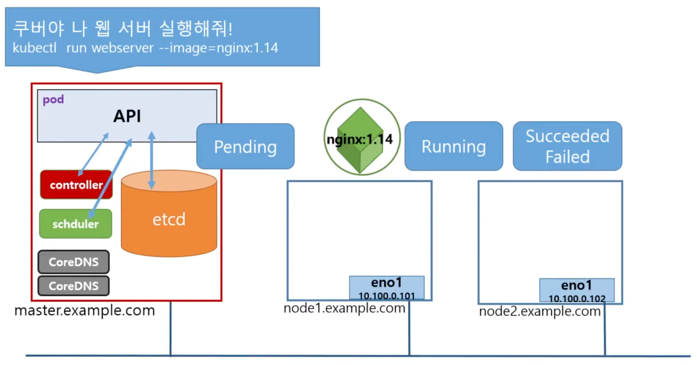

## Pod 동작 flow
- 명령어로 pod를 실행하면
	(1) Pod API가 포맷에 맞는 문법인지 체크
	(2) Scheduler는 Pod를 어느 노드에서 실행할지 선택(선택되기까지의 과정이 Pending 상태)
	(3) 노드가 선택되고 실행되거나 실패
	
	(4) Pending -> ContainerCreating -> Running -> Terminating

## Pod 관리하기
- 동작중인 Pod 정보 보기
	- `$ kubectl get pods`
	- `$ kubectl get pods -o wide`
	- `$ kubectl describe pod webserver`
- 동작중인 Pod 수정(Editor로 수정)
	- `$ kubectl edit pod webserver`
- 동작중인 Pod 삭제
	- `$ kubectl delete pod webserver`
	- `$ kubectl delete pod --all`

## Question & Answer
1. 현재 namespace에서 동작중인 Pod는 몇 개인가?
	- `$ kubectl get pods`
2. 현재 시스템에서 동작중인 Pod 수는?
	- `$ kubectl get pods --all-namespaces`
3. 컨테이너 nginx를 실행하는 nginx-pod라는 이름의 Pod를 생성하시오.
	- `$ kubectl run nginx-pod --image=nginx`
4. 앞에서 생성한 Pod의 image 정보를 확인하는 명령은 무엇인가?
	- `$ kubectl describe pod nginx-pod`
5. 앞에서 생성한 nginx-pod는 어느 node에 배치되었나?
	- get, describe 명령어로 확인
6. 앞에서 생성한 Pod에는 몇 개의 컨테이너가 포함되어 있나?
	- get, describe 명령어로 확인
7. 앞에서 생성한 Pod의 현재 상태는 어떠한가?
	- get, describe 명령어로 확인
8. 새 Pod의 컨테이너 상태는 어떤가?
	- describe 명령어로 확인
9. `kubectl get pods` 명령의 출력에서 READY 열은 무엇을 의미하나?
	- 현재 컨테이너 / 전체 컨테이너
10. 생성한 Pod를 삭제하시오.
	- `$ kubectl delete pod nginx-pod`
11. 컨테이너 image `redis123`을 실행하는 pod `redis`를 redis.yaml을 이용해 생성하시오.
	- `$ kubectl run redis --image=redis123 --dry-run -o yaml > redis.yaml`
	- 
	  ```yaml
	  apiVersion: v1
	  kind: Pod
	  metadata:
	    name: redis
	  spec:
	    containers:
	    - image: redis123
	      name: redis
	  ```
	- `$ kubectl create -f redis.yaml`
	- 실행하면 Status가 ErrImagePull 상태가 됨
12. 앞서 만든 redis pod의 image를 redis로 수정하여 동작시키시오.
	- `$ kubectl edit pod redis`
	  ```yaml
	  apiVersion: v1
	  kind: Pod
	  metadata:
	    name: redis
	  spec:
	    containers:
	    - image: redis
	      name: redis
	  ```
    - 변경 내용이 바로 적용되어 Pod에 반영됨