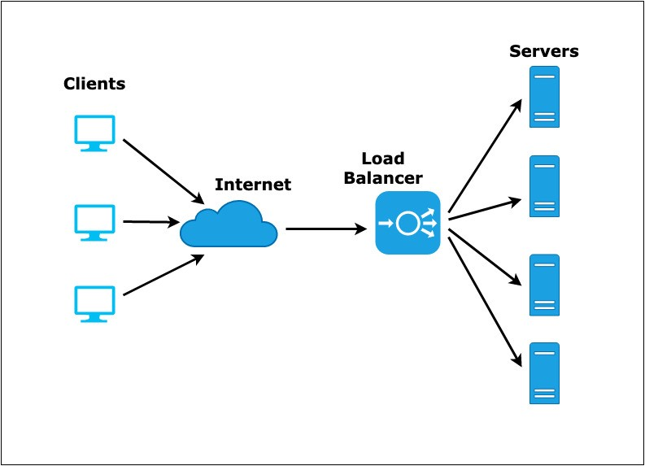
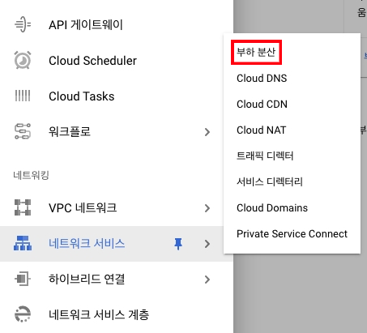
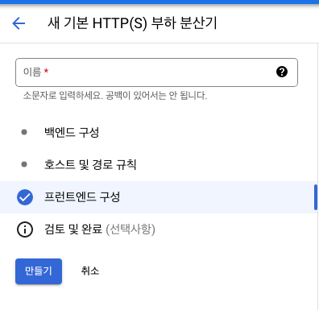
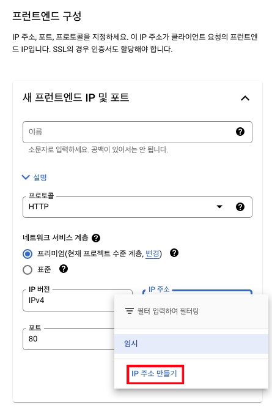
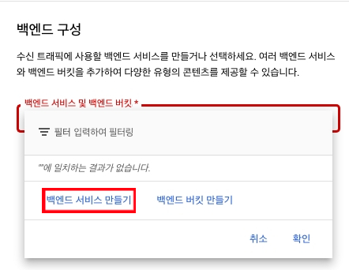
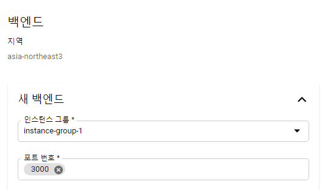

*Load Balancing*

## Load Balancer

로드 밸런서, 부하 분산기라고도 한다.

부하 분산기는 애플리케이션의 여러 인스턴스에 사용자 트래픽을 분산하는 역할을 한다. 만약 서버의 한 인스턴스에 트래픽이 모두 몰릴 경우, CPU, 메모리 사용량 등이 올라가 애플리케이션 성능에 문제가 발생할 수 있기 때문에 부하 분산을 시켜 성능 관리에 도움을 주는 것이다.

공부를 진행하면서 구축한 서버 및 DB를 GCP에 올리고, 추가로 GCP에서 제공하는 Cloud Load Balancing을 통해 부하 분산기를 생성하여 트래픽이 분산되도록 설정할 수 있다. GCP 뿐만 아니라, AWS나 다른 서비스 제공자가 있으니 살펴보기 바란다.

또한 Google Cloud Load Balancing을 이용하면 로드 밸런서에 인증서를 설치하여 HTTPS 접속이 가능하게 설정할 수도 있다. 개인적으로 인증서를 구해 설정할 수도 있지만, 로드 밸런서 생성 시 Google이 제공하는 인증서를 발급받아 설정해줄 수 있다.

## Google Cloud Load Balancing

간단하게 GCP에서 부하 분산기를 만드는 예제를 진행해보고자 한다.

부하 분산기 생성할 때 나오는 백엔드는 부하 분산기가 내보내주는 곳이고, 프론트엔드는 외부 트래픽을 받는 곳이다.

프로토콜(HTTP, HTTPS)을 선택하고 IP 주소를 생성하여 부하 분산기의 IP 주소를 설정하도록 한다. DNS에서 도메인명을 받아서 연결해줄 IP 주소로 백엔드가 아닌 부하 분산기를 설정하려는 것이다.

백엔드 서비스는 내가 만들었던 백엔드 서버로 연결해줄 것이다.

하지만 그냥 연결은 되지 않고, 백엔드 서버가 특정 인스턴스 그룹에 들어가 있어야 한다. 그 이유는 부하를 “분산"하는 것이기 때문에 연결된 백엔드 인스턴스 그룹 중에서 어느 인스턴스에 트래픽을 전달할지 결정하는 것이기 때문이다.

백엔드 서버를 3000번으로 띄웠기 때문에 3000번 포트로 백엔드 연결하도록 설정해준다.

로드 밸런서를 만들고 나서, http(s)://로드 밸런서 IP/graphql 로 접속하면 띄웠던 백엔드 서버(3000번 포트)로 자동 연결이 된다.

도메인 주소로 연결하고 싶다면, DNS 설정에서 IP 주소를 백엔드 서버가 아닌 위에서 만든 로드 밸런서의 주소로 설정하면 된다.

\[출처\]

https://cloud.google.com/load-balancing/docs/load-balancing-overview?hl=ko
