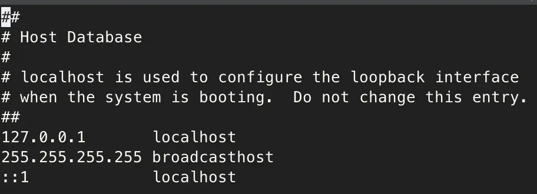

## localhost

#### DNS 호스트명

-   /etc/hosts (Linux/macOS) 또는 C:\\Windows\\System32\\drivers\\etc\\hosts (Windows)에 정의된 이름
-   기본적으로 127.0.0.1과 ::1 둘 다 가리킴

#### 특징

-   DNS 조회 필요(매우 빠르지만 한 단계 거침)
-   OS 설정에 따라 IPv4/IPv6 중 어느 쪽으로 해석될지 결정됨
-   응용 프로그램이 dual-stack으로 구현되었으면 둘 다 시도할 수 있음

---

## 127.0.0.1

#### IPv4 loopback 주소

-   IPv4 루프백 네트워크 전체: 127.0.0.0/8 (127.0.0.1 ~ 127.255.255.254)
-   관례적으로 127.0.0.1 사용
-   네트워크 인터페이스 없이 커널 내부에서 처리

#### 특징

-   DNS 조회 없음, 직접 IPv4 주소
-   무조건 IPv4 소켓 사용
-   네트워크 카드 거치지 않음(가상 인터페이스)

---

## ::1

#### IPv6 loopback 주소

-   IPv6에서 유일한 루프백 주소(범위 없음, 딱 하나)
-   0000:0000:0000:0000:0000:0000:0000:0001의 축약형

#### 특징

-   DNS 조회 없음, 직접 IPv6 주소
-   무조건 IPv6 소켓 사용
-   IPv4와 완전히 별개 네트워크 스택

---

## 문제되는 케이스

#### localhost로는 접근 안되는데 127.0.0.1로는 접근 되는 경우

-   /etc/hosts에서 localhost가 잘못 설정됨
-   IPv6가 활성화되어 ::1로 해석되는데 서버는 IPv4만 바인딩

#### 127.0.0.1로는 안되는데 localhost로는 되는 경우

-   서버가 ::1에만 바인딩
-   localhost가 IPv6로 해석됨
