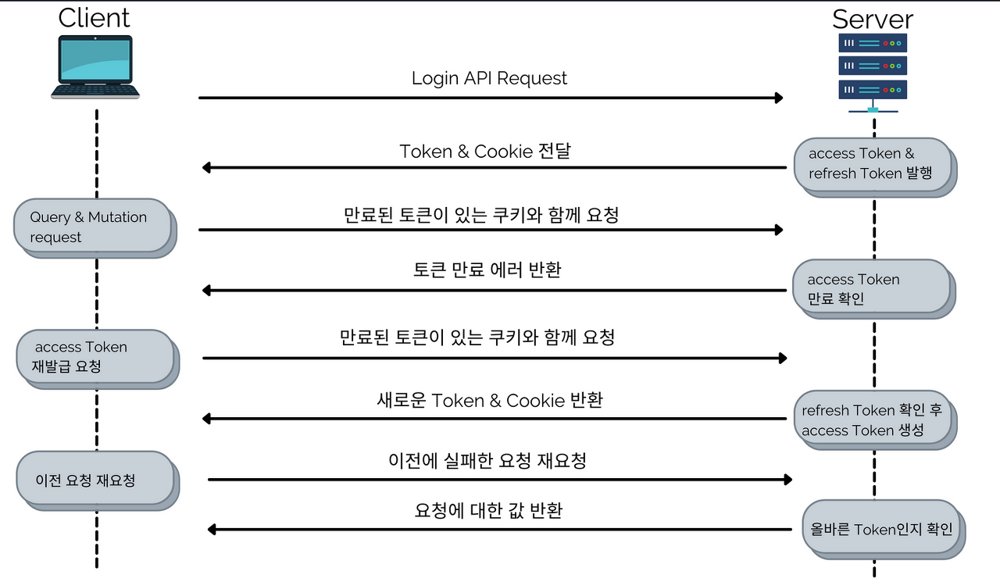

*Login Process*

## Access Token & Refresh Token

앞서 JWT에 대한 개념을 확인했었다.

클라이언트가 웹브라우저에서 로그인 요청을 서버에 하게 되면, 서버는 올바른 로그인 정보인지 확인을 하고, JWT 토큰을 발급해 클라이언트에 반환해주게 된다(Access Token). 이는 클라이언트가 서버에 인증이 필요한 요청을 할 때 넘겨주어야 하는 값으로 Access Token이라 한다. 그런데, 서버는 이에 추가로 한 토큰을 더 반환해주게 된다. 이는 Refresh Token이라 한다.

Refresh Token은 왜 추가로 클라이언트에 보내줄까?

JWT를 이용한 토큰이라도, 해킹을 당했을 때 완전히 안전하다고 할 수 없다. 그러면 JWT의 유효시간을 짧게 가져가 취약점을 보완할 수 있을까? 하지만 자주 토큰을 발급받아야 해서 로그인을 자주 해야 한다는 단점이 있다.

Refresh Token은 처음 로그인을 했을 때 동시에 발급되지만, 더 긴 유효시간을 가지면서 Access Token이 만료되었을 때 새로 발급하게 해주는 토큰이 된다. 즉, Access Token의 유효시간은 짧게 가져갈 수 있으면서, 로그인을 하지 않고도 Refresh Token을 이용해 새로운 Access Token을 발급받아 인증을 할 수 있는 방식인 것이다.

그렇다고 해서 Refresh Token의 유효기간을 무작정 길게 설정하면 마찬가지로 해킹의 위험이 있어 적당한 기간 설정이 필요하다.

*Login Process*

위 그림은 Access Token과 Refresh Token을 이용한 로그인 과정과 인증 과정을 나타낸 것이다.

실제로 코드 단에서 Token을 이용해 서버에서 검증하는 방식은 아래와 같이 간단하게 정리할 수 있다.

-   인증이 필요한 userResolver의 API 실행 요청
-   UseGuards가 막음
-   Rest API이면 상관없지만, GraphQL이므로 gql-auth.guard를 새로 만듬
-   context를 GraphQL용으로 바꿔주고, guard 이름을 설정함
-   jwt-access.strategy에서 guard 이름이 같으면 실행되어 전달받은 token을 검증함.
-   검증완료되면 복호화한 데이터가 validate로 떨어짐
-   validate에서 return하는 값은 context에 들어감(context.req.user를 만들어 넣어줌)
-   이후에 API 실행됨(이때 데코레이터를 만들어 context의 값을 뽑아서 사용할 수 있음)
-   검증이 되지 않으면 API 실행되지 않음
-   만료된 Access Token인 경우 만료되었다고 반환
-   클라이언트에서 Refresh Token을 전송해 서버에서 새로운 Access Token 반환
