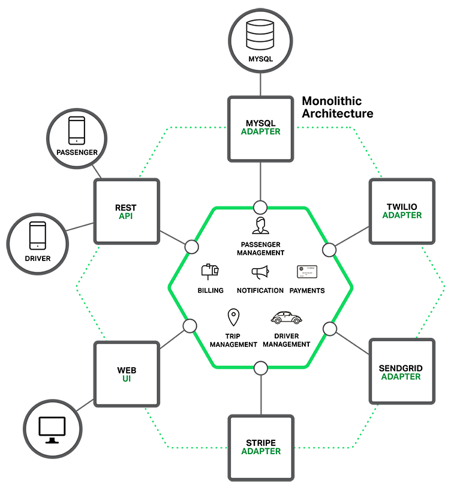
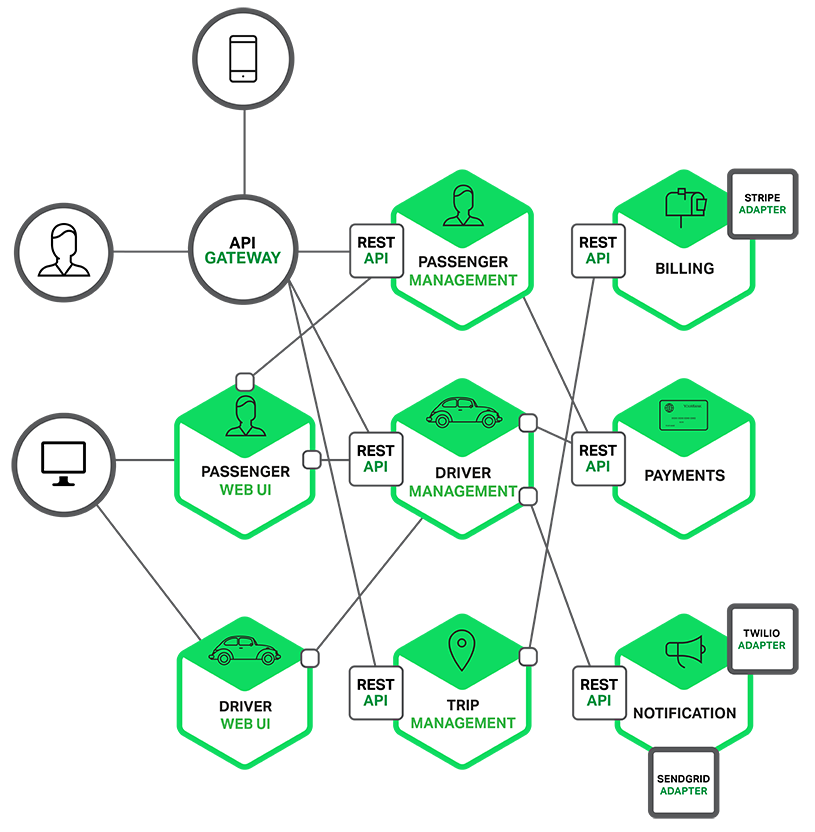
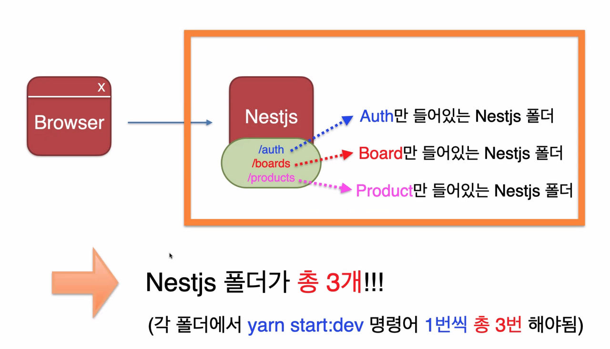
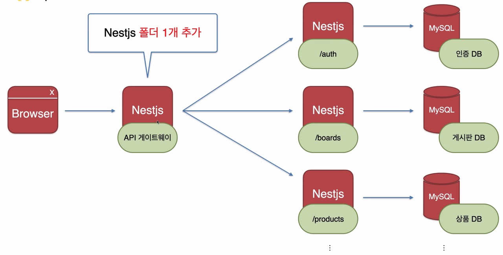
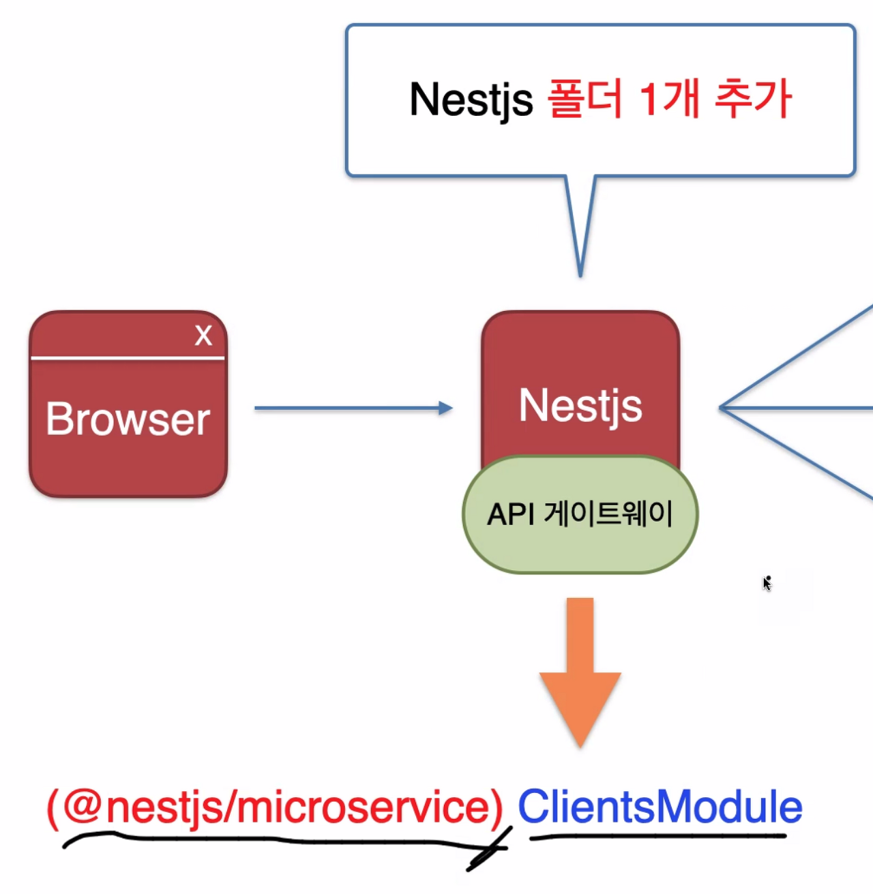

*Microservice*

## Microservice

개인적으로 공부를 하면서, 개인 프로젝트를 진행하면서 개발한 로그인, 파일 업로드, 게시판 등록, 상품 등록삭제 등의 기능들을 한 소스 폴더에 묶어서 배포했었다.

위 폴더와 같이 로그인, 게시판, 댓글, 파일 등등 한 src 폴더에 담아 한번에 배포했었는데, 이를 모놀리식 아키텍처(Monolithic Architecture)라고 한다.

*Monolithic Architecture*

하지만, 프로젝트가 커지고 많은 개발자들이 함께 개발하는 경우 여러 모듈들이 긴밀하게 연결되어 어떤 한 부분에 문제가 생겨도 다른 부분에 영향을 끼치게 된다. 프로젝트가 커질수록 하나로 묶는 것이 힘들어지는 것이다. 그래서 각 서비스들을 나누어 관리하게 된 것이 마이크로서비스 아키텍처(Microservice Architecture)이다.

*Microservice Architecture*

## Microservice 추가 설명

-   기존 Monolithic Service에서는 모든 API가 같이 빌드, 실행되어 한 API에 문제가 있을 경우 다른 API도 모두 중단됨
-   프로젝트 규모가 커져 API 기능이 많아질 경우, 빌드하는 시간이 늘어남

-   Micro Service에서는 각 API마다 별도로 빌드해주는게 가능해 필요한 기능만 빠른 시간에 빌드가 가능함
-   또한 한 서비스에 문제가 있을 경우 전부 중단되는 것이 아니라, 해당 서비스만 중단됨

-   Micro Service를 이용하기 위해서는 모듈 설치가 필요함
-   단점으로는 전체적인 기술 복잡도가 증가함(작은 서비스보다 큰 서비스에서 많이 사용함)
