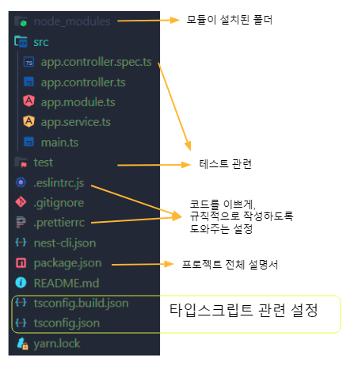

*NestJS*

## NestJS

NestJS의 폴더구조를 살펴보기에 앞서, NestJS가 무엇인지, 그리고 사용하는 이유에 대해 먼저 살펴보고자 한다.

### NestJS란?

NestJS는 TypeScript를 지원하는 효율적이고 확장 가능한 Node.js의 서버 애플리케이션 프레임워크이며, OOP(Object Oriented Programming), FP(Functional Programming), FRP(Functional Reactive Programming) 요소를 결합하는 특징을 가지고 있다.

### NestJS를 사용하는 이유?

JavaScript는 프론트엔드, 백엔드 모두에서 많이 쓰이는 언어가 되었다. 하지만 많은 JavaScript 모듈, 라이브러리가 존재함에도 불구하고 Architecture의 주요 문제를 해결하지 못했다.

JavaScript는 제약이 없고 너무 자유롭기 때문에 규칙이 없고, 어떤 패턴을 따라 프로그램을 작성해야 할지 사용자가 정해서 사용해야 했다. 자유성은 좋은 점도 있지만, 다른 사람과 협업을 할 때, 각자의 패턴을 가지고 개발한다면 협업 과정에서 드는 소통비용이 증가하게 되어 진행이 매우 어려워진다. 이는 생산성 저하로 이어지고, 유지보수 또한 어려워진다.

위와 같은 문제 때문에 규칙이나 제약을 제시하는 프레임워크가 필요한데, Java에는 Spring, 그리고 파이썬에는 Django와 같은 프레임워크가 있다. NestJS는 규칙, 제약, 모듈 등 다양한 기능을 제공하는 Node.js 용 프레임워크이다.

기존의 JavaScript는 변수나 함수의 타입을 지정하지 않아 실제로 사용하기 전에는 어떤 타입의 데이터가 처리될 지 몰라 예기치 못한 오류가 발생하는 경우가 많다. NestJS는 TypeScript를 도입하여 타입을 지정하여 사전에 발생 가능한 오류들을 방지해줄 수 있다.

## NestJS 폴더 구조

Nest를 설치 후 nest 명령어를 통해 새로운 nest 프로젝트를 생성하면, 아래와 같은 파일 구조를 확인할 수 있다.

아래와 같이 초기 폴더 구조를 **‘보일러 플레이트’**라고 한다.

*보일러 플레이트*

src - 소스 파일이 들어있는 폴더

app.controller.spec.ts - app 컨트롤러에 대한 단위 테스트 파일

app.controller.ts - appication 기본 컨트롤러

app.module.ts - application의 root module

app.service.ts - application 기본 서비스

main.ts - Nest 애플리케이션 생성

test - 테스트 파일이 담긴 폴더

.eslintrc.js - 코딩문법 규칙, 코드 오류를 찾기위한 규칙 설정 파일

.gitignore - github에 업로드하지 않을 파일,폴더 설정

.prettierrc - 코딩 포맷 설정 파일

nest-cli.json - Nest 설정 파일

package.json - 프로젝트 설정 및 패키지 의존성 관리

README.md - 프로젝트 설명 파일

tsconfig.build.json - TypeScript 설정파일

tsconfig.json - TypeScript 설정파일

yarn.lock - 버전 잠금 파일

\[출처\]

[https://loy124.tistory.com/386](https://loy124.tistory.com/386)

[https://docs.nestjs.com/first-steps](https://docs.nestjs.com/first-steps)
