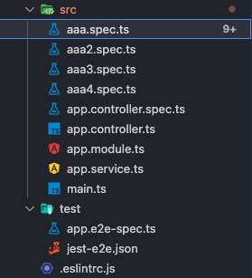
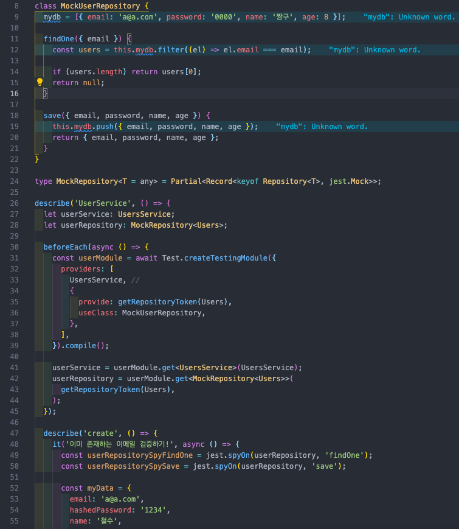

*Jest*

## 테스트의 종류

-   **단위 테스트**

응용 프로그램에서 테스트 가능한 가장 작은 소프트웨어를 실행하여 정상적으로 동작하는지 확인하는 테스트

-   **통합 테스트**

여러 모듈들을 모아 의도대로 작동하는지 확인하는 테스트. 모듈 간의 호환성을 확인하기 위해 수행

-   **E2E 테스트(End-To-End)**

Endpoint 간 테스트로 사용자의 입장에서 하는 테스트. 보통 Web 브라우저에서 UI를 통해 시나리오를 가지고 기능을 테스트

프로젝트를 진행하면서, 자신이 혹은 여러 사람이 만든 프로그램이 제대로 작동하는지 확인하는 것은 필수적인 작업이다. 모듈을 하나 만들고 테스트하고, 하나 만들고 테스트하고..

하지만, 프로그램이 점점 커질수록 수정사항도 많고, 새로운 기능을 추가하면 문제가 없던 기능들에 영향을 미쳐 또다른 오류가 발생하기도 한다. 그렇다고 해서 새로운 기능을 추가할 때마다 매번 기존의 기능과 연계해 직접 테스트하기도 어려운 일이다.

NestJS에서는 기본 테스트 프레임워크로 Jest를 제공하기에 이 Jest를 이용하여 단위 테스트, 통합 테스트에 이어 E2E 테스트도 가능하다. 테스트 코드를 작성해 새로운 기능을 추가하고 기존 기능에 문제가 없는지, 서로 영향을 미치지 않는지 수월하게 테스트할 수 있게 해주는 Jest에 대해 간단하게 알아보고자 한다.

## Jest

Jest는 테스트 코드를 작성해서 테스트할 수 있도록 도와주는 테스팅 프레임워크이다.

사용하고 있는 NestJS 프로젝트에는 기본적으로 설치되어 있고, 관련 명령어도 설정되어 있다.



NestJS 프로젝트를 생성하면 test 폴더가 있는데, 안에 있는 파일들은 Jest에서 사용하는 파일들이다.

src 디렉토리 내에 .spec.ts 파일들을 생성했는데, 해당 파일들이 테스팅 파일이다.

```javascript
// aaa.spec.ts
// 1. 한개 테스트하기
it('더하기 테스트', () => {
  const a = 1;
  const b = 2;

  expect(a + b).toBe(3);
});

// 2. 여러개 묶음으로 테스트하기
describe('나의 테스트 그룹', () => {
  it('더하기 테스트', () => {
    const a = 1;
    const b = 2;

    expect(a + b).toBe(3);
  });

  it('곱하기 테스트', () => {
    const a = 1;
    const b = 2;

    expect(a * b).toBe(2);
  });
});

// 3. 상품 구매하기 테스트 예제
describe('상품구매 테스트', () => {
  beforeEach(() => {
    // 로그인 로직 작성!!
  });

  it('돈검증하기', () => {
    const result = true; // 돈이 충분하다고 가정
    expect(result).toBe(true);
  });

  it('상품 구매하기', () => {
    const result = true;
    expect(result).toBe(true);
  });
});
```

위 코드는 예시로 작성한 테스트 파일이다. 몇가지 사용되는 메소드가 있는데, 용도가 명확하고 사용하기 쉽다.

### 몇 가지 메소드

-   **describe**

테스트 항목을 묶는 용도로 사용되는 메소드이다. 그룹핑한 메소드 안에 또 describe를 통해 다른 테스트 그룹을 생성할 수 있다. 예를 들어 한 기능의 테스트 안에 여러 함수가 포함되어 있을 때 각 함수에 대한 테스팅을 거쳐 묶인 기능의 최종 테스트 결과를 확인할 수 있다.

-   **beforeEach**

각 테스트를 수행하기 전에 실행되어야 하는 메소드이다. 위 코드를 예로 들면, 돈 체크와 상품을 구매하기 전에 로그인이 이뤄져야 하므로, 로그인 로직을 beforeEach에 작성하게 된다.

-   **it**

테스트를 실행하는 메소드이다. expect(result).toBe(true)와 같이 result가 true인지 체크할 수 있다.

### Mocking

Jest에서 Mock은 해당 코드의 의존 부분을 가짜(mock)로 대체하는 기능이다. 예를 들어, DB에서 데이터를 조회, 삽입하는 기능을 테스트하려고 할 때, 실제 DB에 데이터를 넣는 방식은 좋지 않고 사용하지도 않는다.



위 코드는 예시로 작성한 코드인데, 원래는 Users Repository에 접근하여 데이터 조회 및 삽입을 해야 하지만, MockUserRepository를 생성하여 의존성 주입을 해주고, DB를 사용하는 것처럼 테스트할 수 있게 코드를 작성한 것이다.

단위 테스트 뿐만 아니라 E2E 테스트도 진행이 가능하지만, 아직 배우지 않은 부분으로 추후 작성하려고 한다.
