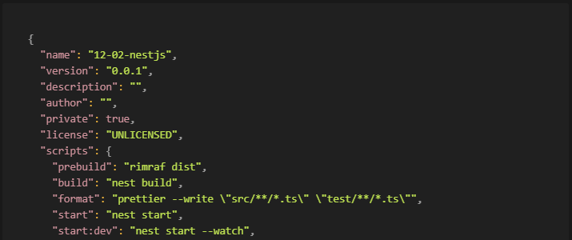

*Package.json*

## Package.json

프로젝트의 정보와 패키지 매니저(npm, yarn)로 설치한 모듈들의 의존성을 관리하는 파일이다.

여기서 의존성이란 한 모듈이 정상적으로 동작하기 위해 필요한 다른 모듈을 말한다. 예를 들어 A라는 모듈을 사용하려는데 이 모듈은 B, C라는 모듈을 설치해야 사용할 수 있는, 그런 것을 말한다.

그러면 그 package.json 파일을 직접 생성해야 할까?

패키지 매니저로 npm, yarn 등을 많이 사용하는데, 명령어를 통해 파일을 생성할 수 있다.

```shell
npm init

혹은

yarn init
```

위 명령어를 터미널에 입력하면 각종 설정정보를 입력(생략할 수도 있음)하여 package.json 파일을 생성할 수 있다.

지금 공부하고 있는 프로젝트는 NestJS로 진행하기 때문에, NestJS 프로젝트에서 생성한 package.json 파일을 예로 설명하고자 한다. nest 프로젝트를 생성하면 기본적으로 필요한 모듈이나 스크립트 등이 자동으로 기본 설정되어 있다.

```shell
{
  "name": "12-02-nestjs",
  "version": "0.0.1",
  "description": "",
  "author": "",
  "private": true,
  "license": "UNLICENSED",
  "scripts": {
    "prebuild": "rimraf dist",
    "build": "nest build",
    "format": "prettier --write \"src/**/*.ts\" \"test/**/*.ts\"",
    "start": "nest start",
    "start:dev": "nest start --watch",
    ...생략
  },
  "dependencies": {
    "@google-cloud/storage": "^5.19.2",
    "@nestjs/apollo": "^10.0.8",
    "@nestjs/common": "^8.0.0",
    ...생략
  },
  "devDependencies": {
    "@nestjs/cli": "^8.0.0",
    "@nestjs/schematics": "^8.0.0",
    "@nestjs/testing": "^8.0.0",
    ...생략
  },
  "jest": {
    "moduleFileExtensions": [
      "js",
      "json",
      "ts"
    ],
    "rootDir": "src",
    "testRegex": ".*\\.spec\\.ts$",
    "transform": {
      "^.+\\.(t|j)s$": "ts-jest"
    },
    "collectCoverageFrom": [
      "**/*.(t|j)s"
    ],
    "coverageDirectory": "../coverage",
    "testEnvironment": "node"
  }
}
```

내용이 너무 많아서 일부분 생략했다.

모든 항목을 다 설명하기는 내용이 너무 많아, 중요한 부분을 설명한다.

### name

패키지의 이름을 정의하는 부분이다. version 항목과 더불어 가장 중요한 부분이라고 공식문서에 나와있다. 나는 공부나 과제를 하면서 자동으로 생성되기도 하고, 디렉토리명과 같아서 별로 중요하게 생각하진 않았지만 생각해보니 다른 곳에서 패키지를 사용한다면 쉽게 알아볼 수 있게 작성해야 하는 부분인 것 같다.

### version

name과 더불어 가장 중요한 부분으로, name+version으로 유일한 식별자가 된다. 패키지 변경이 있다면 이 버전 항목도 업데이트가 되어야 한다.

### description

말 그대로 설명 부분이다. npm search 시 사람들이 찾을 수 있는 부분으로, 생략이 가능하다.

### author

작성자(개인)이다.

### private

true로 되어있다면 npm에 게시하지 않는다. 개인적으로 사용하는 패키지일 수도 있는데 게시되는 것을 방지하기 위함이다.

### license

사람들이 사용할 수 있는 허용범위를 지정하는 부분이다.

### scripts

실행할 수 있는 스크립트 명령어를 설정하는 부분이다.

위 파일을 예로 들어 명령어 ‘yarn start:dev’를 실행한다면 실제로 ‘nest start --watch’ 명령어가 실행된다.

### dependencies

가장 위의 설명에서 나온 부분으로, 실제 운영 환경에서 프로그램이 돌아가는데 필요한 패키지들의 버전들을 명시한 부분이다.

아래는 npm docs에 있는 예시로, 실제로 유효한 표기 방법이다.

```shell
{
  "dependencies": {
    "foo": "1.0.0 - 2.9999.9999",
    "bar": ">=1.0.2 <2.1.2",
    "baz": ">1.0.2 <=2.3.4",
    "boo": "2.0.1",
    "qux": "<1.0.0 || >=2.3.1 <2.4.5 || >=2.5.2 <3.0.0",
    "asd": "http://asdf.com/asdf.tar.gz",
    "til": "~1.2",
    "elf": "~1.2.3",
    "two": "2.x",
    "thr": "3.3.x",
    "lat": "latest",
    "dyl": "file:../dyl"
  }
}
```

### devDependencies

로컬 개발, 테스트 환경에서 필요한 패키지 버전들을 명시한 부분이다.

의존성 버전을 표기하는 부분에 부등호는 알것 같은데, 물결표시(~)와 눈웃음표시(^)는 뭘 의미하는 걸까?

~는 틸드로, 현재 지정한 버전의 마지막 자리 내의 범위에서만 자동으로 업데이트 하는 방식이다.

~0.0.1 → ≥ 0.0.1 \< 0.1.0

~0.1.1 → ≥ 0.1.1 \< 0.2.0

과 같이 작동한다.

^는 캐럿으로, 하위 호환성이 보장되는 버전만을 업데이트하여 사용하는 방식이다.

^1.0.2 → ≥ 1.0.2 \<2.0 (2버전으로 올라가면 호환성이 보장되지 않는 변경사항이 있을 수 있음)

\[출처\]

[https://docs.npmjs.com/cli/v7/configuring-npm/package-json](https://docs.npmjs.com/cli/v7/configuring-npm/package-json)

[https://velog.io/@skyepodium/package.json](https://velog.io/@skyepodium/package.json)

[https://blog.outsider.ne.kr/1041](https://blog.outsider.ne.kr/1041)

[https://outofbedlam.gitbooks.io/npm-handbook/content/config/package-json.html](https://outofbedlam.gitbooks.io/npm-handbook/content/config/package-json.html)

[https://phsun102.tistory.com/28](https://phsun102.tistory.com/28)
