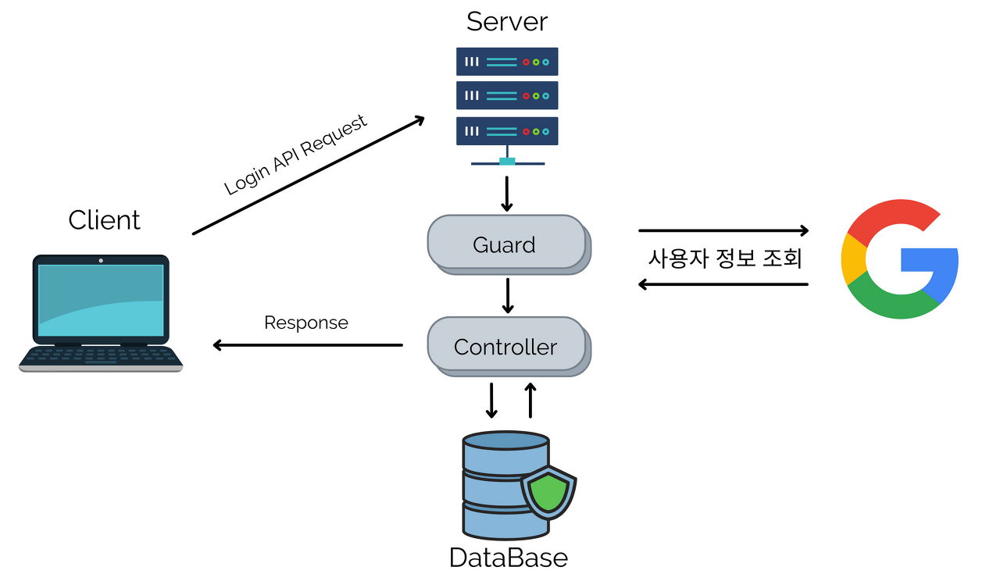

*Social Login*

## Social Login

소셜 로그인이란, 서버 자체에서 로그인 정보를 검증하고 클라이언트로 응답을 주는 것이 아니라, 소셜 서비스에서 인증하여 서버에서 인증 정보를 받아 클라이언트로 응답을 주는 것을 말한다.

소셜 로그인이 진행될 때 주체는 아래와 같다.

Client(Server) - Resource Owner(User) - Resource Server(Google)

-   Client(Server) - 우리가 개발하는 서버를 말한다.
-   Resource Owner(User) - 실제 사용 유저를 말한다. 구글에 로그인하는 유저 입장이다.
-   Resource Server(Google) - 소셜 로그인을 제공하는 구글 서버 등을 말한다.

Resource Owner(User)가 Client(Server)로 소셜 로그인 API를 요청한다.

Client(Server)는 Resource Server(Google)과 미리 설정한 OAuth라는 서비스를 이용한다.

API를 요청하면 Resource Server(Google)이 제공하는 로그인 페이지로 연결된다.

로그인에 성공하면, Client(Server)의 서비스 페이지로 Redirect된다.

즉, Google에 로그인을 하게 되면, OAuth를 거쳐 서버에 Access Token을 주게 되고, 최종 유저에게 소셜 로그인 페이지를 제공할 수 있다.

Social Login은 Google, Kakao, Naver 등 다양한 소셜 사이트에서 기능을 제공한다. 제공하는 기능을 웹사이트에 구현하려면, 각 사이트의 개발자로 가입하여 개발하려는 웹사이트의 주소를 등록하는 과정이 필요하다.
