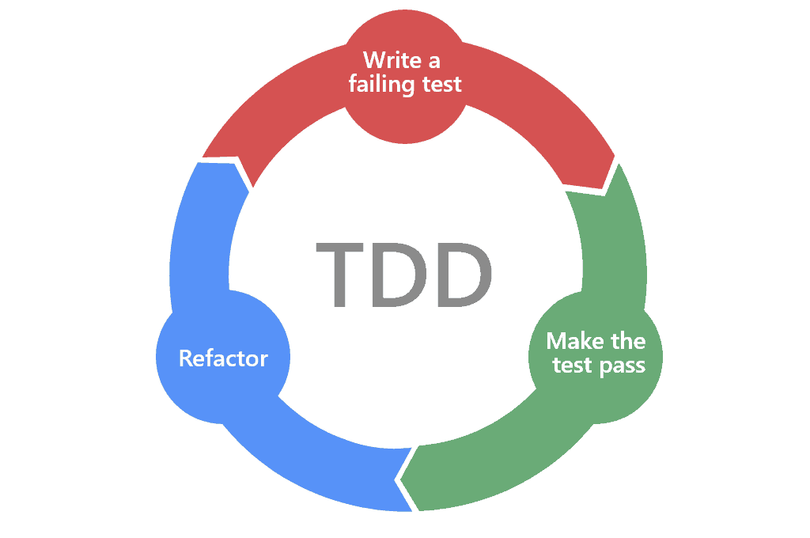
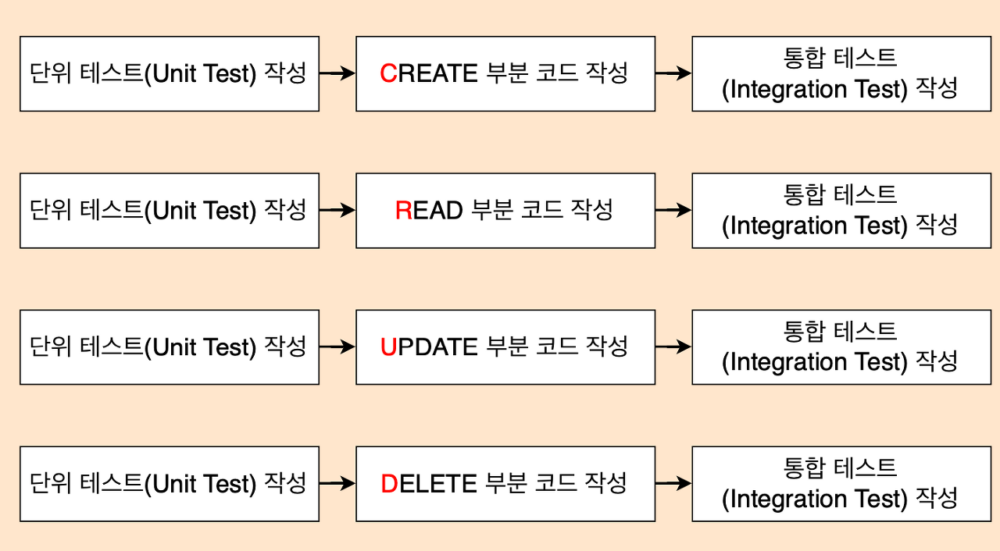

*TDD*

## TDD

TDD란 **‘Test Driven Development’의 약자**로 **테스트 주도 개발**이라고 한다.

테스트 케이스를 작성하고 이를 통과하는 코드를 작성하는 개발 방법이다.

코드를 작성할 때 단위 테스트를 진행하고, 완성된 코드는 통합 테스트를 진행한다.

1.  테스트 케이스 작성
2.  테스트 케이스 통과하는 코드 작성
3.  코드 리팩토링

TDD는 위 3단계를 반복해 진행되며 점진적으로 개발이 진행된다.

## TDD의 장점

**1\. 결함이 줄어듬**

실패할 경우를 대비한 테스트 케이스를 미리 작성하고, 이에 맞춰 코드를 작성하면 예상치 못한 버그를 방지하는데 도움이 된다.

**2\. 객체 지향적 코드 작성**

단위 테스트 작성에 이어 그에 대한 코드를 작성하므로, TDD를 통한 프로그램 개발 시 기능 별로 모듈화가 된다. 의존성과 종속성이 낮은 기능들의 집합으로, 기능을 새로 추가하더라도 기존 구조에 영향이 덜 가게 된다.

**3\. 유지보수의 용이**

단위 테스트 기반의 테스트 코드를 작성하므로, 문제가 발생했을 때 해당 단위 별로 테스트를 진행하면 문제를 쉽게 찾을 수 있다.

**4\. 설계 수정시간 단축**

기능을 만족하는 테스트 코드를 먼저 작성하기 때문에, 코드를 작성하면서 기능과 정의를 명확하게 가져가게 된다. 테스트 케이스, 코드를 작성하면서 설계의 문제를 찾아내는데 시간이 단축된다.

## TDD의 단점

**1\. 사전준비 or 개발 시간 늘어남**

기존 개발 뿐만 아니라 테스트 케이스 작성, 테스트 코드를 작성하기 위한 사전 지식을 습득하고 그에 맞는 개발환경을 미리 구축해야 한다.

**2\. 생산성 저하**

많은 기능이 필요하지 않고, 짧은 기간 내에 개발이 완료되어야 하는 경우, 어떤 예외상황이 있을지 예상이 됨에도 불구하고 테스트 코드를 작성함으로 불필요한 시간을 낭비할 수도 있다.

**3\. 어렵다**

기존에 이 방식을 사용하지 않던 개발자들에게는 낯설고 어려운 방식이다. 무조건 어렵다기보다 기존에 다른 방식으로 개발을 하는데 익숙해져 있다면 이 방식을 적용하기 쉽지 않을 수 있다.

이렇게 TDD의 장점과 단점을 명확하게 확인할 수 있는데, TDD를 사용하는 이유가 있을 것이다.

## TDD를 사용하는 이유

**1\. 의도한 대로 로직이 동작하는지 명확하게 알 수 있다**

의도한 대로 작동하는지 확인하는 테스트 코드를 작성했으므로, 그 테스트 코드를 만족하는 코드는 의도한 대로 작동하는 코드임이 보장된다.

**2\. 다양한 케이스를 고려함으로 잠재적 오류를 방지할 수 있다**

단순히 한 기능만을 검증하는 테스트 코드가 아닌, A 상황, B 상황과 같은 여러 상황을 고려함으로 예상치 못한 오류도 방지할 수 있다.

**3\. 로직을 수정하게 되면, 수정에 의한 영향도가 명확하게 확인된다.**

로직을 수정할 때, 기존에 작성된 테스트 코드를 만족할 지 생각해 본다면, 자신이 수정하는 부분이 끼칠 영향을 생각하기 쉽다.
