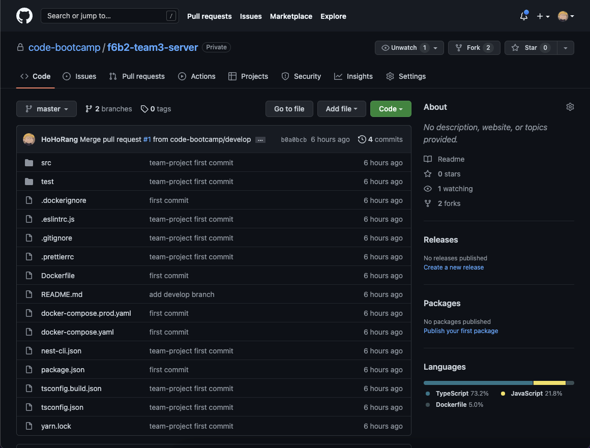
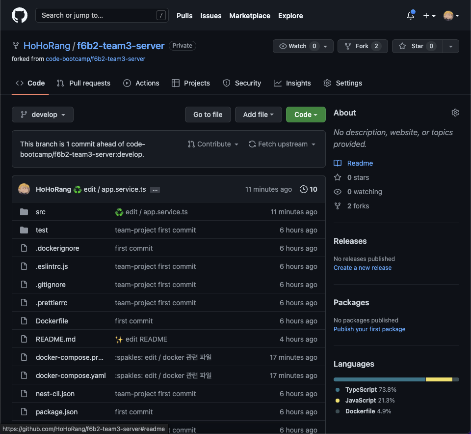
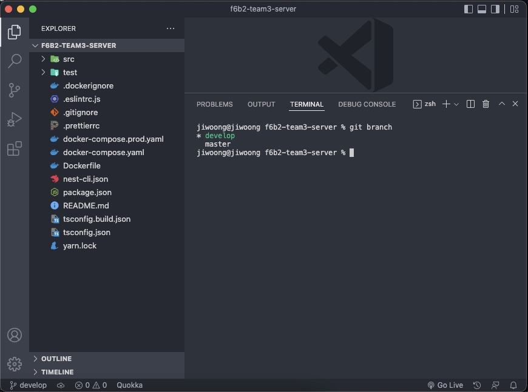
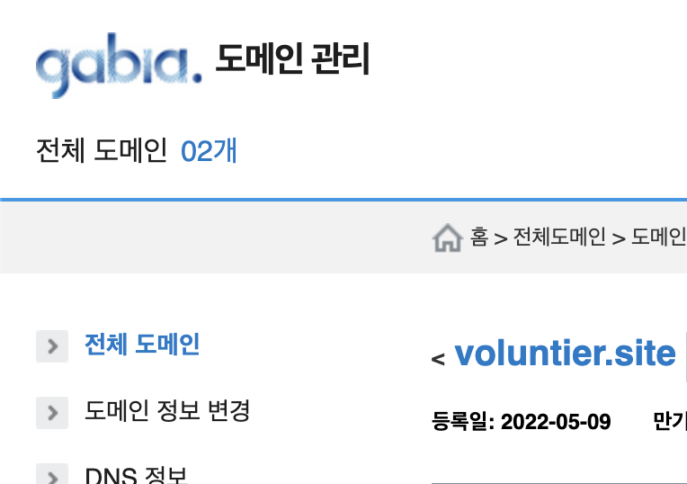
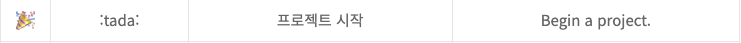
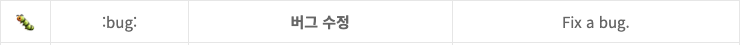
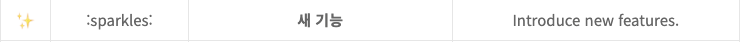
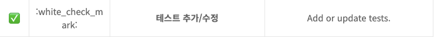
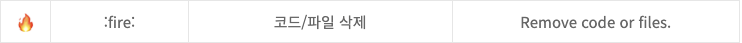
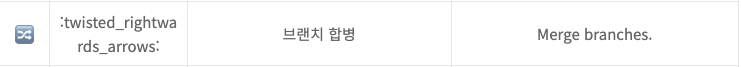

## 회의록

### 1. 포지션 정하기

-   팀 발표자, 발표자료 제작, 노션 정리 담당, Git 관리자 등 담당자 선정

### 2. 기본 규칙

-   출근 시간 10시 10분 (지각하면 당일 커피 쏘기!)
-   아침회의 10시 10분
-   주말은 선택(금요일에 회의해서 결정)
-   점심식사 오후 1시

### 3. 기타

-   커밋메시지 정하기 (백 프론트 따로 오늘안에) [https://treasurebear.tistory.com/70](https://treasurebear.tistory.com/70)
-   깃 레퍼지토리 사용방법 이슈 올리는법 정독하고 (클론받고 나서부터)
-   **마일스톤**(**milestone**)이란 프로젝트 진행 과정에서 특정할 만한 건이나 표를 말한다. 예를 들어, 프로젝트 계약, 착수, 인력투입, 선금 수령, 중간보고, 감리, 종료, 잔금 수령 등 프로젝트 성공을 위해 반드시 거쳐야 하는 중요한 지점을 말한다.
-   협업할때 사용할 툴정하기 (깃헙이슈)

### 4. 아이디어 회의

-   **유기동물 봉사 사이트**  
    \- 가제 :VolunTier(volunteer + Tier(독일어로 동물이라는 뜻~!)  
    \- 기획의도 : 유기동물 센터와 자원봉사자 및 후원자들을 연결해주는 플랫폼 서비스입니다.  
    기존의 포인핸드 봉사센터를 찾는 사이트의 편리함을 키우기위해?

## 백엔드 진행사항

### 오늘 할 일

- [x] 프로젝트 아이디어 선정
- [x] Github 레포지토리(백엔드) 기본 설정
- [x] 도메인 구입
- [x] GCP용 구글 계정 새로 생성
- [x] Git commit 메시지 정하기
- [x] Issue 형식 정하기
- [x] Branch 형식 정하기
- [x] Pull Request 형식 정하기
- [x] 쿠버네티스 서버 배포 설정
- [x] GCP DNS 도메인 설정

### 오늘 할 일 진행사항

#### 1. 프로젝트 아이디어 선정

#### 2. Github 레포지토리(백엔드) 기본 설정(fork, clone)



\- 백엔드 서버 Git Repository 권한 부여(백엔드 개발자들)

\- 기본 Nest 프로젝트 생성 후 Git Repository에 commit, push



\- 백엔드 개발자 별로 레포지토리 fork



\- 로컬에 clone하여 개발환경 구축 (git clone [https://github.com/HoHoRang/f6b2-team3-server.git](https://github.com/HoHoRang/f6b2-team3-server.git))

#### 3. 도메인 구입



\- 가비아(gabia)에서 도메인(voluntier.site) 구입

#### 4. 구글 계정 새로 생성(무료 크레딧 이용)

\- 계정 2개 생성

#### 5. Git commit 메시지 정하기

\- :gitmoji: \[Actions(add/edit/delete...)\] / \[Files/Functions\]

(ex. :sparkles: add / fetchUsers API)

(참고:[https://treasurebear.tistory.com/70](https://treasurebear.tistory.com/70))














#### 6. Issue 형식 정하기

```bash
### Issue
- Group: `Client`, `Server`
- Type: `bug`, `feature`, `delete`
- Detail: ~~~ 기능에 문제가 있습니다. / ~~~ 기능을 삭제했습니다.

### Todo
1. Job 1
2. Job 2
3. fetchUsers API 구현

### Estimated time
> `0.5h`, `1h`, `1.5h`, `2h`, `2.5h`, `3h`
```

#### 7. Branch 형식 정하기

:gitmoji: \[Issue Number\] \[Actions(add, edit, delete...)\] / \[Files/Functions\]

(ex. :sparkles: #15 add / fetchUsers API)

#### 8. Pull Request 형식 정하기

:gitmoji: \[Actions(add, edit, delete...)\] / \[Files/Functions\]

(ex. :sparkles: add / fetchUsers API)

#### 9. Git-hub 브랜치 삭제 방법 참고!

git branch -d feature#15 git push origin --delete feature#15

#### 10. 쿠버네티스 서버 배포 설정

Dockerfile

```dockerfile
FROM node:14

WORKDIR /myfolder/
COPY ./package.json /myfolder/
COPY ./yarn.lock /myfolder/
RUN yarn install

COPY . /myfolder/
CMD yarn start:dev
```

docker-compose.prod.yaml

```bash
version: '3.7'

services:
  my-backend:
    image: asia.gcr.io/[TEAM_PROJECT_ID]/team-project:1.2
    platform: linux/x86_64
    build:
      context: .
      dockerfile: Dockerfile
    ports:
      - 3000:3000
```

\- 레지스트리 저장소를 새로 만든 구글 아이디로 변경한 뒤

\- docker-compose -f docker-compose.prod.yaml build,

\- docker-compose -f docker-compose.prod.yaml push 진행.

\- k8s에서 클러스터 autopilot모드로 설정한 뒤, 리전을 asia-northeast3로 설정하고 생성.

\- k8s engine의 작업 부하에 들어가 container registry에 push되어 있는 이미지를 설정한 뒤 생성.

\- 작업 부하의 노출 설정. 포트는 3000 번으로

\- Ingress 생성을 선택한 뒤 이름을 정해준다.

\- Host and path 에서 경로를 설정해준 뒤, 프론트엔드 구성에서 프로토콜을 https로 설정하고 인증서를 생성해 줍니다. 그리고 ingress를 만들어 준다.

\- 이후 GCP DNS에서 도메인 설정을 해줘서 이어준다.

#### 11. GCP DNS 도메인 설정

\- GCP의 네트워크 서비스 - Cloud DNS 메뉴에서 영역 만들기

\- DNS 영역 이름 설정 및 구입한 도메인명 입력 후 만들기

\- 생성된 DNS 영역 세부정보에 들어가 NS 유형의 네임서버들을 복사하여, 도메인 구입한 곳에서 네임서버 변경(뒤에 .은 포함하지 않음)

\- 도메인 정보 변경에서 해당 도메인의 네임서버 설정에서 변경

\- 네임서버를 GCP에서 복사했던 네임서버로 변경 후 저장

\- GCP에서 DNS 이름에 따른 IP주소(위에서 설정한 인그레스의 IP)를 리소스 레코드 유형 ‘A’로 생성

\- 위에서 설정한 A 레코드, NS 레코드를 dig \[도메인\] \[레코드 유형\] 으로 확인하여 설정된 것 확인

\- 도메인명으로 HTTPS 접속시 정상 접속되는 것 확인
