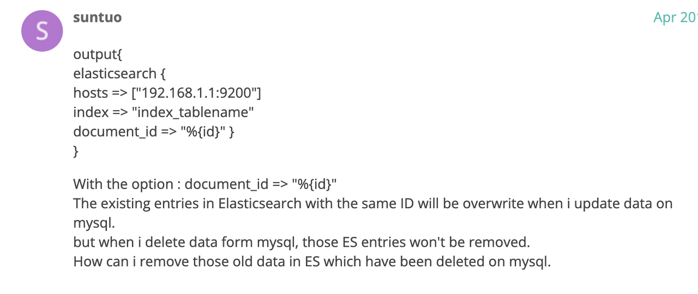
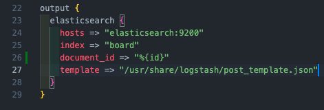
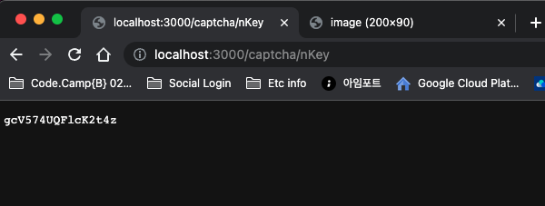
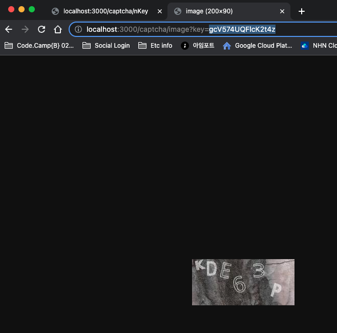
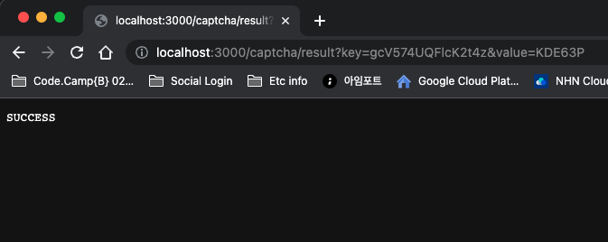
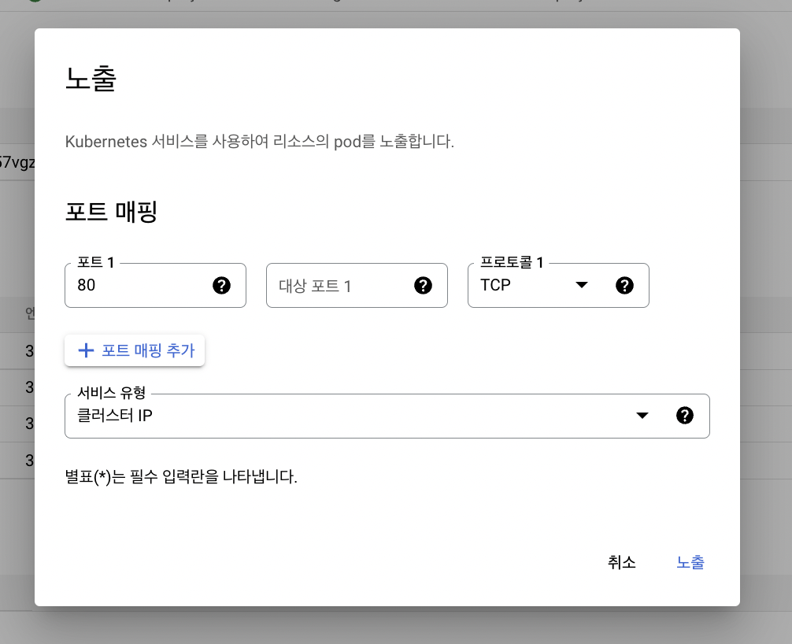

## 백엔드 진행사항

### 오늘 할 일

- [x] 1.!!!!! MySQL에서 게시글 삭제했을 때, Elastic Search에도 데이터 동기화하는 방법 !!!!!
- [x] 2.(추가 기능)회원가입 시 캡챠 입력
- [x] 3.Board(봉사 게시글) 관련 API 기능 수정
- [x] 4.(추가 기능)채팅 기능 구현(팀원A)
- [x] 5.(추가 기능)채팅 비속어 필터 적용

### 오늘 할 일 진행사항

1\. !!!!! MySQL에서 게시글 삭제했을 때, Elastic Search에도 데이터 동기화하는 방법 !!!!!

[https://discuss.elastic.co/t/delete-elasticsearch-document-with-logstash-jdbc-input/47490/2](https://discuss.elastic.co/t/delete-elasticsearch-document-with-logstash-jdbc-input/47490/2)

위와 같이 document\_id에 id로 설정해주면, 기존에 들어갔던 데이터는 덮어 씌워진다.

updatedat 컬럼을 두고, 삭제, 수정하는 경우 원래 데이터에 덮어쓰도록 수정함

2\. (추가 기능)회원가입 시 캡챠 입력

네이버 캡차 API 이용하여 키 발급 및 이미지 입력값 검증하도록 구현

[https://developers.naver.com/docs/utils/captcha/reference/#캡차-키-발급-요청](https://developers.naver.com/docs/utils/captcha/reference/#캡차-키-발급-요청)

3\. Board(봉사 게시글) 관련 API 기능 수정

-   fetchBoards 에서 page 필수 입력 제외
-   fetchBoardsCount API 구현(fetchBoards와 같이 ES에서 조회하도록)
-   fetchEnrollsByBoardId 에서 user 정보도 받아올 수 있게 수정

4\. (추가 기능)채팅 기능

채팅기능 추가 완료. 8080 포트로 채팅서버 올려줌.

BoardId로 채팅창에서 이전에 채팅했던 내역들 불러오는 API추가.

채팅할 경우 채팅로그 저장하는 기능 게이트웨이에 설정. 채팅방에 nickname을 userId, room을 boardID로 설정 안 해줄 경우 제대로 로그 저장이 안됨(유저와, 보드에 1:N관계여서 그럼). 프론트에게 전달 필요.

배포한 서버에서도 IP로 사용할 경우 채팅이 가능하지만 A레코드로 설정해준 [https://chat.backendapi.voluntier.site](https://chat.backendapi.voluntier.site)로는 사용이 안됨. 8080포트로 열어줬는데 health checker 가 제대로 확인을 하지못해서 그런것 같음.

5\. (추가 기능)채팅 비속어 필터 적용

정규식 활용하여 채팅 비속어 필터 추가.

파일을 읽어오는 방식으로 진행. 파일에 저장되어있는 비속어를 가져오고 그것으로 비속어 정규식을 만들어서 프론트 엔드로 전달하는 방식으로 비속어 필터생성.

현재 방식의 문제점으로는 이전 채팅데이터를 불러올 경우 비속어가 필터링되지 않음. 이전 채팅기록을 서버에서 불러올때 필터링을 걸어주는 방식으로 해결이 가능할 것 같음.

### 이슈

1\. Kubernetes Engine 탭에서 노출 중인 서비스의 추가 버튼이 없어짐.

쿠버네티스 엔진에서 작업부하탬에서 배포 세부정보로 들어갈 경우 원래는 노출중인 서비스에서 추가로 노출을 요청할 수 있는 버튼이 있으나 찾을 수가 없었음. 확인해보니 위치가 위쪽에 있는 작업 탭으로 변경됨

노출 버튼을 클릭하면 아래와 같이 창이 뜸.

포트 매핑을 자신이 원하는 포트로 해준 뒤 서비스 유형을 선택해주면 외부로 노출이되어 접근이 가능해짐.
