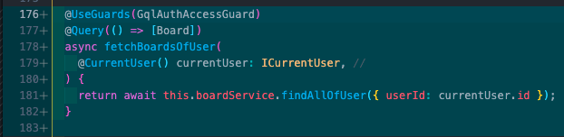
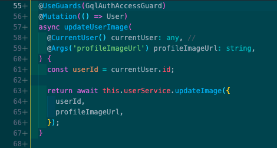
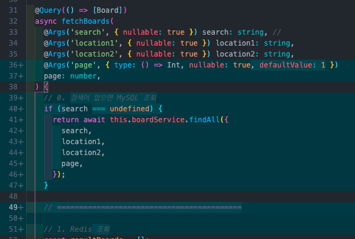
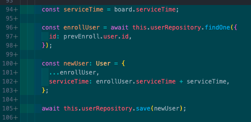

## 백엔드 진행사항

### 오늘 할 일

- [x] 1.유저가 작성한 봉사 게시글 조회 API
- [x] 2.유저의 프로필 이미지 변경 API
- [x] 3.createPurchase API 버그 수정.
- [x] 4.board 조회 시 검색어 없을 때 MySQL 조회하도록 수정
- [x] 5.봉사 완료처리 시 유저 봉사시간 업데이트 되도록 수정

### 오늘 할 일 진행사항

1\. 유저가 작성한 봉사 게시글 조회 API

구현 완료

2\. 유저의 프로필 이미지 변경 API

구현 완료

3\. createPurchase API 버그 수정

4\. board 조회 시 검색어 없을 때 MySQL 조회하도록 수정

5\. 봉사 완료처리 시 유저 봉사시간 업데이트 되도록 수정

### 이슈

1.  (BE)엘라스틱 서치가 작동하지 않을 때, MySQL(매니지 서비스로 돌아가는 SQL)을 조회하는 방법을 찾아봐야 할 것 같음(AWS에서 제공하는 Open Search라는 서비스를 이용하는 방법도 있음. 다만, Logstash는 지원하지 않아서 별도로 Data를 MySQL로부터 가져오는 작업이 필요함)
2.  (BE)채팅서버는 기존 3000번 포트가 아닌 8080번 포트로 띄우기 때문에 Health Checker가 기존처럼 작동하지 않음 → 이 부분은 해결책을 더 찾아보도록 → 3000번 포트로 동일하게 띄우는 방법 찾음
3.  (BE)정기 메일 발송 기능 → BigQuery 이용해서 DB Subscribe 이용해서 이벤트 발생했을 때, 메일링하는 기능을 이용할 수도 있을 것 같음  
    서버에 메일링 기능 구현 → 정기적으로 실행 → 유저 DB 조회해서 특정 조건을 만족하는 사용자에게 메일링
4.  (BE)정기 결제 구현?
5.  gateway health checker 문제로 도메인 변경 안되던 이슈 해결  
    기존에 따로 8080 포트로 입력해줘서 서버를 따로 열었음. 하지만 포트를 입력해주지 않을 경우 기존의 서버의 포트와 동일한 포트로 소켓이 생성됨(기존 3000번 포트) 이렇게 할 경우 문제없이 health check이 가능해짐
