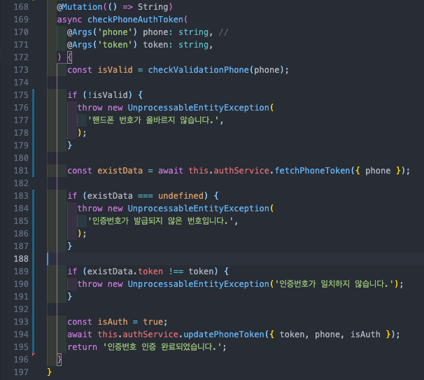
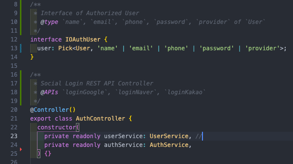
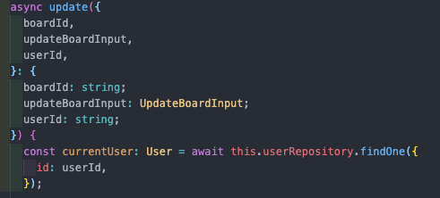
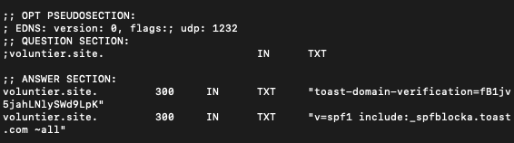
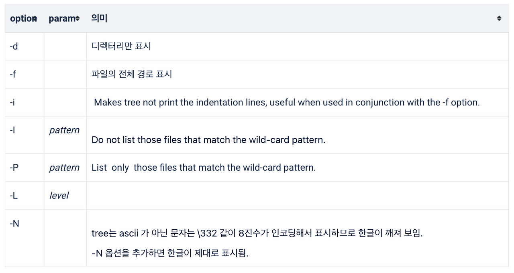

## 백엔드 진행사항

### 오늘 할 일

- [x] 코드 리팩토링
- [x] 파이프라인 및 ERD, API 명세서 최종 수정
- [x] 정기후원 메일 템플릿 수정

### 오늘 할 일 진행사항

1\. 코드 리팩토링

(1) if문 중첩되는 부분 수정

(2) 각 API, 함수에 주석 작성

주석 작성하는 방법: [https://typedoc.org/guides/doccomments/](https://typedoc.org/guides/doccomments/)

(3) 매개변수, 리턴타입 Type 지정하기

2\. 파이프라인 및 ERD, API 명세서 최종 수정

수정 완료

3\. 정기후원 메일 템플릿 수정

→ 템플릿 수정

### 이슈

1\. 도메인이 스팸 메일로 처리될 때

등록한 도메인으로 메일을 보낼 때, 토스트 서버를 통해 메일을 보내기 때문에 도메인 확인이 되지 않아 스팸으로 처리될 가능성이 있다. 그래서 아래와 같이 TXT 레코드에 실제 메일을 전송하는 서버 정보를 입력해주면 SPF 검증이 되고 스팸처리가 되지 않는다.

2\. 이슈는 아니지만, 디렉토리 tree 구조 출력하는 방법

tree 명령어를 통해 할 수 있다. mac에 brew install tree 명령어로 tree를 설치하고, tree -L 3 -N -I "node\_modules” 와 같이 특정 디렉토리를 제외한 tree 구조를 출력할 수 있다.

