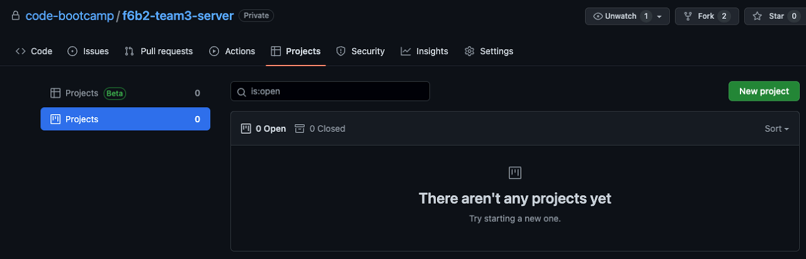
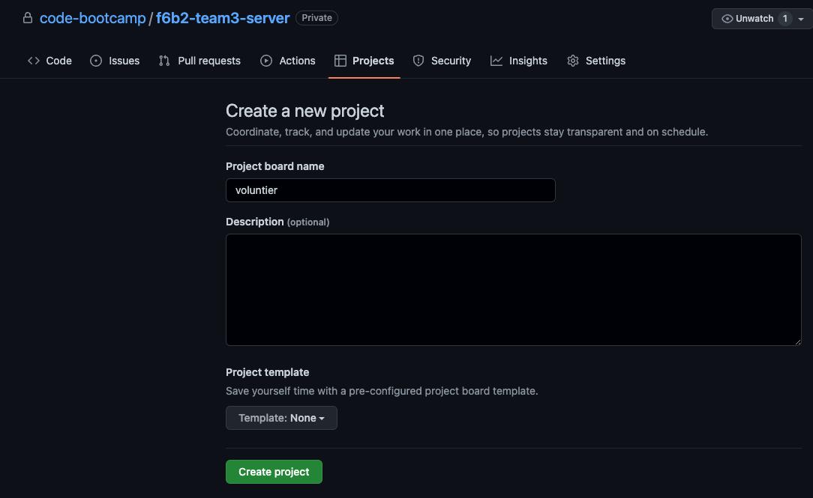
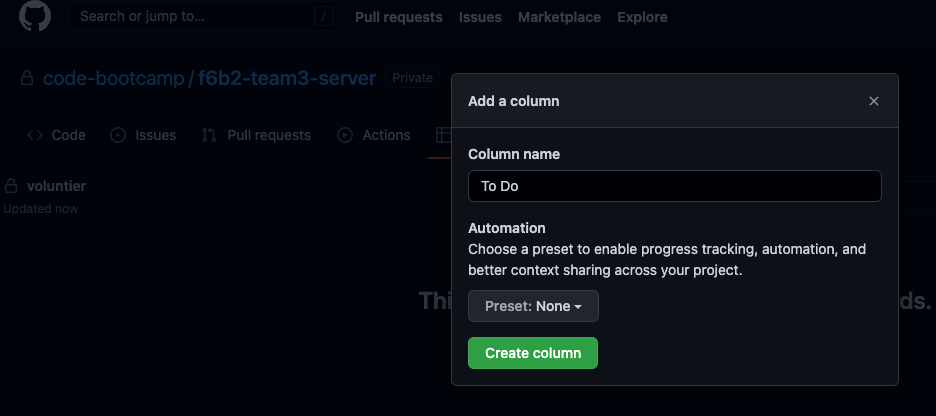
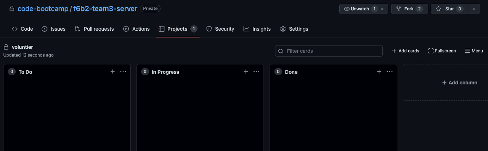
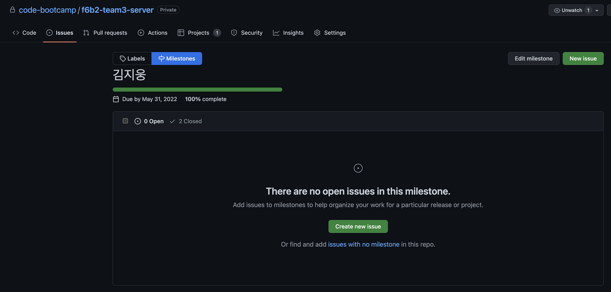
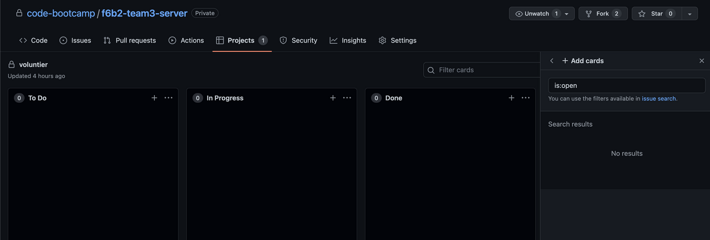
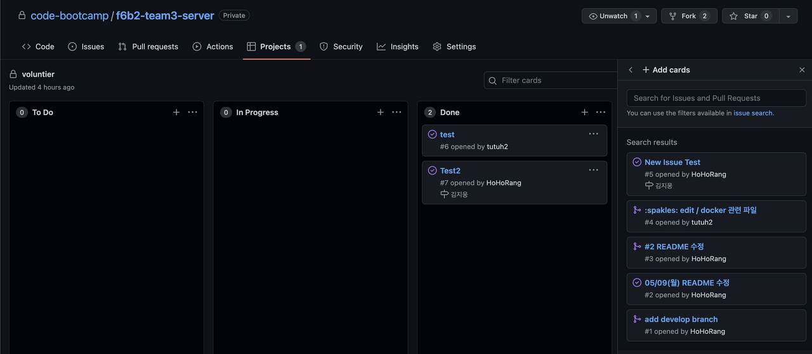
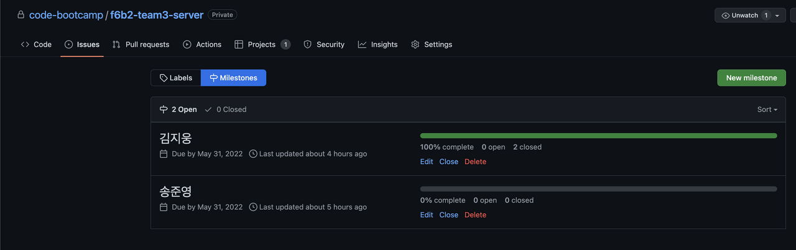

## 회의록

### 1. 회의 내용

\- 서비스/프로젝트명 정하기 ⇒ 그대로

\- 백엔드에서 기능 위주로 api 독스 작성해서 프론트와 소통(사용할 수 있을지 확인) → 디테일 정하기

\- 백 -프론트 와이어프레임 보면서 회의 하면서 기획의도에 맞는지, 서비스안정성 가능한지 고민하다보니 와이어프레임 틀이 바뀜

\- 회원가입이 아니라 구매할 때 주소 입력, 배송완료 ⇒ 배송조회 버튼(라우터 사용)

\- 로그인 되어 있으면 마이페이지에서 개인정보 수정할 수 있도록 (모달 사용)

### 2. To-Do

\- 프로젝트 개요 (팀, 멤버, 멤버 포지션 및 역할 소개) 화요일

\- 서비스 소개 화요일

\- 사용할 기술 스택, 프레임워크, 라이브러리 등 백 협의됨/ 프론트 수,목 협의

\- 프로젝트 기능 구현 계획 (담당, 작업계획 등) 수 협의

\- API Docs

\- Figma

\- DB Schema

\- Data Flow Chart

\- milestone 기록

\- 디자이너 메인페이지 캐러셀작업

## 백엔드 진행사항

### 전날 체크사항

- [x] Github 칸반보드, 마일스톤 생성 오늘 마저 해보기!
- [x] API 목록 정리 됐는지? → 마저 정리 예정
- [x] 회고록 매일? → 블로그에 쓰는 것은 선택이지만 권고사항!

### 오늘 할 일

- [x] Github 칸반보드, 마일스톤&테스크 생성, 회고 생성 확인하기
- [x] 화면 별로 기능 명세서 작성
- [x] 프로젝트 ERD 작성!
- [x] 추가적인 기능 구현 생각해보기(채팅)
- [x] API 목록 정리 및 API Docs 작성 ([https://github.com/code-bootcamp/Flog\_server](https://github.com/code-bootcamp/Flog_server) 참고)
- [x] 전체 시스템 구성도
- [x] Data-flow 작성(Pipeline)

### 오늘 할 일 진행사항

#### 1. Github 칸반보드, 마일스톤&테스크 생성, 회고 생성 확인하기

상위 레포지토리(맨 처음 레포지토리)에서 projects 메뉴에 들어가 프로젝트를 생성한다.

프로젝트명을 입력하고 생성

생성된 프로젝트에 들어가면 Column을 생성할 수 있다.

위와 같이 To Do, In Progress, Done으로 구분하여 생성한 Issue를 각 Column 넣어 구분할 수 있다.

Issues 메뉴에 들어가 Milestones를 클릭해서 프로젝트에 참여한 사람의 이름으로 milestone을 생성해 그 milestone에 issue를 생성할 수 있게 된다.

issue를 생성 후, 다시 프로젝트에 들어가면 생성했던 issue를 보드에 추가해줄 수 있게 된다.

이미 close된 issue도 검색해 Done칸에 추가해 줄 수 있다.

생성한 issue를 해결하고 close하면 milestone에서 진행률 확인 가능!

#### 2. 화면 별로 기능 명세서 작성

(기능 명세서)(프로젝트 끝나고 첨부 예정)

#### 3. 프로젝트 ERD 작성

(ERD)(프로젝트 끝나고 첨부 예정)

#### 4. 추가적인 기능 구현 생각해보기(채팅)

[https://velog.io/@code\_sign/ToyProject-실시간-채팅과-귓속말까지-feat.-socket.io](https://velog.io/@code_sign/ToyProject-실시간-채팅과-귓속말까지-feat.-socket.io)

참고해서 채팅 기능 구현 검토(구현 고려해서 ERD 작성함)

#### 5. API 목록 정리 및 API Docs 작성

(기능 명세서)(프로젝트 끝나고 첨부 예정)

기능 정리완료, 담당자 선정 완료.

#### 6. 전체 시스템 구성도

(Data Flow)(프로젝트 끝나고 첨부 예정)

(시스템 구성도)(프로젝트 끝나고 첨부 예정)

#### 7. Data-flow 작성(Pipeline)

(Pipeline)(프로젝트 끝나고 첨부 예정)

### 내일 할 일

- [ ] API 작성
- [ ] (하면 좋을 것) REST API Docs(Swagger) 조회시 비밀번호 입력하는 기능 고려
