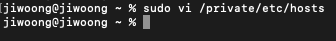
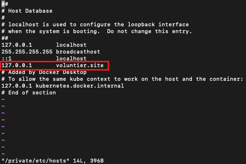

## 백엔드 진행사항

### 오늘 할 일

- [x] 실제 배포시 고려할 사항 정리
- [x] 발표자료 준비(시현 항목 추리기)

### 오늘 할 일 진행사항

1\. 실제 배포시 고려할 사항 정리

→ config(환경변수) 정보에 SOCIAL\_REDIRECT\_URL 정보 변경하기

→ user.resolver.ts 파일에 sendThanksMailTest API에 Crontab 설정하기

→ 시현을 위해 월간젤리(Wallpaper) 테이블에 4월, 5월 월간젤리 데이터 넣어놓기

2\. 발표자료 준비(시현 항목 추리기)

-   현재 위치 확인후 지도에 찍어주기, 글등록시 지도에 찍어주기. 지도에서 클릭하면 게시물로 이동.
-   지역별 봉사활동 검색 가능.
-   자기 자신이 쓴 글에 들어갈 경우, 수정, 삭제 가능. 아닐경우 신청하기만 가능. 작성자는 신청이 올 경우 봉사완료처리, 삭제 처리가능,
-   실시간 채팅, 이전 채팅내역을 볼 수 있음, 자신이 작성한 글에 채팅 올 경우 알람 기능.
-   결제 가능(후원), 결제 완료시 총 후원금액 증가.
-   모든페이지 반응형 처리
-   관리자가 db에 이미지 등록하면 crontab을 이용해서 정기매일 발송 설정.(올리자 마자 가는게 아님)

### 이슈

1\. 프론트엔드 배포 후, voluntier.site라는 도메인으로 접속하려면 접속이 되지 않는다!

이는 저번에 로컬에서 실제와 같은 도메인으로 작동하게 하기위해 설정했던 것을 해제해줘야 한다.

위의 항목을 지워줘야 voluntier.site로 접속했을 때, 127.0.0.1이 아닌, 실제 서버로 연결이 된다.

로컬에서 voluntier.site로 테스트해보고 싶으면 다시 위의 항목을 입력하면 된다.
