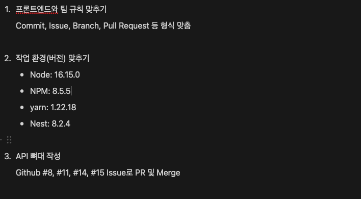
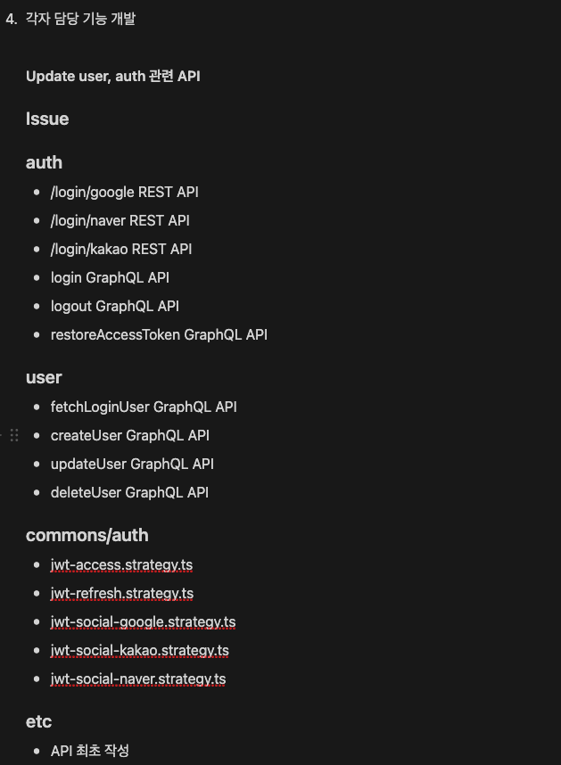
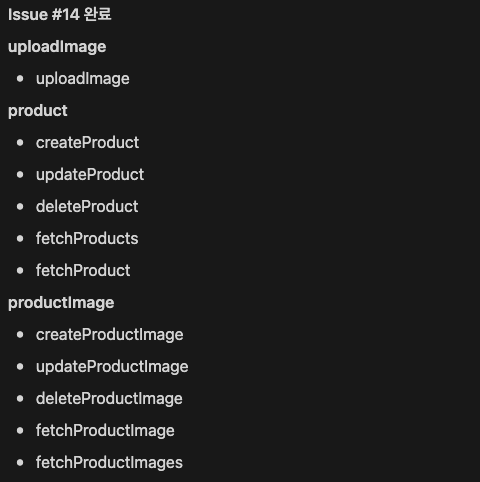
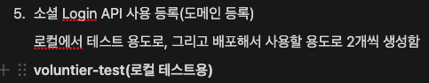
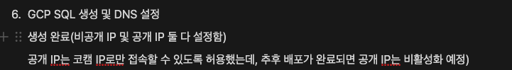
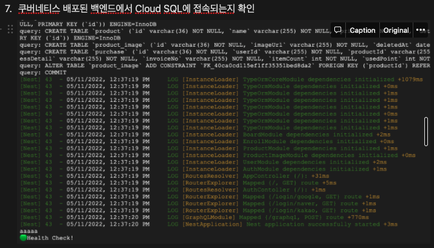

## 회의록

1\. 정해진깃규칙

2\. 회의한 내용 바탕으로 오늘부터 기획서 완성 시작(회사 공식 노션)

3\. 중간 회의 바로바로 업데이트

4\. 백엔드 오늘의 계획 노션 업데이트

\-어제 기능명세서 api 만들어야하는거 정하고 , 이름 정하고 플로우차트 생성

\-오늘 독스 기본으로 api 제작 api를 호출할수 있는 기본틀, api의 뼈대를 만듦

\-이번주 그래프큐엘 호출(이런모양이 갈거야)은 모두다 가능,

5\. 프론트

\-어제

-   깃규칙, 환경설정, 변수명, 파일이름, 페이지이름
-   피그마 나온부분 작업 80%이상 끝 / 반응형 랜딩 (피그마가 3페이지 밖에 안나와서 빨리 나와야함)

\-오늘

-   기본 기획서 작성 + 목업파일 (팀장)
-   페이지 퍼블리싱 반응형 완료 + 피그마 추가되는대로 생성
-   소켓아이오 공부, 기본환경고민

## 백엔드 진행사항

### 전날 체크사항

- [ ] (하면 좋을 것) REST API Docs(Swagger) 조회시 비밀번호 입력하는 기능 고려

### 오늘 할 일

- [x] 프론트엔드와 팀 규칙 맞추기
- [x] 작업 환경(버전) 맞추기
- [x] API 뼈대 작성
- [x] 각자 담당 기능 개발
- [x] 소셜 Login API 사용 등록(도메인 등록)
- [x] GCP SQL 생성 및 DNS 설정
- [x] 쿠버네티스 배포된 백엔드에서 Cloud SQL에 접속되는지 확인

### 오늘 할 일 진행사항

### 내일 할 일

- [ ] donation API 작성(iamport결제), Transaction 적용 필요.
- [ ] 채팅 기능 구현에 대해 공부
- [ ] 인증번호 전송 및 인증 API 구현
- [ ] Redis 쿠버네티스에 생성하기
- [ ] Redis 이용해서 로그아웃 구현
- [ ] 로컬 프론트엔드 로그인 화면에서 소셜 로그인 되는지 확인
