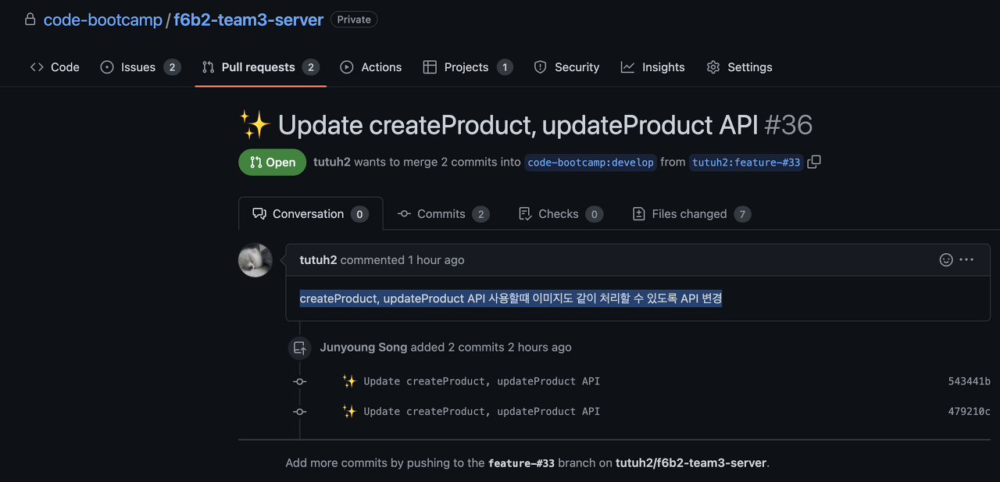
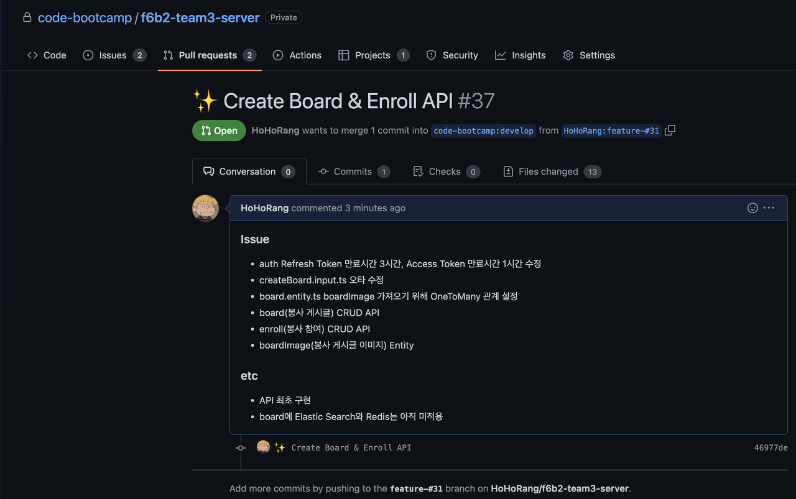

## 백엔드 진행사항

### 오늘 할 일

- [x] 주간 회고 작성(각자)
- [x] Update createProduct, updateProduct API(팀원A)
- [x] Board 관련 API 작성(HoHoRang)
- [x] Enroll 관련 API 작성(HoHoRang)

### 오늘 할 일 진행사항

1\. 주간 회고 작성(각자)

작성 완료

2\. Update createProduct, updateProduct API(팀원A)

createProduct, updateProduct API 사용할때 이미지도 같이 처리할 수 있도록 API 변경

3\. Board 관련 API 작성(HoHoRang)

작업 완료

4\. Enroll 관련 API 작성(HoHoRang)

작업 완료

### 이슈

1\. 배포를 다시 할 때마다, yaml 설정에 gcp-storage.json의 경로를 입력했던 정보가 초기화 됨.

배포를 할 때마다 다시 입력해주고 있는데, 다른 방법이 없는지 확인 필요함.
