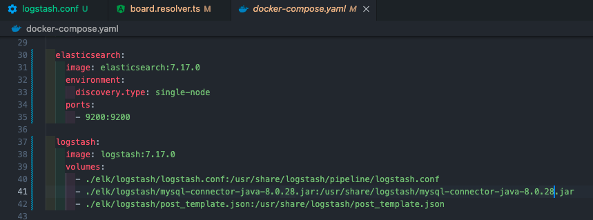
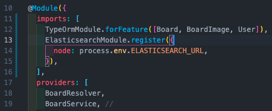
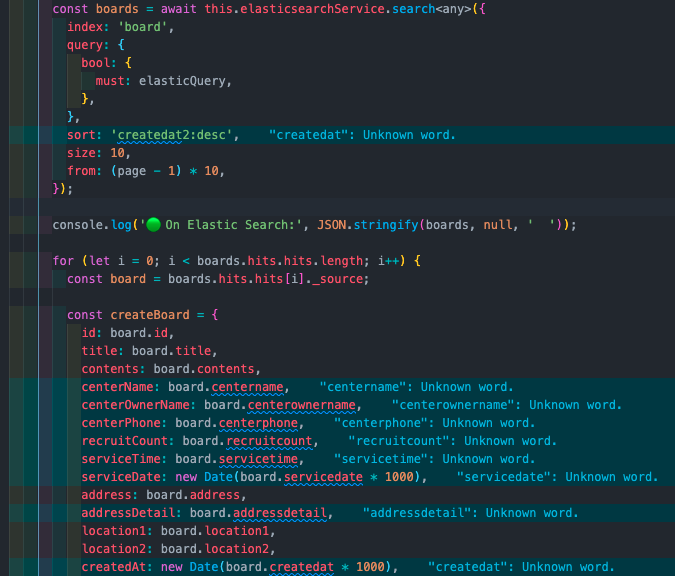
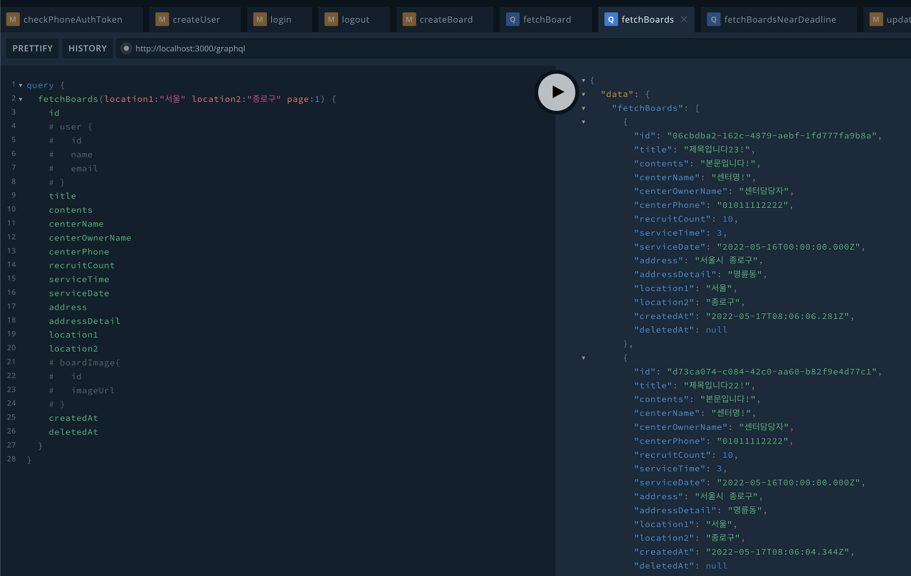
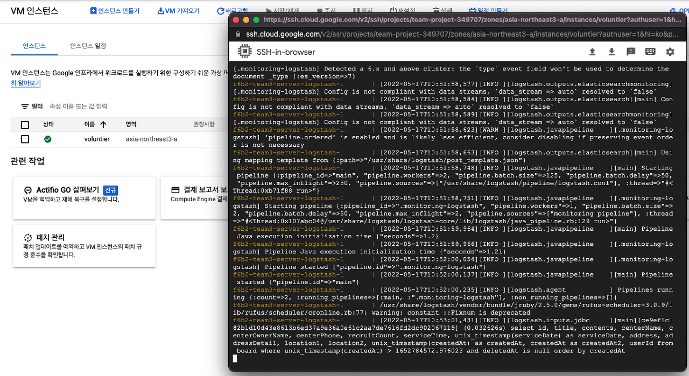
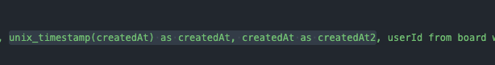
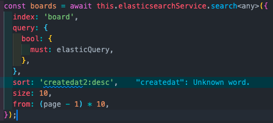

## 백엔드 진행사항

### 오늘 할 일

- [x] 로컬 환경에서 ELK 스택 설정하기(HoHoRang)
- [x] Elastic Search, Redis로 봉사 게시글 검색 구현하기(HoHoRang)
- [x] GCP에 ELK 스택 구현하기(HoHoRang)

### 오늘 할 일 진행사항

1\. 로컬 환경에서 ELK 스택 설정하기

docker-compose.yaml 파일에 설정

2\. Elastic Search, Redis로 봉사 게시글 검색 구현하기

봉사 게시글에 Elastic Search, Redis 검색 구현

3\. GCP에 ELK 스택 구현하기(HoHoRang)

-   기존 쿠버네티스 인스턴스가 있는 계정과 별개의 계정을 생성
-   VM 인스턴스에서 새로운 컴퓨터 생성
-   해당 인스턴스에 접근할 수 있도록 방화벽 태그 생성해 설정
-   기존 계정의 SQL 서버에 ELK 인스턴스 IP가 접근할 수 있게 허용 설정
-   docker, docker-compose 설치
-   git 소스 pull 받아, elasticsearch와 logstash 실행
-   정상적으로 logstash가 SQL(MySQL) 조회해서 데이터 가져오는 것 확인함
-   IP로 된 Elasitc Search 서버 DNS 설정함

### 이슈

1\. Elastic Search Sort(정렬) 안먹는 현상

Data 조회 시 정렬을 위의 createdAt 컬럼으로 하려고 했지만, unix\_timestamp로 변환되어 해당 컬럼으로 제대로 정렬되지 않았다. 그래서 createdAt 컬럼을 그대로 받아서 해당 컬럼으로 정렬하니 제대로 정렬이 되는 것을 확인했다.

2\. 엔그램 Tokenizer 이용해서 검색 시, 일부분만 일치해도 데이터가 나오는 현상

-   term 쿼리 : 검색어에 대한 분석을 하지않고 온전히 그 검색어와 일치하는 문서를 검색한다. 즉 검색어가 분석기를거쳐 토크나이징 없이 검색을 하지않는다는 뜻이다.
-   match 쿼리 : 검색어에 대해 분석을 통한 검색을하며 이는 bool 쿼리 중에서도 should조건으로 검색을한다. 즉 검색어를 분석기를 통해 토크나이징해서 토크나이징된 단어들을 찾아 문서들을 검색하고 토크나이징된 단어들이 최소 1개라도 들어있다면 검색 결과에 포함한다. 이때 최소 n개이상 포함되면 포함시킬지 말지 결정하는 옵션도 있으니 이는 설정에 따라 다르겠지만 기본은 일단 1개라도 포함이 되면 결과에 포함된다.

처음에 match 쿼리를 이용해서 조회를 했는데, 일부 문자열이 일치해도 데이터가 나오는 현상이 발생했다.

(ex. 니다12로 검색 시, 제목입니다12, 제목입니다13, 제목입니다14, ... 등이 나옴)

그래서 term 쿼리로 바꿔주니 일치하는 데이터만 나오는 것을 확인했다.

3\. GCP VM에 ELK 설치

docker-compose 명령어 실행시 오류가 발생했다. 아래 포스트를 보고 해결했다. 그리고, ELK build 시 VM의 CPU가 너무 안 좋으면 실행이 안 될 수 있다.

[https://sukill.tistory.com/100](https://sukill.tistory.com/100)
