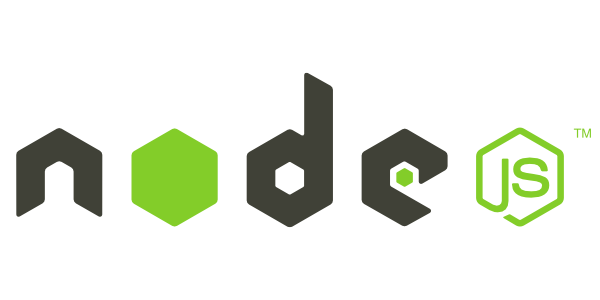

## 1일차 Today-I-Learned



*Node.js*

## Node.js

> JavaScript를 브라우저 없이 실행시켜줄 수 있는 도구

---

### npmjs.com

JavaScript에서 사용 가능한 기능(라이브러리)을 모아둔 패키지 공유 사이트

### npm

npmjs.com에서 필요한 라이브러리를 받을 수 있는 기능

### yarn

facebook에서 npm의 속도를 개선해 만든 기능

### 설치방법

node.js 및 npm은 node.js 홈페이지에서 다운받아 설치하면 같이 설치된다.

yarn은 npm을 통해 아래와 같이 설치한다.

```shell
hohorang@MacBookPro codecamp-backend-02 % node --version
v16.14.0
hohorang@MacBookPro codecamp-backend-02 % npm --version
8.3.1
hohorang@MacBookPro codecamp-backend-02 % sudo npm install -g yarn
hohorang@MacBookPro codecamp-backend-02 % yarn --version
1.22.17
```

\-g 옵션은 global 옵션으로, 내 컴퓨터의 모든 사용자에 설치

## 터미널에서의 명령어

```shell
hohorang@MacBookPro codecamp-backend-02 % ls
algorithm       class           homework
hohorang@MacBookPro codecamp-backend-02 % cd class
hohorang@MacBookPro class % pwd
/Users/hohorang/Desktop/codecamp-backend-02/class
hohorang@MacBookPro class % pwd
/Users/hohorang/Desktop/codecamp-backend-02/class
hohorang@MacBookPro class % cd ..
hohorang@MacBookPro codecamp-backend-02 % pwd
/Users/hohorang/Desktop/codecamp-backend-02
hohorang@MacBookPro codecamp-backend-02 % mkdir bbb
hohorang@MacBookPro codecamp-backend-02 % mkdir aaa
hohorang@MacBookPro codecamp-backend-02 % mv aaa bbb
hohorang@MacBookPro codecamp-backend-02 % cd bbb
hohorang@MacBookPro bbb % cp aaa ../qqq
cp: aaa is a directory (not copied).
hohorang@MacBookPro bbb % cp -R aaa qqq
hohorang@MacBookPro bbb % cd ..
hohorang@MacBookPro codecamp-backend-02 % rm -rf bbb
```

## 스코프 / 스코프 체인

Javascript는 스코프 안에 변수가 없을 경우 그 스코프 밖에서 변수를 찾아서 계산한다.

이런 현상을 스코프 체인이라고 한다.

최상위 스코프에서도 변수를 찾지 못하면 에러가 발생한다.

## 퍼사드(Facade) 패턴

여러 사람들이 사용하는 형태를 잡고, 그 안을 세부적으로 개발하는 방법

## JS에서의 import / export

node.js 기반 파일이라는 것을 명시해줘야 import / export 기능을 사용할 수 있음

```shell
import { ~~~ } from './phone.js' -- module 방식

const { ~~~ } = require('./phone.js') -- commonjs 방식(옛날 방식)

npm init
혹은
yarn init
```

module 방식 사용을 위해 package.json 파일에 아래 항목 추가

```shell
"type": "module"
```
