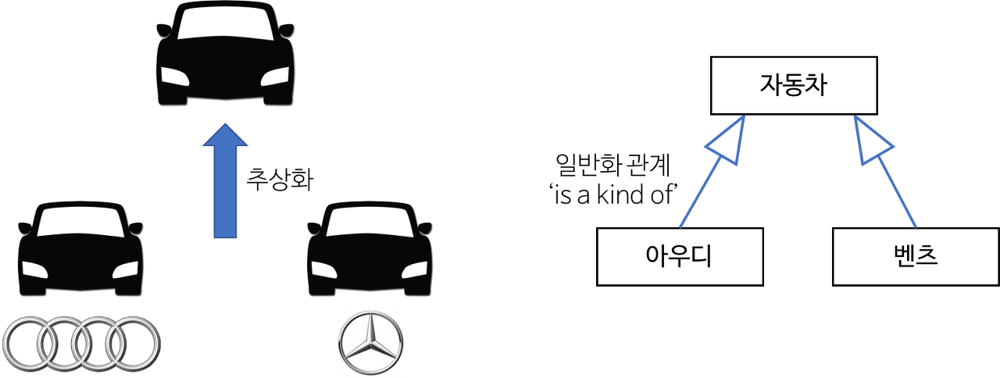
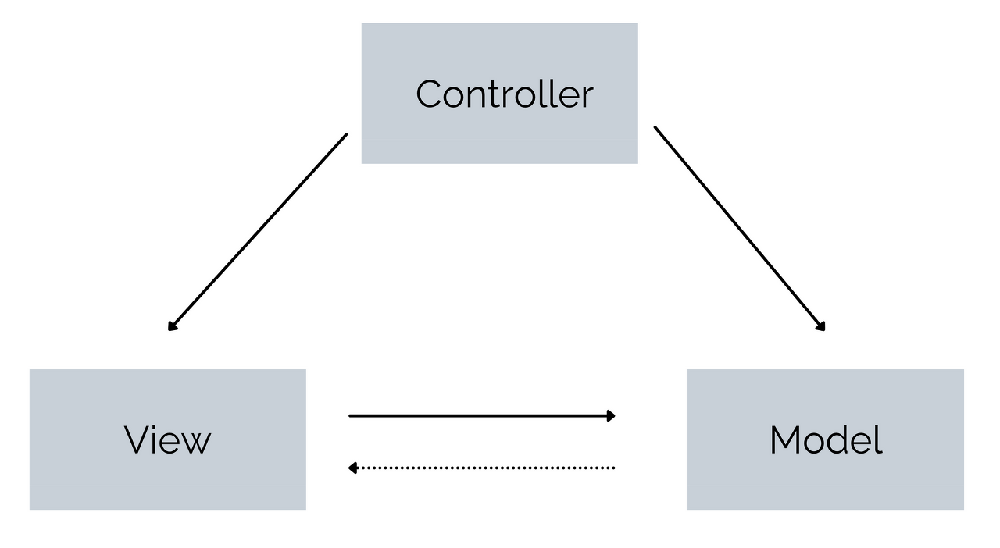

## 11일차 Today-I-Learned


*MVC 패턴*

## Class(클래스)

> 💡 특정 객체를 생성하기 위해 변수와 메소드를 정의하는 일종의 틀로, 객체를 정의하기 위한 상태(멤버 변수)와 메서드(함수)로 구성된다.

즉, 물건을 만드는 설명서라고 보면 된다. 클래스라는 틀을 통해 동일한 종류의 데이터가 생성되면 이것을 객체라고 부른다.

```javascript
class Monster{
  power = 10

  constructor(attackStep){
    if(attackStep) this.power = attackStep
  }

  attack(){
    console.log("공격하자!!!")
    console.log("내 공격력은" + this.power + "야!!!")
  }

  fly(){
    console.log("날라서 ! 도망가자!!")
  }

}

const monster1 = new Monster()
monster1.attack()
monster1.fly()

const strongMonster = new Monster(50)
strongMonster.attack()
strongMonster.fly()
```

constructor()는 new에 의해 객체가 생성될 때 자동으로 실행된다. 이 생성자를 통해 매개변수를 전달받아 객체의 변수를 초기화해줄 수 있다.

클래스 내의 메서드(함수)는 function 키워드가 붙지 않고, 마찬가지로 변수, 상수에도 키워드가 붙지 않는다.

```javascript
/**
class Date{
	getFullYear(){
	 }
	getMonth(){
	 }
}
**/

const aaa = new Date()
console.log(aaa.getFullYear())
aaa.getMonth()
```

Date라는 객체로 시간 관련 기능을 구현 했었는데, 따로 구현한 적이 없는 기본적으로 내장되어 있는 객체를 내장 객체라고 한다.

이렇게 객체를 이용하여 프로그래밍하는 것을 객체지향 프로그래밍이라고 한다.

```javascript
class SkyUnit {
  run = () => {
    console.log("날라서 도망가자!!!");
  };
}

class GroundUnit {
  run = () => {
    console.log("뛰어서 도망가자!!!");
  };
}

class Monster extends SkyUnit {
  power = 10;

  constructor(aaa) {
    super(300);
  }

  attack = () => {
    console.log("공격하자!!!");
    console.log("내 공격력은 " + this.power + " 이야!!!");
  };
}

const myMonster1 = new Monster(50);

myMonster1.attack();
myMonster1.run();
```

위와 같이 extends 키워드를 통해 다른 클래스를 상속받을 수 있다.

상속받은 클래스의 생성자에서는 먼저 부모 클래스의 생성자를 호출해야 사용할 수 있다.

## Object-Oriented-Programming(OOP)

> OOP의 4가지 특징

#### 1. 추상화(Abstraction)

-   목적과 관련이 없는 부분을 제거하여 필요한 부분만을 표현
-   공통적인 특징, 즉 추상된 특징을 파악해 인식의 대상으로 삼음
-   구체적인 사물들의 공통적인 특징을 파악해서 하나의 개념(집합)으로 다루는 수단



*추상화의 개념*

#### 2. 캡슐화(Encapsulation)

하나의 객체에 대해 특정한 목적을 위한 변수나 메소드를 하나로 묶는 것

-   정보은닉 : 캡슐화는 정보은닉을 통해 높은 응집도와 낮은 결합력을 갖게 한다.  
    (ex. 필요 없는 정보는 외부에서 접근하지 못하도록, private 키워드로 데이터 보호)
-   응집도 : 클래스나 모듈 안의 요소가 밀접하게 관련있는 정도
-   결합도: 어떤 기능을 실행하는 데 다른 클래스나 모듈에 의존하는 정도

#### 3. 상속성(Inheritance)

상속이란 상위 클래스에 근거하여 새롭게 클래스와 행위를 정의하는 것

-   기존 클래스의 기능을 가져와 재사용할 수 있고, 새로운 기능을 추가할 수 있음
-   공통된 특성을 부각시켜 하나의 개념이나 법칙으로 성립시키는 과정
-   같은 특징이 있는 클래스를 물려받아, 다시 작성할 필요없이 재사용하여 효율성 높임
-   다형성을 확보할 수 있음

#### 4. 다형성(Polymorphism)

다형성은 상속을 통해 기능을 확장하거나 변경하는 것을 가능하게 해준다. 형태가 같은데 다른 기능을 하고 서로 다른 클래스의 객체가 같은 메시지를 받았을 때 각자의 방식으로 동작하는 능력을 말한다.

-   상속과 연계되어 동작하면 매우 강력하다.
-   다형성과 일반화 관계는 코드를 간결하게 하여 재사용과 유지보수가 용이하도록 도와준다.

Overriding(오버라이딩)

-   부모 클래스에서 상속받은 자식 클래스에서 부모 클래스의 메소드를 다시 재정의해서 사용하는 것을 말한다.

Overloading(오버로딩)

-   같은 이름의 메소드를 사용하지만, 메소드마다 다른 용도로 사용되며 그 결과물도 다르게 구현하는 것을 말한다.
-   메소드끼리 이름은 같지만 매개변수의 갯수나 데이터 타입이 다르면 적용된다.

## Model-View-Controller(MVC)

> Design Pattern

프로그램이나 어떤 특정한 것을 개발하는 중에 발생했던 문제점들을 정리해 상황에 따라 간편하게 적용해서 쓸 수 있는 것을 정리해 특정한 “규약"을 통해 쉽게 쓸 수 있는 형태로 만든 것을 말한다.

디자인 패턴에는 strategy 패턴, observer 패턴, MVC 패턴 등등 여러가지 패턴이 있다.

> MVC Pattern



*MVC 패턴*

MVC

-   controllers : API들을 클래스로 묶은 것  
    \- services : 핵심 로직으로, 이 안의 로직을 비즈니스 로직이라 한다
-   models : 데이터가 저장되는 모델
-   views : 시각적인 표현

MVC는 Model, View, Controller의 약자로, 하나의 애플리케이션이나 프로젝트를 구성할 때 이 세가지 역할로 구분한 패턴이다.

사용자가 controller를 조작하면 model을 통해 데이터를 가져오고, 그 정보를 바탕으로 시각적인 표현을 담당하는 view를 제어해 사용자에게 전달한다.

View는 요즘 프론트엔드에서 개발하기에 잘 쓰지 않는다고 한다.

> Why MVC Pattern?

사용자가 보는 페이지, 데이터 처리, 그리고 이 2가지를 중간에서 제어하는 컨트롤, 3가지로 구성되는 하나의 애플리케이션을 만들면 각각 맡은 역할을 효율적으로 수행한다.

서로 분리되어 각 역할에 집중해 개발하면, 유지보수성과 확장성, 그리고 유연성이 증가하고, 중복코딩의 문제점이 사라진다.

> 강한 결합(Tight Coupling)

```javascript
// product.controller.js

import { ProductService } from './services/product.service.js'
import { CashService } from './services/cash.service.js'

export class ProductController {

    buyProduct(req, res) {
        // 1. 가진돈 검증하는 코드(10줄 => 2줄)
        const moneyService = new CashService()
        const hasMoney = moneyService.checkValue() // true 또는 false

        // 2. 판매여부 검증하는 코드(10줄 => 2줄)
        const productService = new ProductService()
        const isSoldout = productService.checkSoldout() // true 또는 false

        // 3. 상품 구매하는 코드
        if(hasMoney && !isSoldout) {
            res.send('상품을 구매합니다.')
        }
    }

    refundProduct(req, res) {
        // 1. 판매여부 검증하는 코드(10줄 => 2줄)
        const productService = new ProductService()
        const isSoldout = productService.checkSoldout() // true 또는 false

        // 2. 상품 환불하는 코드
        if(isSoldout){
            res.send('상품을 환불합니다.')
        }
    }

}
```

buyProduct는 cashService와 productService를 변수로 생성하고 직접 사용하는데 이런 관계를 의존관계(dependency)라고 한다.

위의 코드와 같이 controller 내부에서 비즈니스 로직을 변수로 선언하여 사용함에 따라 강하게 결합(Tight Coupling)하며 높은 의존성을 가지고 있다.

```javascript
//index.js

import express from 'express'
import { ProductController } from './mvc/controllers/product.controller'

const app = express()

// 상품 API
const productController = new ProductController()
app.post('/product/buy', productController.buyProduct)
app.post('/product/refund', productController.refundProduct)

app.listen(3000)
```

index.js에는 endPoint 별로 분리하여 라우팅을 핸들링 해준다. endPoint 별로 분리하여 controller를 실행시켜 준다.

## 기타 JS 상식

> JavaScript에서 false로 판단되는 것

```javascript
false
0
“”
null
undefined
NaN
```

위의 값들은 판별식에서 false로 판단된다.

```javascript
Boolean(”철수”) // true

!“철수” // false

!!”철수" // true
```

Boolean()은 변수를 boolean 값으로 변환시켜준다. !와 !!은 같은 역할을 한다.

> 옵셔널 체이닝

```javascript
profile2 = {};

profile2.hobby.hobby1; // Uncaught TypeError: Cannot read properties of undefined (reading 'hobby1')

profile2 && profile2.hobby && profile2.hobby.hobby1; // undefined

profile2?.hobby?.hobby1; // undefined (옵셔널 체이닝이라고 함)
```

정의되지 않은 속성에 접근하려고 하면 위와 같이 에러가 발생한다.

그럴 때는 옵셔널 체이닝을 이용하여 처리가 가능하다.
