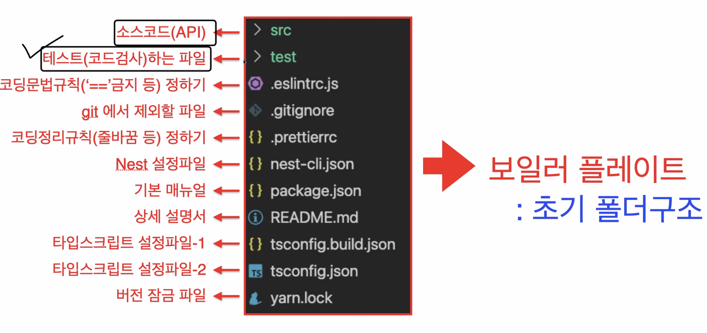

## 12일차 Today-I-Learned


*NestJS*

## Loose-Coupling & Dependency Injection

> Tight-Coupling(강한 결합) vs Loose-Coupling(느슨한 결합)

결합을 “둘 이상의 객체"로 해석했을 때, 말 그대로 강한 결합이란 “객체들 간의 결합이 강한 상태", 느슨한 결합이란 “객체들 간의 결합이 느슨한 상태"로 볼 수 있다.

다시 말해서, 한 클래스에서 다른 클래스를 사용할 때 의존 관계에 있다고 하는데, 다른 클래스를 직접적으로 사용하는 의존성을 줄이는 것이 느슨한 결합이다.

#### 강한 결합

-   하나의 객체를 변경하게 되면 다른 객체들의 변경이 요구되어 변경점들을 놓칠 수 있다.
-   결합이 되어있지 않으면 사용할 수 없다.
-   직접 new로 객체를 선언할 때마다 불필요한 메모리를 사용하게 된다.

#### 느슨한 결합

-   결합이 느슨하여 새로운 기능을 개발하거나 기존 기능을 수정하고 확장하기 쉽다.
-   테스트 대역으로 치환하기 쉬워 유닛 테스트가 용이하다.
-   직접 객체를 선언하지 않아 불필요한 메모리 사용이 줄어든다.

> IoC(Inversion of Control / 제어의 역전)

제어의 역전은 일반적인 디자인 패턴 중 하나이다.

일반적으로 개발자가 프로그램의 흐름을 제어했다면, IoC의 개념이 나오면서 프레임워크가 dependency를 container화 시켜 생명주기를 관리하게 되었다. dependency의 제어권이 개발자에서 프레임워크로 넘어가게 되어 이를 제어의 역전이라 한다.

> DI(Dependency Injection / 의존성 주입)

의존성 주입은 강한 결합을 느슨한 결합으로 전환시키는 방법이며, 제어의 역전 기술 중 하나이다.

기존에 어떤 클래스에서 다른 특정 클래스의 객체를 직접 new로 선언하여 강한 결합으로 사용 했었다면, 외부에서 어떤 클래스를 사용할지(의존성) 주입받아 느슨한 결합으로 사용하게 하는 것을 의존성 주입이라고 한다.

의존성 주입에는 총 3가지 방법이 존재하는데, 이 중 Constructor Inject(생성자 주입)이 권장된다.

이해가 잘 안되는데, 예를 한 번 들어보자.

원래 나는 요리를 할 때 가위만 사용했었다.

그런데, 요리를 하다보니 가위 뿐만 아니라 다른 도구가 필요하고, 옆에서 보던 엄마는 다른 도구도 쓰라고 말했다.

나는 어떤 단계에서 어떤 도구를 써야할지 몰라서, 엄마가 옆에서 이런 때는 가위를, 저럴 때는 칼을 써라 라고 상황에 맞는 도구를 전달해줬다. 나는 그 전달받은 도구를 이용해 요리를 하게되었다.

100퍼센트 맞다고 할 수는 없지만, 위의 예시는 엄마가 어떤 도구를 사용할지(의존성) 전달(주입)해 주었다는 걸 보여준다.

이와 같은 의존성 주입을 지원하는 프레임워크를 DI-Framework라고 한다.

Spring(Java), Nest.js(Node) 등이 있다.(Django는 지원하지 않음)

> Singleton Pattern(싱글톤 패턴)

객체의 인스턴스가 오직 1개만 생성되는 것을 의미한다.

강한 결합이 되어 매번 객체를 생성해서 사용하는 것이 아니라, new 한 번만 선언해 그 인스턴스를 모든 곳에서 사용하는 것을 말한다. 이런 디자인 패턴을 싱글톤 패턴이라고 한다.

#### DI(의존성 주입) -> 싱글톤 패턴?

의존성 주입을 한다는 것이 싱글톤 패턴이라는 것을 의미하지는 않는다.

여러 번 생성해서 사용할 수도 있다.

## NestJS

> NestJS란?

NestJS는 TypeScript를 지원하는 효율적이고 확장 가능한 Node.js의 서버 애플리케이션 프레임워크이며, OOP(Object Oriented Programming), FP(Functional Programming), FRP(Functional Reactive Programming) 요소를 결합하는 특징을 가지고 있다.

> NestJS를 사용하는 이유?

JavaScript는 프론트엔드, 백엔드 모두에서 많이 쓰이는 언어가 되었다. 하지만 많은 JavaScript 모듈, 라이브러리가 존재함에도 불구하고 Architecture의 주요 문제를 해결하지 못했다.

JavaScript는 제약이 없고 너무 자유롭기 때문에 규칙이 없고, 어떤 패턴을 따라 프로그램을 작성해야 할지 사용자가 정해서 사용해야 했다. 자유성은 좋은 점도 있지만, 다른 사람과 협업을 할 때, 각자의 패턴을 가지고 개발한다면 협업 과정에서 드는 소통비용이 증가하게 되어 진행이 매우 어려워진다. 이는 생산성 저하로 이어지고, 유지보수 또한 어려워진다.

위와 같은 문제 때문에 규칙이나 제약을 제시하는 프레임워크가 필요한데, Java에는 Spring, 그리고 파이썬에는 Django와 같은 프레임워크가 있다. NestJS는 규칙, 제약, 모듈 등 다양한 기능을 제공하는 Node.js 용 프레임워크이다.

기존의 JavaScript는 변수나 함수의 타입을 지정하지 않아 실제로 사용하기 전에는 어떤 타입의 데이터가 처리될 지 몰라 예기치 못한 오류가 발생하는 경우가 많다. NestJS는 TypeScript를 도입하여 타입을 지정하여 사전에 발생 가능한 오류들을 방지해줄 수 있다.

> NestJS 폴더 구조

Nest를 설치 후 nest 명령어를 통해 새로운 nest 프로젝트를 생성하면, 아래와 같은 파일 구조를 확인할 수 있다.



*NestJS 초기 폴더구조*

> NestJS package.json

```shell
{
  "name": "12-02-nestjs",
  "version": "0.0.1",
  "description": "",
  "author": "",
  "private": true,
  "license": "UNLICENSED",
  "scripts": {
    "prebuild": "rimraf dist",
    "build": "nest build",
    "format": "prettier --write \"src/**/*.ts\" \"test/**/*.ts\"",
    "start": "nest start",
    "start:dev": "nest start --watch",
    "start:debug": "nest start --debug --watch",
    "start:prod": "node dist/main",
    "lint": "eslint \"{src,apps,libs,test}/**/*.ts\" --fix",
    "test": "jest",
    "test:watch": "jest --watch",
    "test:cov": "jest --coverage",
    "test:debug": "node --inspect-brk -r tsconfig-paths/register -r ts-node/register node_modules/.bin/jest --runInBand",
    "test:e2e": "jest --config ./test/jest-e2e.json"
  },
  "dependencies": {
    "@nestjs/common": "^8.0.0",
    "@nestjs/core": "^8.0.0",
    "@nestjs/platform-express": "^8.0.0",
    "reflect-metadata": "^0.1.13",
    "rimraf": "^3.0.2",
    "rxjs": "^7.2.0"
  },
  "devDependencies": {
    "@nestjs/cli": "^8.0.0",
    "@nestjs/schematics": "^8.0.0",
    "@nestjs/testing": "^8.0.0",
    "@types/express": "^4.17.13",
    "@types/jest": "27.4.1",
    "@types/node": "^16.0.0",
    "@types/supertest": "^2.0.11",
    "@typescript-eslint/eslint-plugin": "^5.0.0",
    "@typescript-eslint/parser": "^5.0.0",
    "eslint": "^8.0.1",
    "eslint-config-prettier": "^8.3.0",
    "eslint-plugin-prettier": "^4.0.0",
    "jest": "^27.2.5",
    "prettier": "^2.3.2",
    "source-map-support": "^0.5.20",
    "supertest": "^6.1.3",
    "ts-jest": "^27.0.3",
    "ts-loader": "^9.2.3",
    "ts-node": "^10.0.0",
    "tsconfig-paths": "^3.10.1",
    "typescript": "^4.3.5"
  },
  "jest": {
    "moduleFileExtensions": [
      "js",
      "json",
      "ts"
    ],
    "rootDir": "src",
    "testRegex": ".*\\.spec\\.ts$",
    "transform": {
      "^.+\\.(t|j)s$": "ts-jest"
    },
    "collectCoverageFrom": [
      "**/*.(t|j)s"
    ],
    "coverageDirectory": "../coverage",
    "testEnvironment": "node"
  }
}
```

package.json 파일에은 위와 같이 작성되어 있는데, scripts는 단축 명령어를 설정 해놓은 것이다.

dependencies와 devDependencies가 나뉘어져 있는 이유는 개발환경에서만 필요한 모듈과 실제 서비스환경에서 필요한 모듈이 다르기 때문에 나누어 놓은 것이다.

## TypeScript

> 💡 TypeScript는 JavaScript에 타입을 부여한 언어이다.

위에서 NestJS를 소개하며 TypeScript라는 언어를 언급했는데, 타입스크립트는 자바스크립트에 타입을 부여한 언어이다. 자바스크립트는 브라우저나 Node로 실행이 가능했지만, 타입스크립트는 바로 실행이 안되기에 자바스크립트 파일로 컴파일하는 과정이 필요하다. 타입스크립트는 ts-node로 실행시켜줄 수 있다.

> TypeScript를 사용하는 이유?

-   에러 사전 방지

타입스크립트에서는 변수에 타입을 지정할 수 있어, 코드를 작성하는 단계에서 맞지 않는 타입의 데이터를 저장하려고 할 때 오류를 표시해, 의도치 않은 작동 및 에러를 사전에 방지할 수 있다.

```javascript
let ccc: string;
ccc = "반가워요";
ccc = 3; // Error: Type 'number' is not assignable to type 'string'

// 숫자타입
let ddd: number;
ddd = "ABCDE"; // Error: Type 'string' is not assignable to type 'number'

// 불린타입
let eee: boolean;
eee = false;
eee = "false"; // true로 작동함 Error: Type 'string' is not assignable to type 'boolean'
```

-   코드 가이드 및 자동 완성

JavaScript에는 string에만 사용할 수 있는 함수나 number에만 사용할 수 있는 함수가 별도로 존재한다.

어떤 변수에 함수의 결과를 저장하고 나서 그 변수에 대해 특정 함수를 실행하고 싶다면 .을 찍고 함수를 작성하면 된다.

그런데, JavaScript에서는 함수가 어떤 값을 반환할 지 타입이 정해져있지 않기 때문에, 변수에 .을 찍더라도 해당 타입에서 사용 가능한 함수 리스트가 조회되지 않는다. 이는 직접 함수명을 입력해야 함을 의미하고, 오탈자가 있다면 실행 했을때 오류를 뱉을 것이다.

TypeScript로 작성한다면, 변수 뿐만 아니라 함수의 결과 타입도 지정할 수 있기에, 어떤 변수에 함수 결과를 저장한다고 하면 그 변수의 타입에서 사용 가능한 함수를 자동완성하여 사용할 수 있다.

> TypeScript 기본 예제

아래는 TypeScript에서 변수나 함수에 타입을 명시하는 예제이다.

```javascript
// 타입추론
let aaa = "안녕하세요";
aaa = 3; // Error: Type 'number' is not assignable to type 'string'
// 타입을 명시하지 않아도, 처음 들어온 값에 따라 타입을 추론한다.

// 타입명시
let bbb: string = "반갑습니다";
bbb = 10; // Error: Type 'number' is not assignable to type 'string'

// 문자타입
let ccc: string;
ccc = "반가워요";
ccc = 3; // Error: Type 'number' is not assignable to type 'string'

// 숫자타입
let ddd: number;
ddd = "ABCDE"; // Error: Type 'string' is not assignable to type 'number'

// 불린타입
let eee: boolean;
eee = false;
eee = "false"; // Error: Type 'string' is not assignable to type 'boolean'

// 배열타입
let fff: number[] = [1, 2, 3, 4, 5, "안녕하세요"]; // Error: Type 'string' is not assignable to type 'number'
let ggg: string[] = ["철수", "영희", "훈이", 13]; // Error: Type 'number' is not assignable to type 'string'
let hhh: (number | string)[] = [1, 2, 3, 4, 5, "안녕하세요"];

// 객체타입
interface IProfile {
  name: string;
  age: number | string; // OR 연산자
  school: string;
  hobby?: string; // 당장 필요하지 않지만 추후 추가될수도 있는 속성
}

let profile: IProfile = {
  name: "철수",
  age: 8,
  school: "다람쥐초등학교",
};

profile.age = "8살";
profile.school = 123; // Error: Type 'number' is not assignable to type 'string'
profile.hobby = "수영"; // interface에 적힌 속성 추가 가능

// 함수타입
const add = (money1: number, money2: number, unit: string): string => {
  return money1 + money2 + unit;
};

add(1000, 2000, "원");
```

> TypeScript Decorator(데코레이터)

사용자가 구조를 수정하지 않고 기존 객체에 새로운 기능을 추가할 수 있도록 하는 디자인 패턴이다. 일반적으로 함수 정의 전에 호출되고, 데코레이터는 함수를 인수로 얻고 새로운 함수로 돌려주는 구조이다.

쉽게 말해, 데코레이터가 붙은 클래스, 메소드 및 변수 등에 데코레이터에서 정의된 기능이 동작하는 것을 말한다.

데코레이터는 클래스, 메소드, 접근자, 프로퍼티, 매개변수에 사용할 수 있고, @expression 과 같은 형식으로 사용한다.

타입스크립트에서 사용하기 위해서는 아래 tsconfig.json 파일과 같이 compilerOptions에 experimentalDecorators 속성을 추가해야 한다.

```shell
{
  "compilerOptions": {
    ...
    "experimentalDecorators": true,
    "allowSyntheticDefaultImports": true,
    "target": "es2017",
    ...
  }
}
```

데코레이터는 아래와 같이 데코레이터가 붙은 클래스를 target으로 받아, 이를 사용할 수 있도록 함수를 정의할 수 있다.

```javascript
function aaa(target) { // 데코레이터
	// target을 이용해 작업 수행
}

@aaa
class A {
	method() {}
}
```

데코레이터가 선언에 적용되는 방식을 바꾸려면 아래와 같이 데코레이터 팩토리를 작성하면 된다. 데코레이터 팩토리는 데코레이터가 런타임에 호출할 표현식을 반환하는 함수이다.

```javascript
function bbb(value: string) { // 데코레이터 팩토리
	return function(target) { // 데코레이터
		// target과 value 변수로 작업 수행
	}
}
```

데코레이터가 여러 개 적용된 경우는 수학 함수가 작동하는 것과 같이, 아래에서 호출된 함수가 먼저 종료되고 상위로 결과가 전달된다. 아래 예시를 보면 이해가 될 것이다.

```javascript
function f() {
    console.log("f(): evaluated");
    return function (target, propertyKey: string, descriptor: PropertyDescriptor) {
        console.log("f(): called");
    }
}

function g() {
    console.log("g(): evaluated");
    return function (target, propertyKey: string, descriptor: PropertyDescriptor) {
        console.log("g(): called");
    }
}

class C {
    @f()
    @g()
    method() {}
}
```

위 코드의 실행결과는 아래와 같이, 먼저 실행된 f() 데코레이터 팩토리가 실행 후 g() 데코레이터 팩토리 실행, 다음으로 g() 데코레이터가 실행되고 마지막으로 f() 데코레이터가 실행된다.

```shell
f(): evaluated
g(): evaluated
g(): called
f(): called
```
