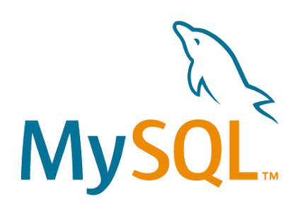
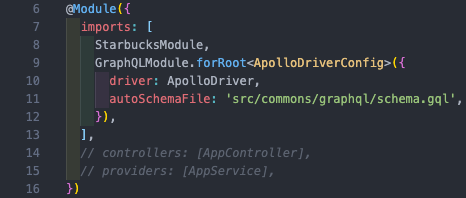
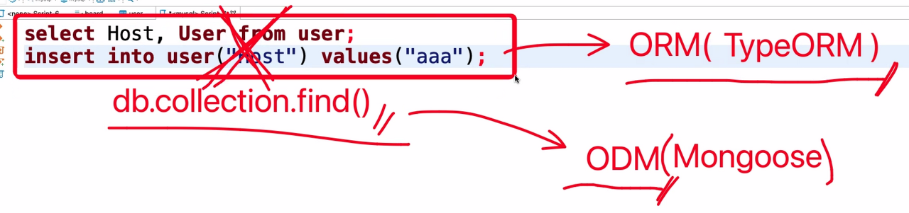
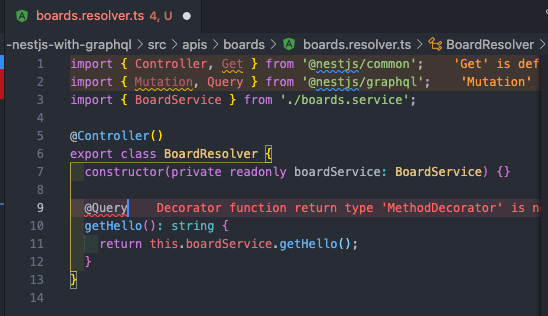
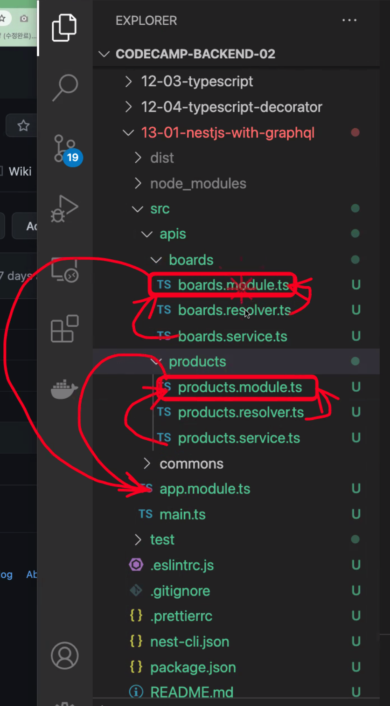

## 13일차 Today-I-Learned



*MySQL*

## GraphQL & TypeScript를 통한 API 작성

NestJS는 GraphQL 애플리케이션 빌드 시 Code First(코드 우선)와 Schema First(스키마 우선) 방법이 있다.

> Code First(코드 우선)

데코레이터와 TypeScript 클래스를 사용하여 해당 GraphQL 스키마를 생성한다.

TypeScript로만 작업하고 언어 구문 간의 컨텍스트 전환을 피하려는 경우 유용하다.



*Code First를 사용하기 위한 설정*

코드 우선 방식을 사용하려면 위와 같이 autoSchemaFile 속성을 추가해야 한다.

자동으로 생성된 스키마가 저장되는 경로이다.

> Schema First(스키마 우선)

GraphQL SDL(Schema Definition Language)라는 Query Language를 통해 접근하는 방식이다.

NestJS에서는 GraphQL 스키마를 TypeScript의 클래스 및 인터페이스 형식으로 구현된다.

```javascript
GraphQLModule.forRoot({
  typePaths: ['./**/*.graphql'],
}),
```

스키마 우선 방식을 사용하려면 위와 같이 typePaths 속성을 추가해야 한다. GraphQLModule이 작성할 GraphQL SDL 스키마 정의 파일을 찾을 위치를 나타낸다.

-   코드 우선 : TypeScript로 클래스를 짜면 GraphQL Schema 생성됨
-   스키마 우선 : GraphQL Schema 짜면 TypeScript 클래스 생성됨

> 기존 Apollo-server 방식은?

→ Schema First 방식

typeDefs를 직접 하나하나 작성하고, resolvers에 API 작성하는 방식

(이 방식은 playground에 docs가 자동으로 만들어져 swagger를 만들지 않아도 되는 장점이 있음)

> 최근 NestJS 방식은?

→ Code First 방식

(이미 작성된 resolvers 코드에 의해 typeDefs를 자동으로 만들어주는 방식, swagger도 만들어짐)

NestJS에서 GraphQL을 사용하기 위해서는 아래 명령어로 필요 모듈을 설치해준다.

(GraphQL 및 REST-API를 사용할 수 있는 express용 apollo-server-express 설치)

```shell
# For Express and Apollo (default)
$ npm i @nestjs/graphql @nestjs/apollo graphql apollo-server-express

$ yarn add @nestjs/graphql @nestjs/apollo graphql apollo-server-express
```

## TypeORM으로 NestJS와 MySQL 연결



*NestJS에서는 TypeORM을 이용한다*

MongoDB에서는 복잡한 쿼리 대신 간단한 명령어로 DB작업을 할 수 있게 해주는 ODM이 있었다.(Mongoose)

MySQL에서는 ORM이 있는데, 그 중 타입스크립트에서 사용하는 TypeORM을 사용한다.

(TypeORM은 mySQL 뿐만 아니라, 다른 DB와 연결할 때도 사용이 가능하다)

TypeORM을 이용해 MySQL과 연결하려면, 아래 명령어를 터미널에 입력하여 TypeORM을 설치한다.

```shell
npm install --save @nestjs/typeorm typeorm@0.2 mysql2

혹은

yarn add @nestjs/typeorm typeorm@0.2 mysql2
```

그 다음으로 아래에 오는 코드들을 작성한다.

```javascript
//board.entity.ts

import { Entity, Column, PrimaryGeneratedColumn } from 'typeorm';

@Entity()
export class Board {
  @PrimaryGeneratedColumn()
  number: number;

  @Column()
  writer: string;

  @Column()
  title: string;

  @Column()
  contents: string;
}
```

TypeORM에서 사용할 entity를 정의하기 위해 board.entity.ts 파일을 작성한다.

typeorm에서 Entity, Column, PrimaryGeneratedColumn을 import한다.

클래스 정의 위에 @Entity()를 입력해서 Board가 entity임을 나타내고, @PrimaryGeneratedColumn()을 입력해 해당 속성(컬럼)이 기본키임을 설정한다. 나머지 속성(컬럼)들은 @Column()을 입력해 일반 컬럼임을 표시한다.(PrimaryGeneratedColumn은 mySQL에서는 increment, uuid 중 하나를 사용한다)

```javascript
// board.service.ts

import { Injectable } from '@nestjs/common';

@Injectable()
export class BoardService {
  findAll(): string {
    // 데이터 조회하는 로직

    return '조회에 성공하였습니다.';
  }

  create(): string {
    // 데이터 등록하는 로직

    return '등록에 성공하였습니다.';
  }
}
```

비즈니스 로직을 board.service.ts 파일에 작성한다.

@nestjs/common 모듈을 import해서 해당 클래스 위에 @Injectable()을 입력하여 의존성 주입 가능하게 하고, findAll(), create() 메소드를 각각 작성한다.

```javascript
// board.resolver.ts

import { Resolver, Query, Mutation } from '@nestjs/graphql';
import { BoardService } from './board.service';

@Resolver()
export class BoardResolver {
  constructor(private readonly boardService: BoardService) {}

  @Query(() => String)
  fetchBoards(): string {
    return this.boardService.findAll();
  }

  @Mutation(() => String)
  createBoard(): string {
    return this.boardService.create();
  }
}
```

다음으로 resolver(controller)를 작성한다.

@nestjs/graphql을 import해 Resolver, Query, Mutation을 사용할 수 있게 한다.

해당 클래스 위에 @Resolver()를 선언하고, 각 API가 Query인지 Mutation인지 설정해 준다.



*Resolver에 데코레이터를 추가하는 모습*

Query, Mutation 데코레이터를 import 시 @nestjs/graphql에서 하도록 주의한다.

```javascript
// board.module.ts

import { Module } from '@nestjs/common';
import { BoardResolver } from './board.resolver';
import { BoardService } from './board.service';

@Module({
  // imports: [],
  // controllers: [AppController],
  providers: [BoardResolver, BoardService],
})
export class BoardModule {}
```

다음으로 board.module.ts를 작성해서, 의존성 주입이 가능하도록 앞서 작성한 Resolver와 Service를 설정해준다.

REST-API에서 controller로 쓰였던 것이 graphQL에서는 resolver로 쓰이는 개념이다.

(resolvers + services ⇒ modules ⇒ main)



*module, resolver, service 간의 관계*

각 API들의 service, resolver가 module에서 연결되고, 각 API들은 app.module에서 import되어 합쳐진다.

```javascript
//app.module.ts

import { Module } from '@nestjs/common';
// import { AppController } from './app.controller';
// import { AppService } from './app.service';
import { GraphQLModule } from '@nestjs/graphql';
import { TypeOrmModule } from '@nestjs/typeorm';
import { BoardModule } from './apis/board/board.module';
import { Board } from './apis/board/entities/board.entity';

@Module({
  imports: [
    BoardModule,
    TypeOrmModule.forRoot({
      type: 'mysql',       //데이터 베이스 타입
      host: 'localhost', //local 환경으로 진행
      port: 3306,          //mysql은 기본 port는 3306
      username: 'root',    //mysql은 기본 user는 root로 지정
      password: 'root',    //설치 과정에서 설정한 비밀번호
      database: 'mysql',   //연결할 데이터 베이스명
      entities: [Board],   //데이터 베이스와 연결할 entity
      synchronize: true,   //연결과 동시에 테이블을 초기화 혹은 생성할 것인지
      logging: true,       //콘솔창에 log를 표시하는지
    }),
    GraphQLModule.forRoot({
      autoSchemaFile: 'src/common/graphql/schema.gql',
    }),
  ],
  // controllers: [AppController],
  // providers: [AppService],
})
export class AppModule {}
```

마지막으로, app.module.ts를 작성하여 @Module imports에 TypeOrmModule.forRoot를 입력해 접속할 MySQL 설정 정보를 입력해 준다.

로컬에서 MySQL을 실행하고, 코드를 실행하면 정상적으로 접속되고 Board라는 entity가 생성된다.

이어서 GraphQL을 사용하려면 추가 코드 작성이 필요하다.

```javascript
//board.entity.ts

import { ObjectType } from '@nestjs/graphql';
import { Entity, Column, PrimaryGeneratedColumn } from 'typeorm';

@Entity() // typeorm한테 알려줌
@ObjectType() // gql한테 알려줌
export class Board {
  @PrimaryGeneratedColumn()
  @Field(() => ID) // gql한테 알려줌
  id: number;

	@Column()
  @Field(() => String)  // gql한테 알려줌
  writer: string;

  @Column()
  @Field(() => String)  // gql한테 알려줌
  title: string;

  @Column()
  @Field(() => String)  // gql한테 알려줌
  contents: string;
}
```

이전 entity 파일에서 entity로 typeORM에게 entity라는 걸 알려줬지만, graphQL은 아직 entity로 인식하지 못한다.

그래서 entity 파일에 클래스 위쪽에 @ObjectType()을 추가해야 한다.

그리고 각 컬럼마다 @Field(() => Int)와 같이 어떤 GraphQL 타입인지 추가해야 한다.

```javascript
// board.resolver.ts

...
@Mutation(() => String)
  createBoard(
    @Args('writer') writer: string,
    @Args('title') title: string,
    @Args('contents') contents: string,
    @Args('createBoardInput') createBoardInput: CreateBoardInput,
  ) {
    console.log(writer);
    console.log(title);
    console.log(contents);
    console.log(createBoardInput);

    return this.boardService.create();
  }
...
```

resolver의 Query 혹은 Mutation에서 parent, args 등의 매개변수가 있었는데, 이를 사용하기 위해서는

@Args(’writer’) writer: string과 같이 추가해야 한다.

위에서 createBoardInput과 같은 사용자정의 데이터타입을 사용하기 위해서는, dto 폴더를 생성해 class를 만들어줘야 한다.

```javascript
// createBoard.input.ts

import { Field, InputType } from '@nestjs/graphql';

@InputType()
export class CreateBoardInput {
  @Field(() => String)
  writer: string;

  @Field(() => String)
  title: string;

  @Field(() => String)
  contents: string;
}
```

input으로 사용하려면 @InputType으로 정의해야 하고, 동일하게 각 컬럼은 @Field(() => String)과 같이 설정

(dto는 GraphQL에서만 사용되므로 graphql 모듈만 import 한다)

## Docker Packaging

MongoDB와 NodeJS 서버를 docker-compose로 같이 실행했던 것처럼, NestJS 서버와 MySQL 서버를 docker-container에서 같이 실행시키는 예제를 해본다.

```shell
# docker-compose.yaml
version: '3.7'

services:
  my-backend:
    build:
      context: .
      dockerfile: Dockerfile
    volumes:
      - ./src/:/myfolder/src/
    ports:
      - 3000:3000

  my-database:
    image: mysql:latest
    environment:
      MYSQL_DATABASE: 'mydocker02'
      MYSQL_ROOT_PASSWORD: 'root'
    ports:
      - 3306:3306
```

my-database 부분에서 image를 mysql로 설정하고, environment 부분에서는 원하는 DB명과 root 계정의 암호 등 설정을 해주면 된다(위와 같이 설정된 경우, mydocker02라는 DB가 자동으로 생성된다). ports는 이전과 마찬가지로 포트포워딩을 해주는 부분이다.

(docker-compose.yaml 파일에서 DB 정의를 하면 자동으로 DB를 생성해주고,

app.module.ts 파일에서는 정의된 DB에 접속하기 위한 정보를 입력해주는 것이다)

이렇게 설정하고, app.module.ts 파일에서 접속하려는 mysql 정보를 맞게 설정해주면 접속이 정상적으로 가능하다(로컬에서 MySQL이 실행중이라면 종료하고 docker build 및 실행해야 한다).
