## 14일차 Today-I-Learned

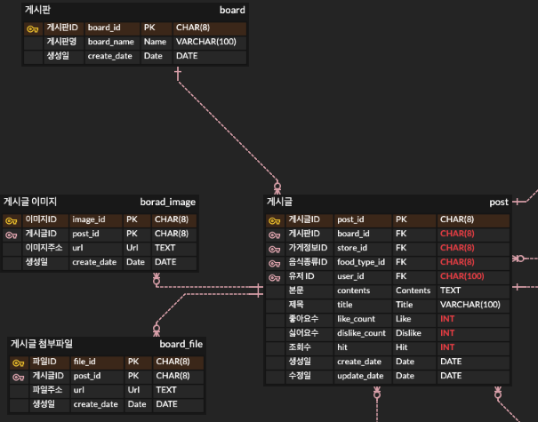

*ERD*

## 정규화

> 💡 중복된 데이터를 분리하는 것

정규형(Normal Form)이란 정규화된 결과를 말하는데, 보통 실무에서는 아래의 정규형을 사용하게 된다.

-   1NF
-   2NF
-   3NF

기본키(PK Primary Key) : 한 줄의 데이터를 구분할 수 있는 유일한 키(컬럼)

복합키 : 2개 이상의 컬럼으로 한 줄의 데이터를 구분할 수 있는 키

외래키(FK Foreign Key) : 다른 테이블의 기본키를 참조하는 키

> 제 1 정규화(1NF)

한 줄에 여러 데이터가 있는 다가속성이 있다면 한 칸에 하나의 값만 들어가도록 분리하는 것을 말한다.

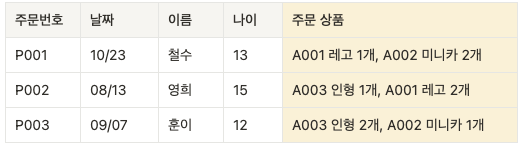

*비정규화된 테이블*

위와 같은 테이블은 한 컬럼에 여러 개의 데이터가 들어가 있어서, 이를 별도의 행 그리고 열로 분리해주는 작업인 제 1 정규화가 가능하다.

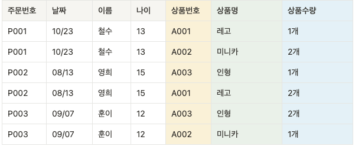

*제 1 정규화 테이블*

제 1 정규화를 거치면 위와 같은 테이블을 가질 수 있다.

> 제 2 정규화(2NF)

복합키 중 일부에만 종속적인 컬럼을 분리시키는 것을 말한다.

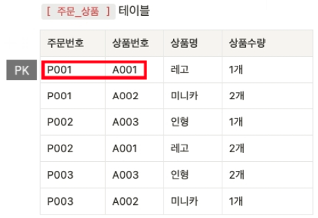

*복합키에 종속적이지 않은 데이터가 있는 테이블*

위 테이블은 주문번호와 상품번호를 둘 다 알아야 각 데이터가 구분이 가능하다. 이를 복합키라고 하는데, 이 복합키에 종속적이지 않고 일부에만 종속적인 데이터를 분리시킬 수 있다.

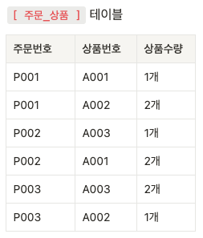

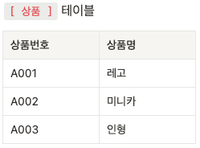

위와 같이 상품번호에만 종속적인 상품명을 별도의 테이블로 가져갈 수 있는데 이 작업을 제 2 정규화라고 한다.

> 제 3 정규화(3NF)

A → B → C의 관계를 가지고 있을 때, A-B, B-C를 묶어 다른 테이블로 분리하는 것을 말한다.

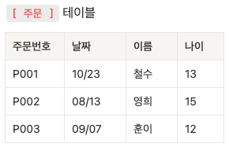

위 테이블에서는 주문번호를 알면 이름을 알 수 있고 이름을 알면 나이를 알 수 있지만, 주문번호와 이름,나이는 특별한 상관이 없는 데이터이다.

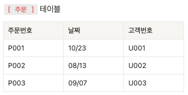

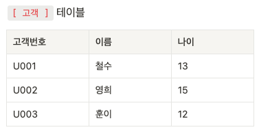

그래서 고객 정보를 별도로 분리할 수 있는데 이 작업을 제 3 정규화라고 한다.

## 정규화 실습

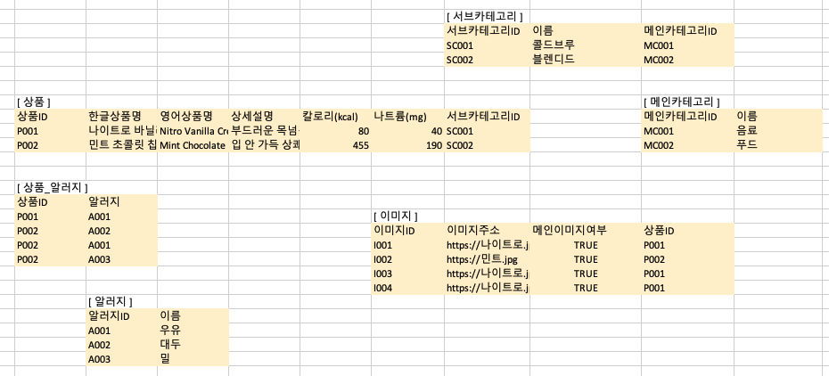

스타벅스의 메뉴 화면을 예제로, 필요한 데이터로 DB를 설계하고 정규화 과정을 거치면 위와 같은 테이블 형태를 가질 수 있다.

## ERD(Entity-Relation-Diagram)

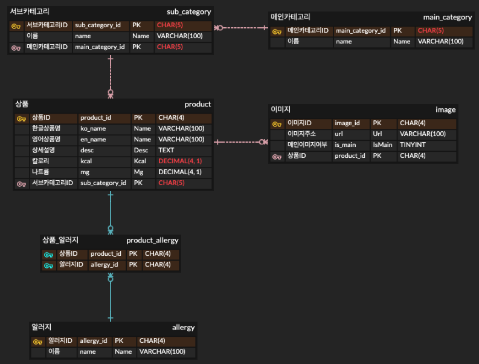

*ERD*

정규화된 테이블을 바탕으로, ERDCloud에서 1:1, 1:N, N:M 관계를 ERD로 표현할 수 있다.

N:M(다대다) 관계는 정규화를 거치면서 중간 테이블이 생성되어, 그 테이블을 기준으로 1:N(일대다) 관계가 생성된다.(중간 테이블이 “다”이다)

MySQL에서 쓰이는 데이터 타입이 아래와 같이 별도로 존재한다.

CHAR(4) : A001 (사이즈가 정해져있으므로 저장 및 조회시 속도가 빠름)

VARCHAR(100) : B001 (유동적인 사이즈가 저장되지만 CHAR에 비해 비교적 느림)

TEXT: 긴 문자열을 입력해야 할 때 주로 사용

INTEGER : 정수형 표현

DECIMAL : DECIMAL(4,1) - 345.6과 같은 소수점 표현에 적합

TINYINT (BOOLEAN) : 1 / 0과 같은 boolean 표현에 적합
