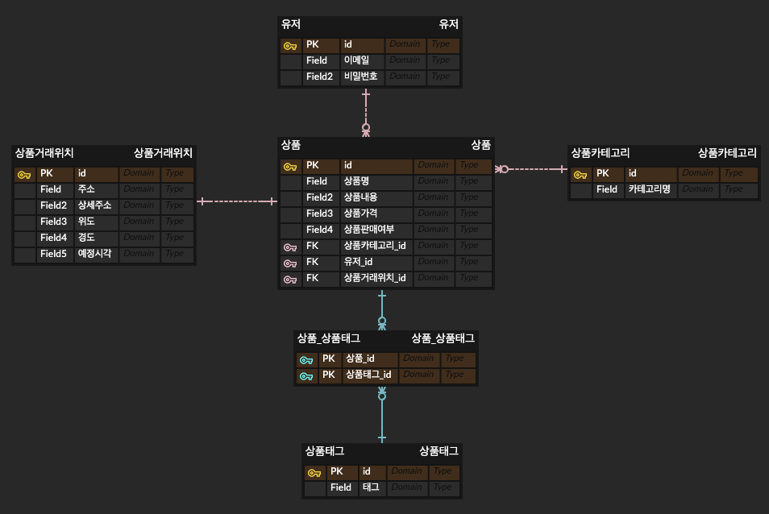
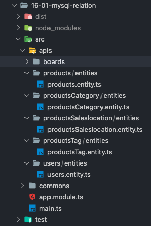
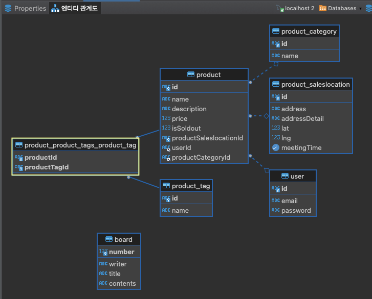

## 16일차 Today-I-Learned


*DBMS에서의 엔티티 관계도*

## TypeORM을 이용한 관계형 테이블 생성

아래 예시 ERD를 바탕으로 NestJS에서 TypeORM을 이용한 테이블 설계를 하려고 한다.



*상품 관련 ERD*



*NestJS에서 entity 구성*

src/apis/ 디렉토리 밑에 각 테이블명/entities/테이블명.entity.ts 로 각 entity를 생성해준다.

```javascript
// productsSaleslocation.entity.ts

import { Column, Entity, PrimaryGeneratedColumn } from 'typeorm';

@Entity()
export class ProductsSaleslocation {
  @PrimaryGeneratedColumn('uuid')
  id: string;

  @Column()
  address: string;

  @Column()
  addressDetail: string;

  @Column()
  lat: number;

  @Column()
  lng: number;

  @Column()
  meetingTime: Date;
}
```

GraphQL은 사용하지 않고, TypeORM을 이용해 DB에 접속해 테이블을 생성해주므로 typeorm 모듈만 import 해서 class 및 각 컬럼에 typeorm 데코레이터를 지정해준다.

```javascript
// productsCategory.entity.ts

import { Column, Entity, PrimaryGeneratedColumn } from 'typeorm';

@Entity()
export class ProductsCategory {
  @PrimaryGeneratedColumn('uuid')
  id: string;

  @Column()
  name: string;
}
```

```javascript
// users.entity.ts

import { Column, Entity, PrimaryGeneratedColumn } from 'typeorm';

@Entity()
export class Users {
  @PrimaryGeneratedColumn('uuid')
  id: string;

  @Column()
  email: string;

  @Column()
  password: string;
}
```

카테고리와 유저 테이블은 위와 같이 먼저 생성해줄 수 있다.

```javascript
// productsTag.entity.ts

import { Products } from 'src/apis/products/entities/products.entity';
import { Column, Entity, ManyToMany, PrimaryGeneratedColumn } from 'typeorm';

@Entity()
export class ProductsTag {
  @PrimaryGeneratedColumn('uuid')
  id: string;

  @Column()
  name: string;

  @ManyToMany(() => Products, (products) => products.productsTags)
  products: Products[];
}
```

상품 테이블과 다대다(N:M) 관계에 있는 상품태그 테이블은 위와 같이 @ManyToMany() 데코레이터를 통해 표시해준다. products 테이블과 관계가 있음을 표시하고, products 테이블의 productsTags 컬럼이 자신임을 적어준다. 다대다 관계이기에 Products\[\]와 같이 배열로 표시된다.

```javascript
// products.entity.ts

import { ProductsCategory } from 'src/apis/productsCategory/entities/productsCategory.entity';
import { ProductsSaleslocation } from 'src/apis/productsSaleslocation/entities/productsSaleslocation.entity';
import { ProductsTag } from 'src/apis/productsTag/entities/productsTag.entity';
import { Users } from 'src/apis/users/entities/users.entity';
import {
  Column,
  Entity,
  JoinColumn,
  JoinTable,
  ManyToMany,
  ManyToOne,
  OneToOne,
  PrimaryGeneratedColumn,
} from 'typeorm';

@Entity()
export class Products {
  @PrimaryGeneratedColumn('uuid')
  id: string;

  @Column()
  name: string;

  @Column()
  description: string;

  @Column()
  price: number;

  @Column()
  isSoldout: boolean;
  // soldedAt: Date;

  @JoinColumn()
  @OneToOne(() => ProductsSaleslocation)
  productsSaleslocation: ProductsSaleslocation;

  @ManyToOne(() => ProductsCategory)
  productsCategory: ProductsCategory;

  @ManyToOne(() => Users)
  users: Users;

  @JoinTable()
  @ManyToMany(() => ProductsTag, (productsTags) => productsTags.products)
  productsTags: ProductsTag[];
}
```

상품 테이블은 다른 테이블들과 1:1, 1:N, N:M 관계를 갖고 있다.

먼저 상품거래위치 테이블과는 1:1 관계로, @OneToOne() 데코레이터를 사용하고, productsSaleslocation 테이블과 관계가 있음을 표시한다. 데코레이터는 양쪽 테이블에 써줄수도 있지만 상품 테이블에만 적어도 된다.

@JoinColumn() 데코레이터는 기준 컬럼이 어느 한 쪽에만 있기에, 한 쪽 테이블에만 작성해야 한다.

다음으로 유저와 카테고리 테이블과는 1:N 관계를 가지고 있다.

@ManyToOne() 데코레이터를 사용하고, 관계가 있는 테이블을 적어준다.

1:N 관계로, 기준이 되는 테이블(N인 테이블)에서 데코레이터를 작성해야 한다.

@OneToMany()라는 개념은 MySQL에 존재하지 않는다. TypeORM에서 강제로 생성해주긴 하지만, 기본은 ManyToOne이라고 생각해야 한다.

마지막으로, 상품태그 테이블과는 N:M 관계에 있다. 이런 경우, 양 쪽 테이블에 @ManyToMany() 데코레이터를 작성해야 하고, @JoinTable() 데코레이터도 둘 중 한 쪽에 써야하기 때문에 상품 테이블에 추가해 주었다.

코드를 빌드 후 실행하면 아래처럼 ERD와 같은 관계도를 DBMS에서 확인할 수 있다.


