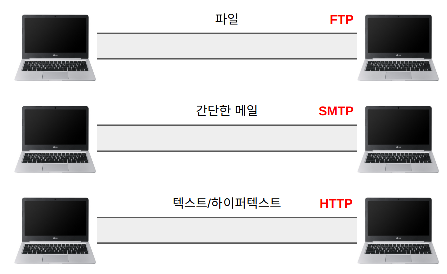
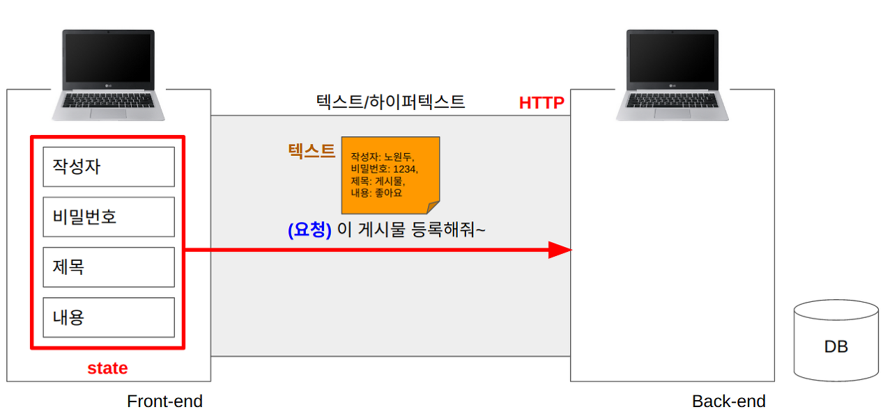
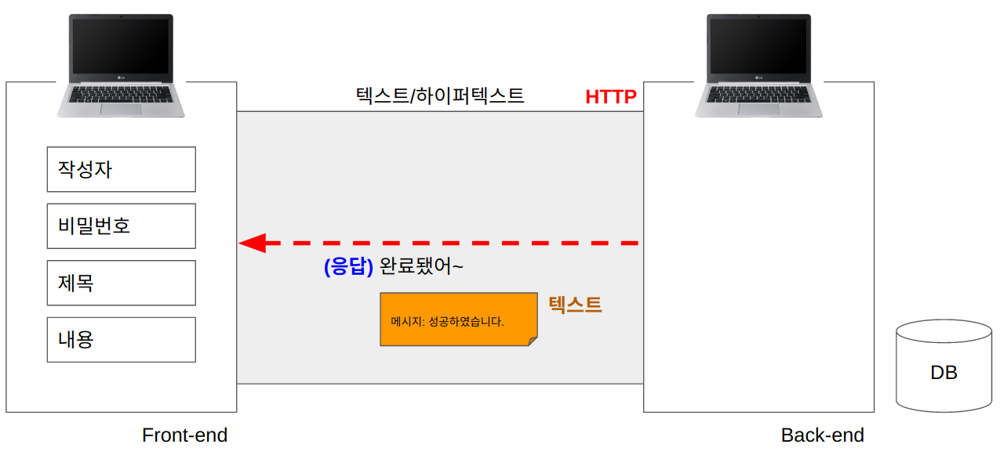
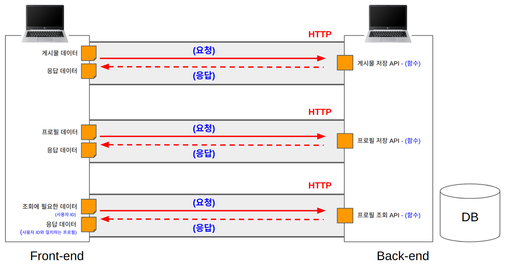
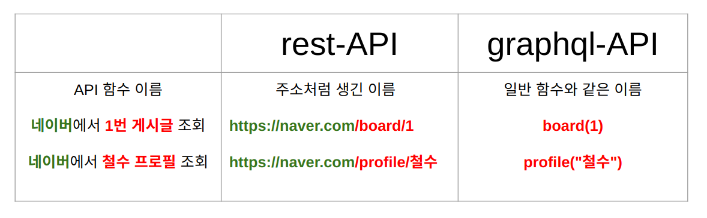
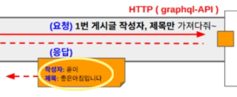
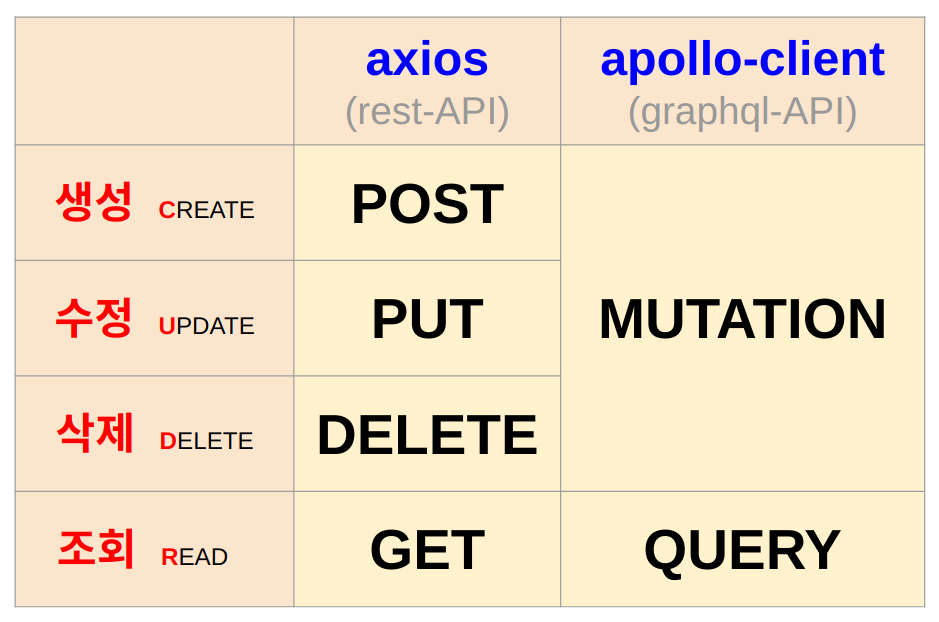
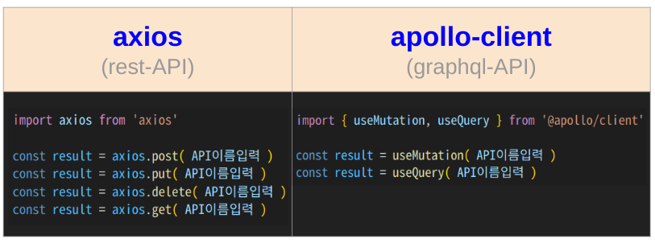
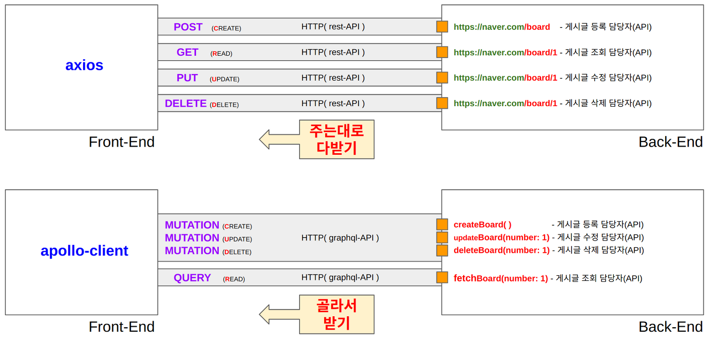
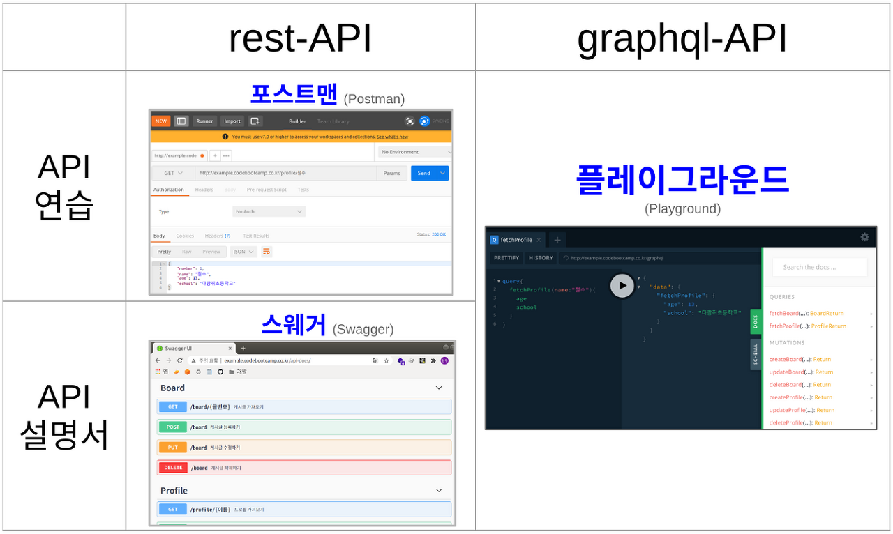

## 3일차 Today-I-Learned(계속)

## HTTP 통신

컴퓨터끼리 데이터를 주고받을 수 있는 도구에는 몇가지가 있다.

파일전송 - FTP(File Transfer Protocol)

메일 - SMTP(Simple Mail Transfer Protocol)

텍스트/하이퍼텍스트 - HTTP(HyperText Transfer Protocol) -> **두 컴퓨터 간 텍스트 데이터를 주고 받는 길**

컴퓨터는 HTTP라는 길로 요청(Request)과 응답(Response) 2가지를 서로 주고받을 수 있다.

## HTTP 요청(Request)과 응답(Response)

*Front-end에서 Back-end로 데이터 저장, 조회 등을 요청함*

*Back-end에서 Front-end로 성공, 실패 등 처리결과를 응답함*

Back-end 컴퓨터는 응답할 때, 응답 상태코드라는 것을 함께 보내준다.(100 ~ 599의 숫자로 구성)  
(ex. 성공(200), Front-end 에러(400), Back-end 에러(500) 등)

더 많은 상태코드(MDN): [https://developer.mozilla.org/ko/docs/Web/HTTP/Status](https://developer.mozilla.org/ko/docs/Web/HTTP/Status)

## API

> 💡API란 HTTP 요청을 Back-end 컴퓨터에 보냈을때 실행되는 Back-end 기능

Front-end에서 원하는 기능이 있을 경우, 그 기능에 해당하는 여러 HTTP 길이 존재해야 하고, 각각의 요청마다 담당자가 필요하다. 그 담당자를 API라고 부른다.

*API*

### REST-API vs GraphQL-API

API에는 크게 2종류가 있다. REST-API는 홈페이지 주소처럼, GraphQL-API는 일반적인 함수처럼 이름이 구성된다.

(GraphQL은 페이스북에서 발생하는 수많은 데이터를 처리하기 위해 페이스북 개발팀에서 만들었다)

*REST-API와 GraphQL-API*

REST-API는 응답결과로 Back-end에서 보내주는 모든 데이터를 받아야 하지만,  
GraphQL-API는 Back-end에서 보내주는 데이터 중 필요한 데이터만 골라 받을 수 있다.

  
REST-API에 요청하는 요청담당자는 axois,  
GraphQL-API에 요청하는 요청담당자는 apollo-client

  
더 효율적인 방식의 GraphQL을 배우지만, REST-API도 배워야 한다.  
1\. 취업하는 회사/팀에서 REST를 사용할 수 있다.  
2\. 다른 회사에서 제공하는 API를 사용할 때, REST를 사용할 수 있다.

### API 요청 결과 타입(JSON)

*JSON*

API의 요청결과를 보면 key와 value 쌍을 이루는 JavaScript의 객체 타입과 유사하다.  
자바스크립트(JavaScript)의 객체(Object)처럼 표기(Notation)할 수 있다고 해서 JSON이라고 부른다.  
JSON은 엄밀히 말해 객체는 아니고, 문자열로 감싸 사용한다.

## HTTP 헤더와 바디

HTTP로 요청과 응답을 보낼 때, 메시지 안에는 시작라인, 헤더, 그리고 바디가 있다.

### HTTP 요청 메시지

시작라인

-   HTTP 메서드(GET, POST 등)
-   요청 엔드포인트('/board')
-   HTTP 버전

헤더

-   Host: 요청을 보내는 브라우저의 주소
-   Content-Type: 응답하는 메시지의 내용의 종류

바디

-   실제 전송하려는 데이터

### HTTP 응답 메시지

시작라인

-   HTTP 버전
-   HTTP 상태 코드(200, 400, 500 등)

헤더

-   Content-Type: 응답하는 메시지의 내용의 종류

바디

-   실제 전송하려는 데이터

## API와 CRUD

API는 크게 4가지 방식으로 구분할 수 있다.  
  
1\. 생성하는 API → CREATE  
2\. 조회하는 API → READ  
3\. 수정하는 API → UPDATE  
4\. 삭제하는 API → DELETE

*API 방식에 따라 다르게 사용*

실제로 Front-end에서 요청을 보낼 때 아래와 같이 사용한다.

### 정리

## API 실습 도구

